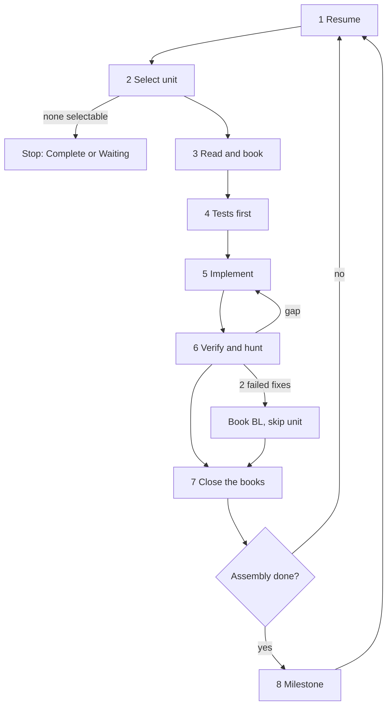

# .NET → Rust Port Loop

Load on `/port-dotnet-rust-loop`, or from `workflow-port-dotnet-rust.md` Phase 2. Requires `port/MANIFEST.md` with status **Approved**. Without it, stop and run Phase 0 and Phase 1 of `workflow-port-dotnet-rust.md`.

Also load: `workflow-port-dotnet-rust.md`, `workflow-port-dotnet-rust-books.md`, `tech-dotnet-rust.md`, `tech-csharp.md`, `tech-rust.md`, `tech-test.md`, `tech-rust-test.md`.

**Purpose:** Port one unit per iteration, completely, and keep the books balanced. Run without human input until a stop condition holds.

## Stage Order (per iteration)

1. Resume
2. Select unit
3. Read and book
4. Tests first
5. Implement
6. Verify and hunt
7. Close the books
8. Milestone (when an assembly completes)

## Stage 1 — Resume

- State lives in files, never only in chat. After a context reset, read in this order: `port/STATUS.md`, the unit record named in its **Cursor**, `port/BLOCKERS.md` (answered records only), then `port/MANIFEST.md` sections the unit needs.
- Read `port/MANIFEST.md` in full once per session.
- Answered blocker (`BL-*` with **Answer** filled and **Applied** empty): apply the answer first. Re-open its rows as `open`, put the unit back in the queue, and fill **Applied**. An answer that adds an `IM-*`, `PA-*`, `EX-*`, or crate goes into `MANIFEST.md` as an amendment with the `BL-*` reference.
- A unit left in `wip` is resumed at its first row that is not done. Rows already `ported` are re-verified by running their tests, not by trust.

## Stage 2 — Select unit

Pick the first match:

1. A unit re-opened by an answered blocker.
2. The unit in `wip`.
3. The next unit of the MANIFEST **Priority targets** whose dependencies are done.
4. The next unit in topological order whose dependencies are done.

- A dependency counts as done when its rows are done (`deviated` counts). A `blocked` dependency makes the dependent unit wait; skip it and record **Waits on** in STATUS.
- Never stub a dependency to unblock a unit. If ordering was wrong (the unit needs an undone type), push that type’s unit first.
- No selectable unit: stop. **Complete** when every row is done; **Waiting** when every remaining row is `blocked` or waits on one. Go to Stage 5 Final Report.

## Stage 3 — Read and book

Before any Rust code:

1. Read every source file of the unit in full, including all `partial` parts, nested types, private helpers, constants, and attributes. Read the base types and interfaces it implements. Read callers inside the assembly when meaning depends on use.
2. Read every .NET test that targets the unit.
3. Create or update `port/units/<Assembly>/<Unit>.md` from the unit template:
   - **API rows:** every inventory ID of the unit’s types. Status `wip`.
   - **Behavior items:** the source walk below. Status `wip`.
   - **Test rows:** every test case from the inventory that targets the unit. Status `wip`.
   - **Design:** Rust form, ownership model (`tech-dotnet-rust.md` memory ladder) with the rejected C#-shaped form, `IM-*` rules applied, source optimizations and how each is mapped.
4. Set the unit to `wip` in STATUS **Cursor**.

### Source walk (behavior items)

For each public or protected member, list one item per observable outcome. Cite the source line.

- each guard and each `throw` (exception type and condition)
- each return path and its value or `false` / `null` / default result
- each state change visible through the public API
- each emitted output: bytes, characters, fields, events, log entries a caller can read
- each loop bound, limit, constant, and default parameter value
- each setting or option read and its effect
- each overload and each explicit interface implementation that adds behavior (`IParsable.Parse` throwing `FormatException` while `TryParse` returns `false` are two items)
- ordering guarantees, equality and hash rules, comparison rules
- thread-safety and reentrancy guarantees, disposal behavior
- culture, encoding, and number semantics (overflow, rounding, UTF-16 length)

Private helpers have no rows. Their behavior shows up as outcomes of the public members that call them. A behavior item that only a private path reaches is still an item of the public member that reaches it.

## Stage 4 — Tests first

- Port every test row of the unit (`workflow-port-dotnet-rust.md` Section 9). Same inputs, same assertions, snake_case names, every data row.
- Write one test per behavior item that no ported test covers (`added`). Cover the behavior classes in `tech-test.md`.
- Add golden fixtures when the unit emits structured output. Generate them with the oracle harness; do not type expected output by hand when .NET can produce it.
- Tests must fail or not compile before Stage 5. A test that passes before the body exists does not test the body.

## Stage 5 — Implement

- Port the **whole** unit: every API row, every behavior item. No partial unit leaves this stage as done.
- Follow the Design written in Stage 3. A change of the ownership model during implementation goes back into the unit record first.
- Apply `IM-*` rules for form. Apply `tech-dotnet-rust.md` for memory, strings, collections, numbers, and optimizations.
- rustdoc on every public item names the source member (`Port of Namespace.Type.Member.`) and, on types, the ownership model and the rejected C#-shaped form.
- Large unit (roughly more than 40 API rows or 1500 source lines): work member group by member group. After each group run its tests and tick its rows in the unit record, so a context reset loses nothing. The unit stays `wip` until every group is done.
- A row that cannot be ported equivalently and has no `PA-*` class: stop that row, write `BL-*`, set the row `blocked`, and finish the rest of the unit. Do not ship a weaker body under the source name.

## Stage 6 — Verify and hunt

Run in this order. Each failure goes back to Stage 5. After two failed fixes for the same root cause, apply Section 4.14 backoff of `copilot-instructions.md` once; if it still fails, book `BL-*` (technical), set the affected rows `blocked`, and continue with Stage 7.

1. `cargo fmt --check`
2. `cargo clippy -p <crate> --all-targets --all-features -- -D warnings`
3. `cargo test -p <crate> --release <unit filter>` — every test row and every `added` test of the unit
4. Golden fixtures of the unit
5. **Hunt** (equivalence audit). Re-open the .NET source **from disk**, not from memory:
   - Walk every behavior item; point to the Rust line that implements it and the test that proves it. Missing pointer = gap.
   - Compare counts: public members vs API rows; `throw` sites vs error items; enum members vs Rust variants or constants; constants and defaults vs Rust values; overloads vs Rust items.
   - `Grep` the unit’s Rust files for `todo!`, `unimplemented!`, `unreachable!`, `TODO`, `FIXME`, `simplif`, `minimal`, `for now`, `not yet`, `stub`, `placeholder`, `subset`, `unsupported`, `ignored`, `only supports`. Each hit is removed or belongs to a row that is not done.
   - Check every `clone`, `Box`, `Rc`, `Arc`, `RefCell`, `Mutex`, `RwLock`, `unsafe` against the Design and the approved `unsafe` sites.
   - Check every `deviated` row: its `DV-*` lists **all** observable differences and names a pinning test that passes.
6. Balance check for the assembly (`workflow-port-dotnet-rust.md` Section 7).

## Stage 7 — Close the books

In the same change as the code:

- Set every row to its final status. A unit is done only when all its rows are done.
- Write or update `DV-*`, `BL-*`, `SB-*` records.
- Fill the unit record **Verification** with the commands just run and their result.
- Update `STATUS.md`: balance numbers, **Cursor** (next unit), **Waits on**, last completed unit.
- Chat (one short paragraph, user language): unit, counts per status, new `DV-*` / `BL-*` / `SB-*`, balance ok or not. No recap of the code.

## Stage 8 — Milestone (assembly complete)

When every unit of an assembly is done or blocked:

1. `cargo test -p <crate> --release` (full crate) and all fixtures of the assembly.
2. Benchmarks of the MANIFEST scenarios that touch the crate; record in `BENCHMARKS.md`. Slower than target: book an optimization row in the owning unit (`open`) and port it as normal work. Do not trade behavior for speed without `PA-*` or `BL-*`.
3. `/review-loop` on the crate with this skill loaded (file mode; skip Exam). Findings are fixed through Stages 5–7. A finding that reveals a missing behavior item adds the item and re-opens the unit.
4. Update `STATUS.md` milestone line for the assembly.

## Final Report (on stop)

- **Complete:** start `workflow-port-dotnet-rust.md` Phase 3.
- **Waiting:** list every open `BL-*` with the question, options, and the rows it holds. The human answers in `BLOCKERS.md`; the next `/port-dotnet-rust-loop` run resumes.
- **Stopped (error):** state the cause, the last consistent STATUS, and the command that reproduces it.

Chat: status counts, file paths, the blocker list. Do not recap unit bodies.

## Loop rules

- One writer. Do not split units across parallel agents; the books have one owner.
- Git is read-only (Section 4.11 of `copilot-instructions.md`). The books are the checkpoint; the human commits.
- Do not ask in chat during Phase 2. A question is a `BL-*` record.
- Do not mark a row done because code “should” cover it. Done = test ran green after the Hunt.
- Do not edit the inventory by hand. Re-run the tool.
- Do not lower a row from `ported` to soft text. If a later finding shows a gap, the row goes back to `open` with the gap as a behavior item.
- Same tool call with the same result twice: change strategy (Section 4.14).
