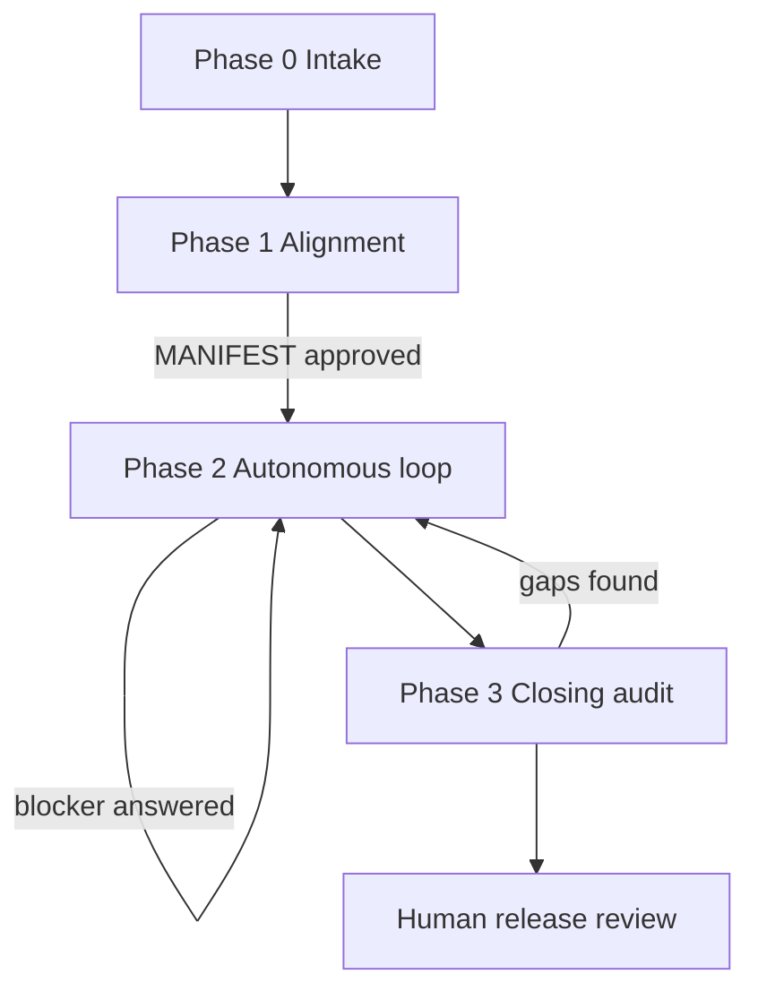

# .NET → Rust Port Workflow

Load on `/port-dotnet-rust`, when porting .NET/C# to Rust, or when `port/**` is in scope. Always also load:
[`workflow-port-dotnet-rust-loop.md`](workflow-port-dotnet-rust-loop.md) (autonomous loop),
[`workflow-port-dotnet-rust-books.md`](workflow-port-dotnet-rust-books.md) (templates and worked example),
[`tech-dotnet-rust.md`](tech-dotnet-rust.md) (mapping, memory, strings, optimizations),
`tech-csharp.md`, `tech-rust.md`, `tech-test.md`, `tech-rust-test.md`, `tech-tunit.md` when the source tests use TUnit.

The workflow is generic for any .NET solution. Project specifics live in `port/MANIFEST.md`, never in these skills.

**Purpose:** Produce a **complete, content-equivalent** Rust port. After one human alignment phase the agent ports autonomously until every inventory row is booked as done, or every remaining row waits on a human answer.

## 1) Why ports failed before

Earlier ports produced something *similar*: a subset of fields, the happy path, a fixed limit where the source was dynamic, a missing setting, a merged state. Each gap was hidden behind a soft status (`short`, `shape`, “minimal field set”, “cone”). This workflow removes every place where a gap can hide:

| Gap | Countermeasure |
|-----|----------------|
| Unknown scope | Machine inventory of every public member and every .NET test |
| Partial types | A unit is a whole type; no partial “done” |
| Hidden simplification | Behavior items per member, each with a test |
| Soft status words | Closed status set; `deviated` needs a deviation record |
| Drift | Balance check: inventory rows = booked rows, every iteration |

## 2) Equivalence (what “ported” means)

A Rust item is **equivalent** to its .NET source when, for every input in the source’s domain:

- the result is the same value (after the Idiom Map in `MANIFEST.md`),
- the failure is the same failure class (exception type → mapped error variant),
- state visible through the public API changes the same way,
- emitted data is the same: bytes, text, field trees, events, **and their order** where the source defines one,
- guarantees callers rely on still hold: thread safety, idempotency, disposal, laziness when observable.

The **form** may differ only by Idiom Map rules (`IM-*`): names, `Result` instead of exceptions, `Drop` instead of `Dispose`, slices instead of spans. A form difference outside the Idiom Map is a deviation.

**Forbidden as `ported`** (each is a deviation or open work, never silent):

- a subset of cases, fields, options, overloads, enum values, or settings
- happy path only; missing guard or error branch
- a fixed limit, default, or constant that differs from the source
- collapsed states (null / empty / missing; absent / zero)
- a different algorithm that differs on edge cases (rounding, overflow, ordering, Unicode)
- eager vs lazy, copy vs share, when a caller can observe it
- dropped thread-safety or reentrancy guarantee
- a stub, `todo!()`, placeholder success, or a public item that does less than its name promises

**Near the source, not forced 1:1.** Port behavior and public API closely. Internals follow Rust ownership and performance; a C# class hierarchy, lock, or GC-shaped graph is not copied when an idiomatic design gives the same behavior (`tech-dotnet-rust.md`). Public API stays close: same types, same members (mapped names), same parameter meaning, same defaults.

## 3) Priority on conflict

1. Safety: no UB, no data race.
2. Equivalent observable behavior (Section 2).
3. Public API close to the source (Idiom Map).
4. Performance at least on par with .NET on the agreed hot paths.
5. Idiomatic internals.

## 4) Phases

### Phase 0 — Intake (agent, no product code)

1. Map the solution: projects, project references, target frameworks, NuGet packages, test projects and framework, `unsafe`, P/Invoke, reflection, source generators, `dynamic`, `async`, events, `lock`, `Interlocked`, SIMD, culture use, regex, time, benchmarks.
2. Build the **inventory** (Section 6). Never write the API inventory by hand.
3. Build the type dependency graph per assembly. Collapse cycles into one unit. Order units topologically, leaves first, assemblies in project-reference order.
4. Read existing Rust code, if any, as **unverified prior art**. Old status words are not trusted. Each existing item is re-audited by the loop like new work.
5. Write the **Hard-spot list**: every place where a 1:1 port is impossible or doubtful (reflection, generators, `dynamic`, `async`, culture, UTF-16, open enums, reentrant locks, GC-shaped graphs, finalizers, regex, `decimal`, `DateTime`). Each spot gets a proposed handling.
6. Draft `port/MANIFEST.md` from the template in `workflow-port-dotnet-rust-books.md`, status **Draft**.

Phase 0 may create the inventory tool and the oracle harness under `port/tools/` and `port/oracle/`. They are port tooling, not product code. Show both in the alignment.

### Phase 1 — Alignment (human, Grill Me rounds)

Everything the loop would otherwise have to ask is decided here. Walk the MANIFEST section by section. Ask only what the code cannot answer.

The human approves:

- **Scope:** in-scope assemblies, test projects, exclusions (`EX-*`) with reason.
- **Crate map:** assembly → crate, workspace layout, `rust-version`, edition 2024.
- **Dependencies:** each crate with purpose and license. Unlisted crates are forbidden in Phase 2.
- **`unsafe` policy:** approved sites or classes (for example the `Text` handle, SIMD fill). Everything else is `#![forbid(unsafe_code)]`.
- **Idiom Map (`IM-*`):** the general form rules. Default rules come from `tech-dotnet-rust.md`; the human may change them.
- **Pre-approved deviation classes (`PA-*`):** narrow classes the agent may apply alone, each with a required test pattern. Example: “UTF-16 length is replaced by UTF-8 length where the input is proven ASCII.”
- **Hard-spot decisions:** one answer per hard spot.
- **Oracle:** how outputs are compared (ported tests, golden fixtures from the .NET oracle harness, differential runs).
- **Performance:** hot paths, benchmark scenarios, target (for example “not slower than .NET on scenario X”).
- **Trust-boundary limits** per Section 4.1 of `copilot-instructions.md`.
- **Priority targets** (optional): units to port first. Priority changes **order only**, never completeness.

MANIFEST status **Approved** = plan approval for Section 6 of `copilot-instructions.md`. From here on the agent does not wait for chat answers.

### Phase 2 — Autonomous loop

Run `workflow-port-dotnet-rust-loop.md`. One unit per iteration. Books updated every iteration. Questions become blocker records (`BL-*`); the loop continues with units that do not depend on them.

### Phase 3 — Closing audit

When the loop reports **Complete** or **Waiting**:

1. Re-run the inventory. New or changed source members since Phase 0 become open rows and go back to Phase 2.
2. Run the balance check (Section 7). Any difference is an Error.
3. Run the full Rust suite in Release, all oracle fixtures, and the benchmark comparison.
4. Run `/review-loop` per crate with this skill loaded. Review hunts simplification first (Section 2 list).
5. Write `port/REPORT.md` (template in books): balance, deviations, blockers, suspected source bugs, performance.

The human reviews deviations and blockers. Approval releases the port. “It builds” is not acceptance.

## 5) Status model

One closed set for API rows, behavior items, and test rows. No other words.

| Status | Meaning |
|--------|---------|
| `open` | Nothing in Rust yet. |
| `wip` | Being ported in the current unit. |
| `ported` | Equivalent (Section 2). Named tests pass. |
| `deviated` | Observable difference recorded in `DV-*`; a test pins the Rust behavior. |
| `n/a` | Cannot exist in Rust by an Idiom Map rule (`IM-*` cited). Test rows and behavior items only. |
| `added` | New Rust test without a .NET counterpart. Test rows only. |
| `excluded` | Not ported by human decision (`EX-*`). |
| `blocked` | Waits on a human answer (`BL-*`). |

- **Done** = `ported`, `deviated`, `n/a`, `added`, `excluded`.
- A unit is done only when **every** row in it is done. Rollup = the worst row: `blocked` > `open` > `wip` > `deviated` > `ported`.
- `deviated` is never a shortcut. Its record names every observable difference. A difference the agent found but did not list is a defect.
- Soft words (`short`, `shape`, `partial`, `minimal`, `simplified`, `mostly`) are forbidden in the books.

## 6) Inventory (the debit side)

The inventory is generated, deterministic, and diffable. It lives in `port/inventory/`.

| File | Content | Source |
|------|---------|--------|
| `<Assembly>.api.txt` | One public or protected member per line, as a .NET documentation comment ID | Inventory tool |
| `<TestProject>.tests.txt` | One test case per line, fully qualified, one line per data row | `dotnet test` list mode |

- **API IDs** use the documentation comment ID format: `T:`, `M:`, `P:`, `F:`, `E:` (for example `M:NetworkInspector.Values.MacAddress.TryParse(System.ReadOnlySpan{System.Char},NetworkInspector.Values.MacAddress@)`). Include constructors, operators, explicit interface implementations, nested public types, enum fields, constants, and compiler-visible record members that the source declares.
- **Inventory tool:** prefer existing `PublicAPI.Shipped.txt` baselines. Else a reflection-based console under `port/tools/ApiInventory` with no NuGet dependency. It reads Release assemblies and writes sorted IDs. Public members the compiler generates from declared syntax (record `Equals`, `GetHashCode`, `==`, `!=`, positional `Deconstruct`) are rows: their behavior is observable. Unspeakable members (`<Clone>$`, `EqualityContract`) go to a separate `filtered` block, so the human sees what was left out.
- **Test inventory:** the native list command of the test runner (TUnit/MTP: `dotnet test --project <proj> -- --list-tests`; VSTest: `dotnet test --list-tests`). Parametrized tests keep one line per argument row.
- **Behavior items** are not machine-generated. The loop derives them per member from the source (loop Stage 3). They are counted in the books like rows.
- The inventory is re-run at the start of Phase 3 and whenever the .NET source changes.

## 7) Books (the credit side) and the balance

All files are under `port/`. Templates and a full example: `workflow-port-dotnet-rust-books.md`.

| File | Role |
|------|------|
| `MANIFEST.md` | Approved alignment: scope, crate map, Idiom Map, pre-approvals, hard spots, limits, performance |
| `STATUS.md` | Balance sheet, cursor (current unit, next units), open blockers. Small; read first on resume |
| `units/<Assembly>/<Unit>.md` | Unit record: API rows, behavior items, test rows, design notes, verification |
| `DEVIATIONS.md` | `DV-*` records |
| `BLOCKERS.md` | `BL-*` questions; `SB-*` suspected source bugs |
| `BENCHMARKS.md` | Performance account per scenario |
| `REPORT.md` | Phase 3 closing report |
| `inventory/`, `fixtures/`, `tools/`, `oracle/` | Inventory, golden data, port tooling |

**Balance rule:** every inventory line is booked in **exactly one** unit record, and every booked API or test ID exists in the inventory. Per assembly: `inventory rows = open + wip + ported + deviated + n/a + excluded + blocked`. STATUS shows the numbers. The loop checks the balance every iteration with `Grep` over `port/units/` against `port/inventory/` (count of IDs per assembly, missing IDs, duplicate IDs, unknown IDs). A balance that does not close is an Error and stops further porting until fixed.

Traceability in code: rustdoc names the source (`Port of NetworkInspector.Values.MacAddress.TryParse.`). Never put `DV-*`, `BL-*`, `IM-*`, or other tracking IDs into code (Section 4.1 of `copilot-instructions.md`).

## 8) Autonomy boundaries

| Situation | Agent action |
|-----------|--------------|
| Form difference covered by `IM-*` | Decide alone; cite `IM-*` in the unit record |
| Internal design, memory class from the approved ladder, private helpers, test layout | Decide alone; note it in the unit record |
| Internal change with **no** observable difference (lock → atomics with the same guarantee, eager vs lazy that callers cannot see) | Decide alone; note it in the unit record |
| Observable difference covered by a `PA-*` class | Decide alone; write `DV-*` citing `PA-*`; add the required test |
| Observable difference **not** pre-approved | Write `BL-*`; mark the rows `blocked`; continue elsewhere |
| New crate, new `unsafe` site, change to an approved public API, changed limit | Write `BL-*`; continue elsewhere |
| .NET behavior looks like a bug | Port the .NET behavior. Write `SB-*` with a reproducer. Do not fix silently |
| .NET test contradicts .NET code | The code is the oracle. Port the behavior; record `SB-*`; keep the test row `blocked` until answered |
| Inventory changed during the run, toolchain broken, balance cannot close | Stop the loop; report |

“Stop and ask” rules in `copilot-instructions.md` (Sections 1, 4.7) are satisfied in Phase 2 by a `BL-*` record plus continuing with independent units. The human answers in `BLOCKERS.md`; the loop picks up answered records on its next iteration.

## 9) Tests

.NET tests are the first oracle. Every .NET test case is a row.

- Port each test case to Rust with the **same inputs and the same assertions**. Name the Rust test as the snake_case of the .NET method name (`TryParse_InvalidAddresses_ReturnsFalse` → `try_parse_invalid_addresses_returns_false`). Data rows stay rows (table-driven loop or one test per row); every row is present.
- Never weaken an assertion. `Assert.Throws<FormatException>` becomes a match on the mapped error variant, not `is_err()`.
- A test that cannot exist in Rust (null argument where the type has no null) is `n/a` with the `IM-*` rule. Its intent is checked: if the intent survives in another form, port that form.
- Add tests (`added`) for every behavior item without .NET coverage, and for the behavior classes in `tech-test.md`.
- Golden fixtures come from the .NET oracle harness under `port/oracle/`, stored in `port/fixtures/`. The harness writes canonical, deterministic text or JSON. Rust tests read the same files. Fixtures are regenerated, never hand-edited.
- Correcting a .NET test is allowed only when the test is wrong about .NET behavior (it would fail on .NET); record it in the unit record and `SB-*`.

## 10) Memory, strings, optimizations

Rules and tables: [`tech-dotnet-rust.md`](tech-dotnet-rust.md). Every unit record states the ownership model of its types before the body is written, and which source optimizations were mapped, adapted, or dropped.

## 11) Done for the port

- [ ] Inventory re-run; balance closes with zero `open`, `wip`, `blocked`
- [ ] Every `deviated` row has a `DV-*` record with all observable differences and a pinning test
- [ ] Every `n/a` row cites an `IM-*` rule
- [ ] Every .NET test case booked; Rust suite green in Release; oracle fixtures green
- [ ] `cargo fmt --check`, `cargo clippy --all-targets --all-features -- -D warnings` clean
- [ ] No `todo!`, `unimplemented!`, placeholder, or simplification marker on any path (loop Stage 6 hunt)
- [ ] `unsafe` only at approved sites, each with `// SAFETY:`
- [ ] Benchmarks recorded against the MANIFEST targets
- [ ] `REPORT.md` written; human release review done
