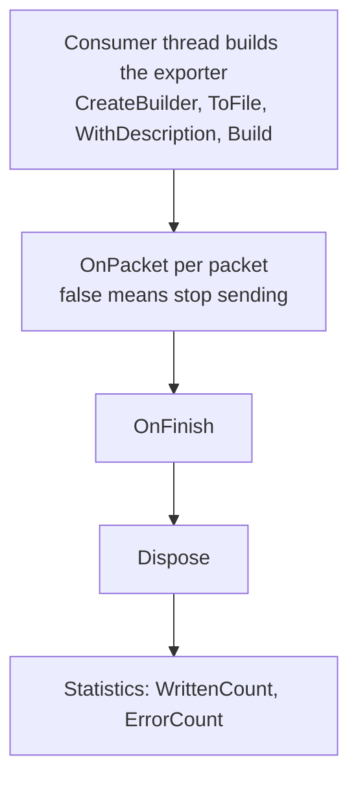
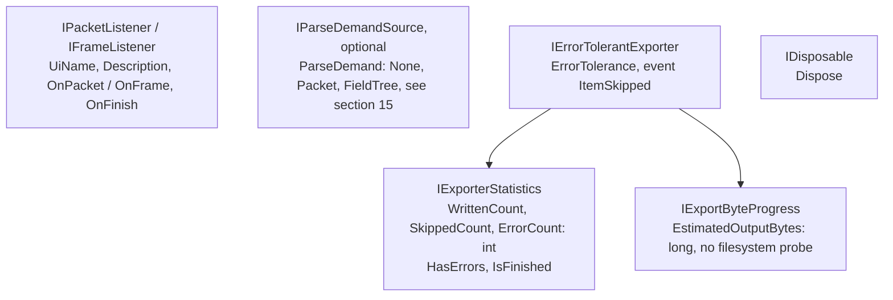
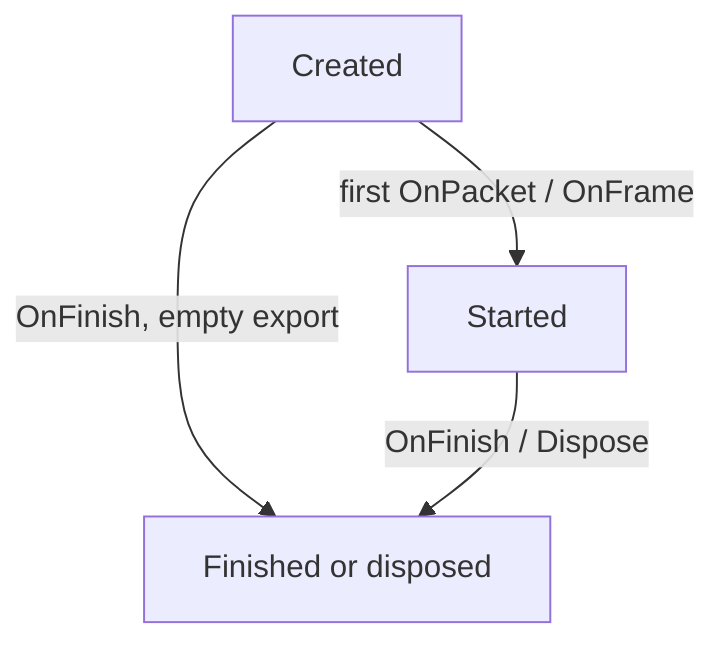
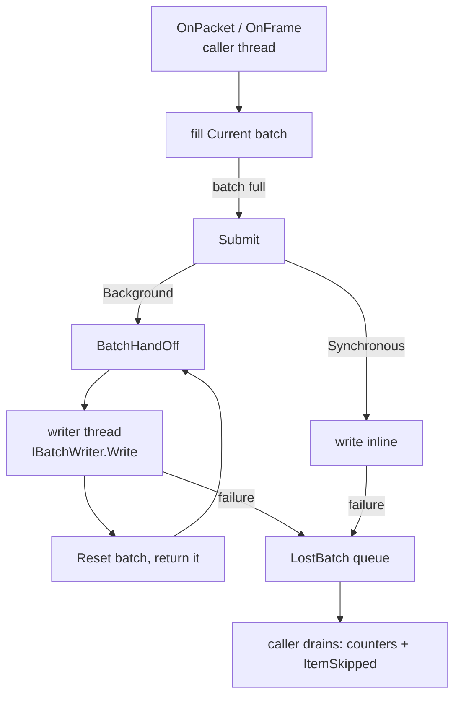

<!-- Copyright © 2026 DevAM. Licensed under the MIT License. See LICENSE in the repository root. -->

# Exporter Implementation Guide

> Canonical reference for implementing, reviewing, and maintaining exporters.
> Derived from the established patterns in `CsvExporter`, `JsonExporter`,
> `PcapngExporter`, `BlfExporter`, and `PbfExporter`.

---

## Table of Contents

1. [Architecture Overview](#1-architecture-overview)
2. [Exporter Taxonomy](#2-exporter-taxonomy)
3. [Interface Hierarchy](#3-interface-hierarchy)
4. [File & Namespace Organisation](#4-file--namespace-organisation)
5. [Naming Conventions](#5-naming-conventions)
6. [Builder Pattern](#6-builder-pattern)
7. [Lifecycle](#7-lifecycle)
8. [Output Targets](#8-output-targets)
9. [Error Tolerance and Batch Writing](#9-error-tolerance-and-batch-writing)
10. [Caller Contract](#10-caller-contract)
11. [Buffer Management](#11-buffer-management)
12. [Display Text & Formatting](#12-display-text--formatting)
13. [Field Traversal](#13-field-traversal)
14. [Export Shapes and Content](#14-export-shapes-and-content)
15. [Parse Demand and the Commit Rule](#15-parse-demand-and-the-commit-rule)
16. [Dispose Pattern](#16-dispose-pattern)
17. [Documentation](#17-documentation)
18. [Testing](#18-testing)
19. [Checklist for New Exporters](#19-checklist-for-new-exporters)

---

## 1. Architecture Overview

Exporters implement a **push-based model**: the consumer sends packets or frames
to the exporter via `OnPacket()` / `OnFrame()` callbacks. The exporter serialises
each item to the configured output target (file, stream, or stdout).



```csharp
XxxExporter exporter = XxxExporter.CreateBuilder()
    .ToFile("output.xxx")
    .WithDescription("...")
    .Build();

foreach (Packet packet in packets)
{
    if (!exporter.OnPacket(packet))
    {
        break;
    }
}

exporter.OnFinish();
exporter.Dispose();

// Statistics are available after the finish.
Console.WriteLine(exporter.WrittenCount);
Console.WriteLine(exporter.ErrorCount);
```

---

## 2. Exporter Taxonomy

Exporters fall into two categories based on their input granularity:

| Category | Interface | Input | When to use |
|----------|-----------|-------|-------------|
| **Packet-level** | `IPacketListener` | `Packet` (parsed tree) | Formats that need field values (CSV, JSON, PBF, Text, Parquet, DuckDB) |
| **Frame-level** | `IFrameListener` | `Frame` (raw bytes) | Formats that need raw frame data (PCAPNG, BLF, ASC) |
| **Columnar analytics** (subset of packet-level) | `IPacketListener` | `Packet` | Option-C dataset: one mono-typed table/file per `FieldId` + slim topology (`ParquetExporter`, `DuckDbExporter`, `PbfExporter` Columnar). Shared walk via `ColumnarPacketBatch`. |

All exporters additionally implement `IErrorTolerantExporter` for error handling
and statistics.

**Parse work follows the content.** A packet-level exporter says what it needs from the parse (`IParseDemandSource`, §15), and
what it needs follows from what it writes (§14): a selected-fields or all-fields export is fed by its own field observer during a
parse without field tree; only the hierarchy shape needs the tree. A packet that arrives with neither a tree nor fields staged by
the exporter's own observer is not written: `OnPacket` skips it and fires `ItemSkipped` with a message that says why, instead of
writing an empty record. Every exporter with a hierarchy shape (Text, JSON, CSV, DuckDB, Parquet, PBF) refuses a hierarchy packet
without a field tree with an explicit check and no exception: `ExportErrorKind.SerializationError` with the message
`Skip packets cannot be exported (HasFieldTree is false).`; the packet is skipped and counted (in `ErrorToleranceMode.Strict` the
export ends instead, without an event). A new exporter with a hierarchy shape reports the same kind and message. The three columnar
exporters share one implementation (§9.6); Text, JSON, and CSV carry the check in their own packet intake. Exporters without a
hierarchy shape (PCAPNG, BLF, ASC) read the frame and have no such condition.

**External validation for columnar exporters:** re-open the output with DuckDB SQL
(`DuckDbExporter` file directly, or `read_parquet` / `parquet_scan` over a Parquet
directory) and assert row counts / typed values. Do not rely on string dumps.

---

## 3. Interface Hierarchy



`IPacketListener` / `IFrameListener` and `IParseDemandSource` are separate contracts; `IErrorTolerantExporter` extends
`IExporterStatistics` and `IExportByteProgress`.

All exporters implement `IDisposable`, the appropriate listener interface, and
`IErrorTolerantExporter` (including live byte progress for size-based CLI splits).

---

## 4. File & Namespace Organisation

```
NetworkInspector.Exporters/
  FormatName/                           ← One folder per exporter format
    FormatNameExporter.cs               ← Main exporter + nested Builder class
    FormatNameWriter.cs                 ← Low-level binary/text writer (optional)
    FormatSpecificHelpers.cs            ← Format-specific utilities (optional)
    README.md                           ← Format documentation
  Columnar/                             ← Shared Option-C batch model (Parquet/PBF Columnar; also used by NetworkInspector.Exporters.DuckDb)
    ColumnarPacketBatch.cs
    ColumnarExportCore.cs / ColumnarBatchExportCore.cs  ← Intake and accounting shared by DuckDB, Parquet, PBF (§9.6)
    FieldColumnBag.cs / OptionalTextReader.cs / TopologyNode.cs
  Content/                              ← Export content model shared by all field exporters (shapes, selection, collector, staging)
  Writing/                              ← Batch writer pipeline shared by DuckDB, Parquet, PBF, and BLF
  ExportOutput.cs / PooledBuffer.cs / SameFlags.cs / …  ← Cross-exporter utilities (package root)

NetworkInspector.Exporters.DuckDb/      ← Standalone DuckDB package (native DuckDB runtime)
  DuckDbExporter.cs
  DuckDbBulkWriter.cs
  README.md
```

**Namespace:** `NetworkInspector.Exporters.<FormatName>` (columnar shared types:
`NetworkInspector.Exporters.Columnar`)

Shared utilities live in the root `NetworkInspector.Exporters` namespace (not a physical `Shared/` folder).

**Output targets:** every exporter except DuckDB writes through an `IExportTarget` of named, write-only streams that need
not seek; `ToFile` / `ToStream` / `ToStdout` are shortcuts that build a target, and `ToTarget(target)` takes the host's own.
A single-file format opens one entry, `ExportEntryName.Main`; the Parquet exporter opens one entry per table file. Columnar
analytics exporters differ:
- `ParquetExporter` → `ToDirectory(path)` (a folder dataset that clears an earlier one) or `ToTarget(target)` (the entries
  as named streams, the host decides where they land)
- `DuckDbExporter` → `ToFile(path.duckdb)` (single database file; package `NetworkInspector.Exporters.DuckDb`); its native
  library opens the file itself, so it has no target and the plugin contract hands it a prepared path (`ExporterCreation.ForFile`)
- `PbfExporter` Columnar → same file target as Standard PBF

---

## 5. Naming Conventions

| Element | Pattern | Examples |
|---------|---------|----------|
| Exporter class | `XxxExporter` | `CsvExporter`, `JsonExporter` |
| Builder class | `XxxExporter.Builder` | `CsvExporter.Builder` |
| Writer class | `XxxWriter` | `PcapngWriter`, `BlfWriter` |
| Static factory | `CreateBuilder()` | — |
| Builder methods | `WithXxx()` or `Xxx()` | `WithUiName()`, `WithDescription()` |
| Output methods | `ToFile()`, `ToStream()`, `ToStdout()`, `ToTarget()` | — |
| Build method | `Build()` | — |
| Display name | `UiName` | — |
| Format enum | `XxxExportFormat` | `PbfExportFormat` |
| Options types | `XxxColumnKind`, `XxxColumnDefinition` | `CsvColumnKind` |

### Builder Method Naming

**Use `With` prefix consistently** for all builder configuration methods:

```csharp
// ✅ CORRECT — consistent With prefix
builder.WithUiName("My Export")
       .WithDescription("Export for analysis")
       .WithCancellationToken(token)
       .WithTargetPacketCount(1000)
       .ToFile("output.csv")
       .Build();
```

---

## 6. Builder Pattern

All exporters use a **nested sealed `Builder` class** with a fluent API.
The exporter constructor is `private` — instances are created exclusively
through the builder.

### 6.1 Structure

```csharp
public sealed class XxxExporter : IPacketListener, IErrorTolerantExporter, IDisposable
{
    // Private constructor — only accessible by Builder.
    // Accept explicit parameters rather than the Builder object to keep the
    // exporter fields independent of the builder's internal state.
    private XxxExporter(
        ExportOutput output,
        string uiName,
        string? description,
        CancellationToken cancellationToken,
        int targetPacketCount)
    {
        _Output = output;
        UiName = uiName;
        Description = description;
        _CancellationToken = cancellationToken;
        _TargetPacketCount = targetPacketCount;
        // ... format-specific fields
    }

    /// <summary>Creates a new builder for configuring and constructing an exporter.</summary>
    public static Builder CreateBuilder() => new();

    /// <summary>Builder for <see cref="XxxExporter"/>. Not thread-safe.</summary>
    public sealed class Builder
    {
        private ExportOutput? _Output;
        private string _UiName = "XXX Exporter";
        private string? _Description;
        private CancellationToken _CancellationToken;
        private int _TargetPacketCount;

        // --- Output target (exactly one required) ---

        /// <summary>Writes to a file at the given path.</summary>
        public Builder ToFile(string path)
        {
            _Output = ExportOutput.File(path);
            return this;
        }

        /// <summary>Writes to an existing stream. Caller retains stream ownership.</summary>
        public Builder ToStream(Stream stream)
        {
            _Output = ExportOutput.FromStream(stream);
            return this;
        }

        /// <summary>Writes the main entry to a host target; the exporter never learns where it lands.</summary>
        public Builder ToTarget(IExportTarget target)
        {
            _Output = ExportOutput.FromTarget(target);
            return this;
        }

        /// <summary>Writes to stdout.</summary>
        public Builder ToStdout()
        {
            _Output = ExportOutput.Stdout();
            return this;
        }

        // --- Common configuration ---

        /// <summary>Sets the display name shown in UI and logs.</summary>
        /// <param name="uiName">Display name; not empty or white space.</param>
        /// <returns>This builder.</returns>
        /// <exception cref="ArgumentException"><paramref name="uiName"/> is null, empty, or white space.</exception>
        public Builder WithUiName(string uiName)
        {
            ArgumentException.ThrowIfNullOrWhiteSpace(uiName);
            _UiName = uiName;
            return this;
        }

        /// <summary>Sets an optional description.</summary>
        /// <param name="description">The description; <see langword="null"/> clears it.</param>
        /// <returns>This builder.</returns>
        public Builder WithDescription(string? description)
        {
            _Description = description;
            return this;
        }

        /// <summary>Sets a cancellation token to abort the export.</summary>
        public Builder WithCancellationToken(CancellationToken token)
        {
            _CancellationToken = token;
            return this;
        }

        /// <summary>Stops after writing the specified number of items (0 … ArrayIndexIdRange.MaxCount).</summary>
        public Builder WithTargetPacketCount(int count)
        {
            ArgumentOutOfRangeException.ThrowIfNegative(count);
            if (count > ArrayIndexIdRange.MaxCount)
            {
                throw new ArgumentOutOfRangeException(nameof(count), count,
                    Invariant($"Target packet count must not exceed {ArrayIndexIdRange.MaxCount}."));
            }

            _TargetPacketCount = count;
            return this;
        }

        // --- Format-specific configuration ---

        // ...

        /// <summary>Validates configuration and creates the exporter.</summary>
        public XxxExporter Build()
        {
            if (_Output is null)
            {
                throw new InvalidOperationException(
                    "Output target is required. Call ToFile(), ToStream(), ToStdout(), or ToTarget().");
            }

            return new XxxExporter(
                _Output,
                _UiName,
                _Description,
                _CancellationToken,
                _TargetPacketCount);
        }
    }
}
```

### 6.2 Rules

1. **Output target is mandatory.** `Build()` must throw `InvalidOperationException` if
   no output was configured.
2. **One output method per builder.** Calling `ToFile()` after `ToStream()` replaces
   the previous output (last-write-wins).
3. **Builder is not thread-safe.** Configuration happens on a single thread before
   calling `Build()`.
4. **Builder is single-use.** Do not reuse a builder after `Build()`.
5. **All common options** (`WithUiName`, `WithDescription`, `WithCancellationToken`,
   `WithTargetPacketCount`) should be available on every exporter builder unless the
   format truly cannot support them (document why). `WithUiName` refuses null, empty, and white space (the exporter's
   `UiName` is never null); `WithDescription` takes `string?` and `null` clears the description.
6. **Field exporters accept `WithContent(ExportContent)`** and refuse content their format cannot write (§14); the exporter
   exposes the content it writes without `WithContent` as `DefaultContent`. CSV is the one exception: without `WithContent` it
   writes packet rows, which no `ExportContent` describes, so it exposes `ContentTemplate`, the starting point for
   `WithContent`, instead.

---

## 7. Lifecycle

### 7.1 States



### 7.2 Lazy Initialisation

Exporters use **lazy initialisation**: the output stream and writer are opened on
the **first `OnPacket` / `OnFrame` call**, not in `Build()`. This prevents creating
empty files when the export produces no items.

```csharp
private bool Start()
{
    _Started = true;
    Stream? stream = _Output?.GetOrCreateUnderlyingStream();

    if (stream is null)
    {
        _HasError = true;
        return false;
    }

    _Writer = new XxxWriter(stream);
    _Writer.WriteHeader();
    return true;
}
```

### 7.3 OnPacket / OnFrame

The callback returns `bool`:
- `true`: continue receiving items.
- `false`: unsubscribe (stop receiving items).

For a field exporter fed by a parse without field tree, `OnPacket` is the **commit**: the fields were staged by the exporter's
observer during the parse, and `OnPacket(packet)` makes them part of the output (§15). A packet the pipeline never passes to
`OnPacket` (a filter rejected it) leaves nothing behind.

Return `false` when:
- `_Finished` is already true (guard at the top).
- A fatal error occurs (`_HasError = true`).
- `CancellationToken` is cancelled.
- `TargetPacketCount` is reached.

### 7.4 OnFinish

- Checks `if (_Finished) return;` and sets `_Finished = true` first — double-finish is safe, also after a failure.
- If never started: either produce an empty-but-valid file (preferred) or skip output.
- Runs the shared finish sequence `ExporterFinish.Run` (§9.4): trailer and final flush, then every release step.

### 7.5 Empty Export Behaviour

When `OnFinish()` is called without any items being written, the exporter should
produce a **valid but empty** output file where the format supports it:

| Format | Empty export result |
|--------|-------------------|
| CSV | May produce header-only file or 0-byte file until first packet |
| JSON | Valid `[]` or `{}` |
| PCAPNG | Valid SHB block |
| BLF | Valid LOGG file header |
| ASC | Valid header + empty trigger block |
| PBF | Valid magic + header + trailer + magic |
| Text | Single newline |
| Parquet | No directory/files created |
| DuckDB | No database file created |

---

## 8. Output Targets

Use `ExportOutput` as the abstraction for the output of a single-file format. It opens the one entry,
`ExportEntryName.Main`, of an `IExportTarget` on the first write, so an export that writes nothing opens nothing:

```csharp
ExportOutput.File(path)         // FileExportTarget: FileStream + BufferedStream (4 MiB), owns stream
ExportOutput.FromStream(stream) // StreamExportTarget: wraps existing stream, caller retains ownership
ExportOutput.Stdout()           // StreamExportTarget.Stdout(): Console.OpenStandardOutput(), owns stream
ExportOutput.FromTarget(target) // The host's own target; it decides where the entry lands
```

`IExportTarget.TryOpenWrite` hands out a write-only stream that need not seek or report a position; a refused open is
`false` plus a reason, never an exception. A dataset format (Parquet) calls the target once per table file instead of using
`ExportOutput`; it never calls a file-system API itself.

**Rules:**
- Store `ExportOutput?` (nullable) — it becomes available after `Build()`.
- Access the underlying stream via `_Output.TryGetOrCreateUnderlyingStream(out stream, out failure)` in `Start()` — this opens the entry on demand and reports a refusal as a result, not an exception.
- To inspect the stream without creating it (e.g. for finalization calls), use `_Output.TryGetExistingStream()` — returns `null` if no data has been written yet.
- Dispose `_Output` in `OnFinish` / `Dispose` — this correctly handles ownership.
- After disposing, set `_Output = null` to prevent double-dispose.

---

## 9. Error Tolerance and Batch Writing

All exporters must implement `IErrorTolerantExporter`.

### 9.1 Error Handling in OnPacket / OnFrame

**Every exporter must wrap the serialisation path in a try/catch:**

```csharp
private bool HandlePacket(Packet packet)
{
    try
    {
        // Serialise the packet
        _Writer!.Write(packet);
        if (WrittenCount < int.MaxValue)
        {
            WrittenCount++;
        }

        return true;
    }
    catch (Exception ex)
    {
        return HandleError(ex, WrittenCount + SkippedCount);
    }
}
```

### 9.2 HandleError / HandleSkip Pattern

Centralise error handling in a `HandleSkip` or `HandleError` method:

```csharp
private bool HandleSkip(ExportErrorKind kind, string message, int itemIndex)
{
    // Counters saturate at int.MaxValue instead of wrapping (Section 4.1): a wrapped count would report negative progress.
    if (ErrorCount < int.MaxValue)
    {
        ErrorCount++;
    }

    if (SkippedCount < int.MaxValue)
    {
        SkippedCount++;
    }

    if (ErrorTolerance == ErrorToleranceMode.Strict)
    {
        _HasError = true;
        return false;   // Stop the export
    }

    // Tolerant mode: fire event and continue
    ItemSkipped?.Invoke(this, new ExportErrorEventArgs
    {
        ItemIndex = itemIndex,
        Kind = kind,
        Message = message,
    });
    return true;        // Continue the export
}
```

### 9.3 Rules

1. **Never let exceptions propagate** from `OnPacket` / `OnFrame`. Catch all
   exceptions (including `IOException`, serialisation errors, `NullReferenceException`).
2. **Distinguish I/O errors from data errors.** Use appropriate `ExportErrorKind` values.
3. **Strict mode aborts immediately.** Set `_HasError = true` and return `false`.
4. **Tolerant mode skips and continues.** Fire `ItemSkipped` event with details.
5. **Increment counters saturating**: `if (ErrorCount < int.MaxValue) { ErrorCount++; }`, the same for `SkippedCount`. A plain
   `++` would wrap to a negative count after `int.MaxValue` items. No `Interlocked` is needed because exporters are
   single-threaded.

### 9.3.1 One stack per export (catalog exporters)

Field ids are dense counters **per protocol stack**: id 17 names another field on the stack a session restart builds. An
exporter that writes a catalog built from the stack of its first packet (PBF **columnar**, Parquet, DuckDB) therefore
accepts packets of that one stack only. The three share one implementation (`ColumnarExportCore<TBatch>`, §9.6), which remembers
the first packet's stack and refuses a packet of another stack with `ExportErrorKind.StackMismatch`:

- the packet is **not written**; `ErrorCount` is incremented and `ItemSkipped` fires with `ItemIndex` = the number of packets
  written so far;
- the error is **fatal** for the export (the error flag is latched, `OnPacket` returns `false`), whatever the error tolerance: every
  later packet of the new stack would be refused too, one report each, for no dataset anybody wants;
- `OnFinish` still finalizes a valid dataset of the packets written before;
- the owner of the export (typically a stack-bound session job, which a restart ends anyway) starts a new export on the new
  stack.

Row exporters (CSV, JSON, Text, PBF standard, PCAPNG, BLF, ASC) carry no catalog, so they need no check of their own. A row
exporter that caches names by field id is a small catalog and keeps the rule at the cache: the cache holds the names of one
stack and starts over when a packet of another stack arrives. CSV does this for the field names its long and hierarchy
layouts write on every row (`_FieldName` clears the cache when the stack changes). A row exporter with a field selection
refuses a packet of another stack than the selection's with `StackMismatch`, like the catalog exporters. A row format that
writes a name once per document and refers to it by id afterwards cannot start over, because the earlier rows are already in
the file: the JSON **compact** field tree (`NA`, `UI`, `TY` on the first occurrence of an id, values elided by id) is such a
catalog and refuses a packet of another stack than its first written packet's (`_CompactStack`). The flat JSON shapes, Pretty,
and Array write the name with every field and accept any stack.

### 9.4 Finish Sequence (`ExporterFinish`)

Every exporter ends through the one internal helper `ExporterFinish.Run`, so a fix to cleanup applies to all formats:

```csharp
public void OnFinish()
{
    if (_Finished)
    {
        return;
    }
    _Finished = true;

    ExporterFinish.Run(
        "BLF",                 // format name for the messages
        _FinalizeFile,         // trailer, header patch, final flush; null when there is nothing to finalize
        _ReportFinishError,    // sets _HasError, counts the error, raises ItemSkipped
        new ExporterReleaseStep("payload buffer return", _PayloadBuffer.Return),
        new ExporterReleaseStep("output disposal", _DisposeOutput)); // the output always comes last
}
```

1. **Finalize** — a failure is reported as `"{format} finalization failed: …"` (`IoError` for `IOException`, else
   `SerializationError`) and not rethrown: the output may already be unusable, and the releases must still run.
2. **Release** — the steps run in order (pooled buffers, builders, last the output, which closes the stream unless the
   caller owns it). Every step runs even when an earlier one failed; each failure is reported as `"{format} {what} failed: …"`.
3. **Aggregate** — when any release step failed, one `AggregateException("{format} exporter cleanup failed.")` carries all
   of them, thrown after every step has run.

Each release helper clears its field before disposing (`ExportOutput? output = _Output; _Output = null; output?.Dispose();`),
so a second call can never dispose twice.

### 9.5 Batch writing and the writer thread

DuckDB, Parquet, PBF (both layouts), and BLF are **batching exporters**: they collect packets (or frames) in a batch and write
the batch when it is full. Encoding, compression, and I/O of a batch (a DuckDB transaction, a Parquet row group, an LZ4 block,
a zlib container) take as long as parsing thousands of packets; written inside `OnPacket` / `OnFrame`, they would stop parsing
for every batch. All four share one internal component, `BatchWriterPipeline<TBatch>`
(`NetworkInspector.Exporters/Writing/`):



| Topic | Rule |
|-------|------|
| Write mode | `WithWriteMode(ExportWriteMode.Background)` (default) writes on a thread named `"{format} export writer"`; `Synchronous` writes inside the call that completed the batch and starts no thread. |
| Memory | Background: two batches (one filling, one writing). Synchronous: one. The caller waits when it is a whole batch ahead; that wait is the back pressure that keeps memory bounded. |
| Batch size | `WithMaxPacketsPerBlock` (1 – `int.MaxValue`, default 50 000) and `WithMaxBlockSize` (1 – `long.MaxValue`, default 16 MiB); BLF: `WithMaxContainerSize` (64 KiB – 64 MiB, default 10 MiB). Threat: memory exhaustion (a batch is held until written); posture: secure by default. An out-of-range value is refused with a message that names the range (`BatchLimits`). |
| Error timing | A failed write is never raised on the writer thread: it becomes a `LostBatch` that the exporter takes on its own thread. In background mode the caller sees it **one batch later** (at the latest in `OnFinish`); in synchronous mode in the very call. The batch is emptied either way, its packets leave `WrittenCount` and count as skipped, and exactly one `ItemSkipped` is raised per lost batch. |
| Caller streams | In background mode the caller must not read, write, seek, or dispose a stream passed with `ToStream` / `ToStdout` until `OnFinish` returned. `OnFinish` joins the writer thread before it writes the trailer (PBF) or patches the header (BLF), so the complete file is in the stream when it returns. Use `Synchronous` to keep every write on the calling thread. |
| Finish order | `Complete` writes the last batch and joins the thread; then the exporter drains lost batches; then it completes its output (catalog, trailer, header patch) so that it states only what was written. |
| Dispose | `Dispose` without `OnFinish` stops the thread and drops the batch that is still filling (an aborted export). |

**Why a hand-off of two batches and not a channel or a queue per packet:** the hand-off runs once per batch, never per packet, so
the per-packet path takes no lock. Both sides must wait by design (the caller when the writer is behind, the writer when there is
nothing to write), so a blocking primitive is the cheapest correct choice. The shipped `BatchHandOff<TBatch>` is one reference slot
with two semaphores for the full direction and a ring of two places for the empty direction; it was measured against two
`BlockingCollection<T>` (6.9 % faster in isolation, 0 instead of about 300 allocated bytes per hand-off, unchanged in the DuckDB
export; see the [decision record](../docs/decisions/batch-hand-off.md)). A channel would need a sync-over-async wait on the
caller's thread.

**What an exporter implements:** a batch type (`IExportBatch`: `PacketCount`, `EstimatedSizeBytes`, `Reset`, `Dispose`) and an
`IBatchWriter<TBatch>` (usually the exporter itself, as an explicit interface implementation that forwards to its output object).
The pipeline creates nothing in its constructor: the first batch on first use, the second batch and the thread on the first
background submit, so an export shorter than one batch writes inline and starts no thread, and an export without packets leaves no
thread and no file behind (§7.5).

### 9.6 Columnar intake and accounting (`ColumnarExportCore<TBatch>`)

The three columnar exporters (DuckDB, Parquet, PBF) do not repeat the code that decides *whether and how a packet is counted*.
One internal type, `ColumnarExportCore<TBatch>` (`NetworkInspector.Exporters/Columnar/`), owns it for all of them, so a rule change
is made once:

| Concern | Rule (one place) |
|---------|------------------|
| Stop checks | cancellation, a latched error, and a finished exporter refuse the packet before anything is touched |
| One stack | a field selection pins the stack; the catalog layouts pin the first packet's stack (§9.3.1) |
| Lazy start | the exporter's `_Start` delegate opens the output on the first packet; a failed start is reported once and not retried |
| Tree-less hierarchy packet | skipped with `SerializationError` and `Skip packets cannot be exported (HasFieldTree is false).` (§2) |
| Add and hand-off | all-or-nothing add; a full batch goes to the pipeline (§9.5); a failed write is accounted in the same call (synchronous) or by the next packet (background) |
| Counters and error channel | saturating `PacketCount`, `SkippedCount`, `ErrorCount`; lost batches leave the packet count and are reported once each |

`ColumnarBatchExportCore` (DuckDB, Parquet; batch = `ColumnarPacketBatch`) and `PbfExportCore` (PBF; batch = `PbfBlock`) derive from
the core and implement the only points where the formats differ: how a packet enters the open batch (`TryAddPacket`), a check
before a full batch leaves (`BeforeSubmit`; PBF's strict nesting check), and where the observer stages the next packet
(`AfterSubmit`). An exporter keeps its builder, the opening of its output, the `IBatchWriter<TBatch>.Write`, the finish sequence
(§9.4), and statistics properties that forward to its core. Create the delegates the core takes (`start`, `raiseItemSkipped`)
once in the exporter's constructor: the per-packet path allocates nothing.

---

## 10. Caller Contract

### 10.1 Single-threaded access

Exporters are **not thread-safe**. `OnPacket` / `OnFrame` and `OnFinish` must be
called **sequentially from a single thread**. The caller is responsible for
synchronization if an exporter is ever driven from multiple threads. The batching exporters run a writer thread of their own
internally (§9.5); that does not change this contract: the thread touches only the batch it was handed and the output.

This contract matches every existing built-in call site (CLI, Playground) —
all of which call `OnPacket` / `OnFrame` sequentially — and avoids
unnecessary locking overhead in the common case.

### 10.2 Counter access

| Operation | Pattern |
|-----------|--------|
| Increment `WrittenCount` | `if (WrittenCount < int.MaxValue) { WrittenCount++; }` |
| Increment `SkippedCount` | `if (SkippedCount < int.MaxValue) { SkippedCount++; }` |
| Increment `ErrorCount` | `if (ErrorCount < int.MaxValue) { ErrorCount++; }` |
| Read counters (getters) | plain property read |

### 10.3 State fields

| Field | Write | Read |
|-------|-------|------|
| `_Finished` | `_Finished = true` in `OnFinish` | `_Finished` in `IsFinished` |
| `_Started` | `_Started = true` on lazy init | `!_Started` guard in `OnPacket` / `OnFrame` |
| `_HasError` | `_HasError = true` in error paths | `_HasError` in `IsFinished` |

The columnar exporters (DuckDB, Parquet, PBF) keep these three flags, the counters, and `IsFinished` in their `ColumnarExportCore` (§9.6); their `IsFinished`
property forwards to it.

### 10.4 IsFinished semantics

`IsFinished` reflects the **logical completion state** — the export is considered
finished when any of these conditions hold:

```csharp
public bool IsFinished =>
    _Finished ||
    _HasError ||
    _CancellationToken.IsCancellationRequested ||
    (_TargetPacketCount > 0 && WrittenCount >= _TargetPacketCount);
```

If the exporter also implements `IExporterStatistics.IsFinished` explicitly,
that property must delegate to `IsFinished` so both surfaces always agree.

---

## 11. Buffer Management

### 11.1 PooledBuffer

`PooledBuffer` is a growable byte buffer for building binary payloads without
per-item allocations:

```csharp
PooledBuffer buffer = new();

// Write data
buffer.Write(headerBytes);
buffer.WriteByte(0x00);
Span<byte> reserved = buffer.Reserve(4);
BinaryPrimitives.WriteUInt32BigEndian(reserved, value);

// Use the built content
ReadOnlySpan<byte> content = buffer.WrittenSpan;

// Reset for next item (keeps allocated array)
buffer.Reset();

// Release array on shutdown
buffer.Return();
```

**Rules:**
- Call `Reset()` between items (reuses the array).
- Call `Return()` in `OnFinish` / `Dispose` to release the array.
- Do not call `Return()` and then continue using the buffer.

### 11.2 Avoid Allocations

- Use `PooledBuffer` or `Span<byte>` for binary serialisation.
- Use `stackalloc` for small temporary buffers (≤ 256 bytes).
- Use `[MethodImpl(MethodImplOptions.AggressiveInlining)]` for small hot-path methods.

### 11.3 Instance scratch buffers vs `ArrayPool<byte>`

Because exporters are single-threaded (see Section 10), UTF-8 encoding scratch
buffers are stored as **private instance fields** (`private byte[]? _Utf8Scratch`)
rather than `[ThreadStatic]` statics. The buffer grows to the maximum length ever
needed by that exporter instance and is reused without allocation for subsequent
items.

Use **`ArrayPool<byte>.Shared.Rent`** when the buffer lifetime crosses components,
spans **zlib/LZ4** framing that needs a contiguous backing array tied to **`Stream`**
APIs, or when the upper bound size is unpredictable until runtime. Prefer
**`PooledBuffer`** / **`Utf8Formatter` + stackalloc** for sequential exporter rows
(CSV, text, JSON payloads). Source-side BLF zlib inflates from a pinned input span
via **`UnmanagedMemoryStream`** + **`ZLibStream`** into the output array; there is
no compressed-side **`ArrayPool`** copy.

### 11.4 BLF `start_date` and relative timestamps

The LOGG **`start_date`** field is **`SYSTEMTIME` in millisecond granularity** without a
zone. The writer fills it as civil time in **`Builder.WithTimestampTimeZone`** (default
**`TimeZoneInfo.Utc`**, the same default as `BlfSourceOptions.TimestampTimeZone`, so a
round trip through this product is machine-independent). Vector tools and other common readers read
the field as local time: export with `TimeZoneInfo.Local` for them. **ObjectTimeStamp
holds nanoseconds (`objectFlags = 2`)**; 10 µs ticks (`objectFlags = 1`) are read but never
written. The writer **floors the anchor `startNs`** to whole milliseconds so sub-ms
residuals live only in offsets. **`BlfExporter`**
tracks **min/max epoch nanoseconds**: the anchor aligns to the earliest **ordered**
revision possible before first written object (**`TryRealignStartEarlier`** on a
seekable stream), **`measurement_end`** uses the **maximum** timestamp, out-of-order
frames after data exists **clamp** negative relative ticks (**`BLF`** cannot express
them) and **`ItemSkipped`** fires **once per export** when that happens.

### 11.5 Bus Fields, Channels, and Interface Metadata

The readers and writers of this product share one representation per bus field, so every exporter writes back what
every reader produced:

| Field | Frame representation | Writers |
|-------|---------------------|---------|
| Classic CAN bus DLC 9–15 | SocketCAN byte 4 = payload count (≤ 8), byte 7 (`len8_dlc`) = bus DLC; `BlfConstants.ClassicCanDlc` | BLF DLC nibble; ASC one hex digit (`base hex`) |
| CAN remote frame | RTR bit; byte 4 = requested count, no data | ASC `r {dlc}`; BLF flags `0x80` + DLC |
| LIN protected id | DLT_LIN byte 5 = id + parity (`LinProtectedId`); writers recover the id with `& 0x3F` | BLF, ASC |
| LIN checksum model | DLT_LIN byte 4 bits 1–0: 1 = classic, 2 = enhanced, 0 = not stated | ASC `CSM = classic/enhanced` (0 → enhanced); BLF LIN_MESSAGE2 |
| Bus channel | `InterfaceChannelConverter.TryGetChannel`: `blf.channel`, then `asc.channel`, then a trailing number ≥ 1 in the interface name | BLF, ASC (resolved once per interface) |
| BLF channel name | Interface `UiName` | BLF writes one AppText channel name per channel unless the name is the default (`"CAN 2"`) |
| PCAPNG interface options | `if.*` properties, one shared table (`PcapInterfacePropertyKeys.InterfaceOptions`) | PCAPNG writes them back as IDB options, plus `if_name` / `if_description` |

In the BLF exporter an interface whose channel property exists but is unusable (out of range, wrong type) is an
error for its frames (`ItemSkipped`), not a silent fallback to channel 1. The ASC exporter still falls back to its
default channel in that case. A link type outside the `LinkType` enum is written unchanged by PCAPNG.
PCAPNG leaves out an interface option that an IDB cannot hold (above 65 535 bytes, wrong type, negative) and raises one
advisory `ItemSkipped` event per interface that names it; the interface's frames are still written.

A CAN FD frame that declares more than 64 data bytes (SocketCAN byte 4) is corrupt: BLF and ASC skip it as `MalformedData` and
name the limit; ASC does the same for a classic frame that declares more than 8 and for a LIN frame that declares more than 8
(DLT_LIN length field, byte 4 bits 7-4). ASC writes a CAN or LIN frame that declares more bytes than the buffer holds (a capture
cut by a snap length) with the bytes present and raises one advisory `ItemSkipped` event (`MalformedData`, not counted as skipped)
per export and frame kind (CAN, LIN).

ASC timestamps are integer-exact: `AscExporter.Builder.WithTimestampDecimals(6..9)` (default 6) rounds the nanosecond
fraction to the nearest digit and carries into the seconds.

### 11.6 Allocation lifetime models

Every bump allocator in the code base follows exactly one of two lifetime models. A new allocation need must pick one of them
and not add a third implementation.

| Allocator | Lifetime model | Released by | Rollback | Used for |
|-----------|----------------|-------------|----------|----------|
| `SlabAllocator<T>` (Core) | **GC regions**: many independent owners share a slab; it dies with its last user | the garbage collector | no | field bodies, lazy populator tables (one per parse thread) |
| `FrameSlabAllocator` (Sources) | GC regions (a policy wrapper on `SlabAllocator<byte>`: rollover, bypass for big frames) | the garbage collector | no | frame payloads that sessions keep indefinitely |
| `BatchByteArena` (Exporters) | **Batch arena**: one owner, everything dies together at `Reset` | return to `ArrayPool<byte>` | `Mark` / `TruncateTo` | frame bytes, additional buffers, and `Bytes` values of one export batch |

**Why they are not merged:** a GC-region slab can neither return memory to a pool nor roll back a half-added packet, and an arena
must not keep a span after `Reset`, which retained frames of a session would. Merging both into one generic core would put reset,
rollback, and pool branches (or a policy indirection) on the measured hot path of field storage for no shared lifetime rule. Frames
cannot use the arena because sessions retain them beyond any batch.

`ChunkedGrowOnlyStore<T>` (published, grow-only reader store of value caches) and `PooledBuffer` (one growable contiguous buffer,
§11.1) are not allocators in this sense.

### 11.7 Buffers a writer thread uses are rented on the caller's thread

`ArrayPool<byte>.Shared` keeps a small cache **per thread** in front of its shared per-core stacks. An exporter returns its
arrays on the thread that finishes it (the caller's), and a writer thread (§9.5) starts empty. A buffer that **grows on the
writer thread** by doubling (the zlib output buffer of the BLF writer: 16 KiB, 32 KiB, …) therefore misses the pool at every step
and allocates a new array for each. Measured with `GC.GetAllocatedBytesForCurrentThread()` on the writer thread, the first container
of each BLF export allocated about 517 KB and every later container 264 bytes — about 0.5 MiB of garbage per exporter that the
synchronous mode (one thread, one warm cache) never produced.

**Rule:** a buffer the writer thread will need is rented once, at its expected capacity, by the code that runs on the caller's
thread (the writer object's constructor), so the rent hits the caller's cache and the writer thread only uses it. The capacity is the
expected size of the output: the BLF writer rents its compressed-output buffer at the container size (at most 64 MiB). The shared
pool hands a returned array of such a size out again on the same thread, up to 64 MiB, which
`PooledBufferTests.TheSharedPoolReusesAnArrayOfThisSizeOnTheSameThread` pins; the pool has no 1 MiB ceiling. An output that exceeds
the capacity still grows on the writer thread, correctly and with an allocation. A new batching exporter checks its allocations once with the `-sync` control scenario of the profiling tool
next to the background scenario (`export-blf-frames` against `export-blf-frames-sync`): equal allocations mean the writer thread
rents nothing it does not need.

---

## 12. Display Text & Formatting

### 12.1 LazyString

Use `LazyString.FormatLazy()` for deferred formatting in field display text.
Prefer static lookup tables for known value domains.

**Custom text is final at append.** A dissector sets a field's custom text when it appends the field (`AppendWithCustomText`,
`AppendLazyWithCustomText`, or a deferred `LazyString`). Observers and tree-free exports see exactly that text, so a tree export
and a selected-fields export of the same packet show the same text; changing it later (`SetCustomText`, `AppendCustomText`,
`ClearCustomText`) is discouraged and throws `InvalidOperationException` once the packet is sealed. An exporter that stages fields
while the parse runs keeps the `LazyString` and evaluates it in `EndPacket`, never in `OnField` (a deferred text may be completed
until the parse of the packet ends). See the protocol guide ("Custom text is final at append").

### 12.2 Field Value Formatting

Path-specific writers format `FieldValue` / `FieldValueData` for text-oriented
exports — do not introduce a shared stringifier on typed same-as-previous or
columnar analytics paths:

| Path | Formatter |
|------|-----------|
| JSON Pretty / Array | `JsonHelpers.WriteFieldValue` |
| JSON Compact | Typed SAP via `PreviousFieldStore`; strings only when emitting |
| CSV | `FieldValue.TryFormat` / `ToString` as needed |
| Text | The display line of [§ 12.3](#123-rebuilding-the-display-line), written part by part after the same decision as `Field.ToString()` (`FieldValueData.TryFormat` for the value part) |
| Columnar (Parquet / DuckDB / PBF Columnar) | Typed bags via `FieldColumnBag`; the address types are read as integers from `FieldColumnBag.FixedValueSpan` (see [§ 12.3](#123-rebuilding-the-display-line), Address values) |
| PBF Standard | Typed `FieldValueData` in `StandardBlockBuilder` |

When a string representation is required, handle all `FieldType` variants; the default text of each is in the table of
[§ 12.3](#123-rebuilding-the-display-line).

### 12.3 Rebuilding the display line

The display line of a field is what `Field.ToString()` returns (the same members exist on `MutField`; the line is the default string
representation of a field, the way `FieldValue.ToString()` is the default string representation of a value). One rule builds it:

| Case | Line |
|------|------|
| The field has a custom text (also an empty one) | The custom text alone; a dissector that wants the label writes it into the text |
| The field has no value (type `None`, for example a container) | The UI name |
| Any other field | The UI name, `: `, and the value's default string |

The label is the registered UI name (`FieldInfo.UiName`, never empty; the formats with a field catalog write it as `ui_name`). A field
id that the stack does not know (no catalog row, no `FieldInfo`) has no label: its line is the value part alone, and the
empty line for a field of type `None`. The value's default string is the custom representation when one is set, else the default text of the data:

| Field type | Default text of the data | Example |
|------------|--------------------------|---------|
| `Bool` | `True` or `False` | `True` |
| `I64`, `U64` | Decimal digits, `-` for a negative value | `-5`, `53` |
| `F64` | Shortest round-trip text, invariant culture | `0.5` |
| `String` | The string verbatim | `GET /` |
| `Bytes` | Upper-case hex, one space between bytes | `0A FF 00` |
| `MacAddress` | Upper-case hex pairs, `:` | `00:1A:2B:3C:4D:5E` |
| `IPv4Address` | Dotted decimal | `192.168.1.1` |
| `IPv6Address` | Upper-case hex groups, zeros compressed | `2001:DB8::1` |
| `Eui64` | Upper-case hex pairs, `:` | `00:1A:2B:FF:FE:3C:4D:5E` |
| `Uuid` | Upper-case hex, `-` | `123E4567-E89B-12D3-A456-426614174000` |
| `Timestamp` | UTC, ISO 8601, nine fractional digits | `2026-01-01T00:00:00.000000000Z` |
| `None` | The empty string | |

Every part stays readable on the field (`FieldInfo.UiName`, `Value.Data`, whose `ToString` is the default text of the data,
`Value.CustomRepresentation`, `CustomText`), so a consumer can build an own line. The line is not escaped: a consumer that writes it to a terminal, a CSV cell,
or markup escapes it for that target.

`Field.ToString()` and `Field.TryFormat` build the line of the table of cases in Core's internal `FieldDisplayLine`. The Text export writes the
same cases itself and does not call `Field.TryFormat` for a whole line, because it must cut and escape capture text part by part: the
maximum text length counts the custom text or the value part but never the label, control characters are escaped in capture text only
(not in the registered label), a bytes value is cut at whole bytes without formatting all of it first, and the flat shapes write staged
values that have no `Field`. The Text tests compare every line with `Field.ToString()` (all shapes, all detail levels), so the two
writers cannot drift apart.

#### Address values

CSV, JSON, and Text write the default text of the table above. The binary formats (DuckDB, Parquet, PBF Standard, PBF Columnar)
store the five address types as unsigned integers instead, so a reader sorts and range-queries them and turns them back into the
default text with the conversion in the last column. An address integer is the **big-endian reading of the address bytes**
(`192.168.1.1` is the bytes `C0 A8 01 01`, the number `0xC0A80101` = `3232235777`), so the numeric order is the address order.

| Type | DuckDB | Parquet | PBF Standard (record) | PBF Columnar (column) | Back to the default text |
|------|--------|---------|-----------------------|-----------------------|--------------------------|
| `IPv4Address` | `UINTEGER` | `UINT_32` `value` | field 5 fixed32 | field 19, packed fixed32 | The four bytes, most significant first, as decimal numbers joined with `.` |
| `MacAddress` | `UBIGINT` (low 48 bits) | `UINT_64` `value` | field 5 varint | field 20, packed fixed64 | The low six bytes, most significant first, as upper-case hex pairs joined with `:` |
| `Eui64` | `UBIGINT` | `UINT_64` `value` | field 5 fixed64 | field 20, packed fixed64 | The eight bytes as hex pairs joined with `:` |
| `IPv6Address` | `UHUGEINT` (`high << 64 \| low`) | `UINT_64` `value_hi`, `value_lo` | field 5 fixed64 (high), field 11 fixed64 (low) | field 20 (high), field 21 (low), packed fixed64 | Eight 16-bit groups from the 128 bits, each as upper-case hex without leading zeros, the longest run of two or more zero groups (the first when equal) written as `::`, groups joined with `:` |
| `Uuid` | native `UUID` (`value::VARCHAR` gives the lower-case text) | `UINT_64` `value_hi`, `value_lo` | field 5 fixed64 (high), field 11 fixed64 (low) | field 20 (high), field 21 (low), packed fixed64 | The 32 hex digits of the 128 bits in upper case, grouped 8-4-4-4-12 and joined with `-` |

- **Both halves.** The 128-bit types are two 64-bit halves wherever the format has no 128-bit integer (Parquet, PBF); a reader
  needs both, because the high half alone is only the `/64` prefix of an IPv6 address. DuckDB reads the halves back with
  `value >> 64` and `value & 0xFFFFFFFFFFFFFFFF`.
- **Fixed-width fields.** The PBF fixed32 and fixed64 values are little-endian (as protobuf fixes them); the packed columns hold
  one entry per row. Details: the [PBF README](Pbf/README.md#field-values).
- **Text formats.** CSV, JSON, and Text keep the notation (`192.168.1.1`, `2001:DB8::1`, `00:1A:2B:3C:4D:5E`); they never write
  these integers.

Sync: `DuckDbAddressTests`, `ParquetAddressTests`, `PbfAddressTests` (the stored forms), `DuckDbDisplayRebuildTests` (the conversion
of every row of this table, executed against the Text lines), the per-format READMEs, and `docs/decisions/export-integer-addresses.md`.

#### What the exports store

Only the Text export writes lines. Every data export writes the parts of the rule and leaves the rebuilding to the reader: the
field's UI name (from the catalog, the field header, or the key), the value, the custom representation, and the custom text. A
custom text and a custom representation are written **only when a dissector set them**, so the reader sees the dissector's own
setting and never a default text in a text column:

| Format | A text that is absent | A text that is set (also an empty one) |
|--------|----------------------|----------------------------------------|
| DuckDB, Parquet | `NULL` | The text; `''` when empty |
| PBF Standard | Field 6 / 7 not written | The field is written (length 0 when empty) |
| PBF Columnar | A run of absent rows (sub-field 2), or no column when no row has a text | Sub-field 1 holds the text |
| JSON | The key is omitted | `"custom_text": "…"`; `""` when empty |
| CSV | An empty cell between the delimiters | The text; the quoted empty cell `""` when empty |
| Text | The line is built without the part | The line is built with it (the rule above) |

Reader rule, in the order of the table of cases above: `text` set → the line is `text`; else the node has no value → the line is
the UI name; else the line is the UI name, `: `, and `repr` when it is set, else the default text of the value. An absent text is
not an empty text: a node with `custom_text IS NULL` falls through to the next case, a node with `custom_text = ''` has the empty line.

Limits that the reader must know:

- **Switches.** With `text` switched off no custom text is written (no column, field, or key) and no text is read from the
  field; in a tree-free parse the dissectors are not even asked to build one (a field tree holds the texts anyway). The same holds
  for `repr`. A reader that rebuilds lines from such an export gets the line without that part, which is
  also what the Text export of the same switches shows.
- **Nodes without a value** (protocol layers, groups) carry their custom text in every format: DuckDB and Parquet
  `topology.custom_text`, PBF Standard field 7 of the node, PBF Columnar the presence-encoded text column (field 5) of the topology
  message, the CSV hierarchy `custom_text` cell, the JSON tree key, the Text line. A value node has no topology text (its text is in
  its field table), so a topology row of a value node reads as an absent text. The tree-free shapes have no layers.
- **CSV wide layout.** A cell that joins several occurrences of a field (`10.0.0.1|192.168.0.1`) cannot show whether an occurrence
  had no text or an empty one (both contribute nothing between the separators); one occurrence per cell can (`""` versus an empty
  cell). Readers that unquote cells (spreadsheets, most data-frame readers) show both as empty; a reader that keeps the quoting
  keeps the difference (the Python `csv` module from Python 3.12 returns `None` for an unquoted empty field and `''` for `""` with
  `quoting=csv.QUOTE_NOTNULL`).
- **Text export.** The maximum text length cuts the text of a line (the custom text or the value part), never the label, and capture
  text is written with control characters escaped (C0 and DEL as `\n`, `\r`, `\t`, or `\xHH`; the C1 controls as `\u00HH`; the
  backslash as `\\`); the Text export writes the line of the rule, so a flat shape line is `name=<line>` (`name[occurrence]=<line>` in the all-fields shape).

Sync: `FieldStringRepresentationTests` (the Core tests carry the same strings and the three cases; they read no Markdown), the
`FieldDisplayLine` in Core, `TextExporter._WriteLineFromParts`, `DuckDbDisplayRebuildTests` (rebuilds the lines of a DuckDB export with
this rule and compares them with the Text lines), `TextPresenceTests` (the presence table above), and the per-format "Texts" paragraphs
of the exporter READMEs.

---

## 13. Field Traversal

### 13.1 Zero-alloc enumeration

`Field.Children(bool materialize)` returns `FieldChildEnumerable` and
`Field.Descendants(bool materialize)` returns `FieldDescendantEnumerable`.
Both types expose a **public non-interface** `GetEnumerator()` that returns a `ref struct`.
The `materialize` argument is **required** (no default) — pass `true` for full-tree export,
`false` when lazy containers must stay unpopulated.

The same rule applies to packet-level lookups used by column exporters:

| Packet API | Typical exporter choice |
|------------|-------------------------|
| `packet.TryGetFieldValue(id, out value, materialize:)` | `true` — CSV columns may reference lazy fields |
| `packet.TryGetNextField(id, ref cookie, out field, materialize:)` | `true` — multi-occurrence export must see the full tree; read `field.Value` by reference |
| `packet.FieldCount(materialize:)` / `IterFieldsDfs` / `IterFieldsFlat` | `true` when exporting the complete tree |

| Method | Return type | Enumerator type | Allocation |
|--------|-------------|-----------------|------------|
| `field.Children(materialize:)` | `FieldChildEnumerable` | `ref struct FieldChildEnumerator` | zero |
| `field.Descendants(materialize:)` | `FieldDescendantEnumerable` | `ref struct FieldDescendantEnumerator` | zero (inline stack ≤ 16 deep) |
| `field.HasChildren(materialize:)` | `bool` | — | — |
| `field.ChildCount(materialize:)` | `ushort` | — | — |

C# `foreach` uses **duck-typed pattern matching** — it calls the public `GetEnumerator()`
method, not the explicit `IEnumerable<Field>` interface. This resolves to the
`ref struct` enumerator, which is allocated on the **C# stack**. No boxing,
no heap allocation on the hot path.

### 13.2 When to use each

| Scenario | API to use | Why |
|----------|-----------|-----|
| Format requires nesting (JSON, PBF rows, indented text) | Recursive `field.Children(materialize: true)` | Each level generates its own output; depth is tracked via call stack |
| Flat DFS over all descendants (columnar PBF, field lookup) | `field.Descendants(materialize: true)` | Single `FieldDescendantEnumerator` with `InlineStack16`; avoids per-level stack frame growth |
| Eager-only walk (no lazy population) | `Children`/`HasChildren` with `materialize: false` | Leaves unpopulated lazy containers empty |
| Flat shapes fed from a packet with a tree | `ExportTreeWalker.WalkValues` into the shape's `ExportFieldCollector` | The same collector the observer feeds, so both feeds give the same values and occurrences (§14) |
| Hierarchy layouts | An own pre-order walk with `field.Children(materialize: true)` and a node counter (parent id smaller than child id, top level has parent −1) | One numbering of `node_id` for every format |

### 13.3 Rules

1. **Always iterate via `foreach (Field child in x.Children(materialize: …))` or
   `foreach (Field f in x.Descendants(materialize: …))`** — the duck-typed path calls the
   zero-alloc `ref struct` enumerator.
2. **Never assign to `IEnumerable<Field>`** — this forces boxing through the
   allocating `BoxedEnumerator` class.
3. **Never call LINQ on `Children` / `Descendants`** — LINQ operates on
   `IEnumerable<T>` and boxes the enumerator.
4. **Use `Descendants` when depth information is not required** — simpler code
   and avoids recursion.
5. **Use `ChildCount(materialize:)`** when you need the number of direct children without iterating.
6. **Always pass `materialize` explicitly** — there is no default on `Field`, `MutField`, or `Packet` materialize APIs.
7. **Prefer `materialize: true` for exporters** — incomplete lazy trees produce incomplete output. Use `false` only for intentional eager-only diagnostics.

---

## 14. Export Shapes and Content

Every field exporter (CSV, JSON, Text, PBF Standard, PBF Columnar, Parquet, DuckDB) writes one of three shapes, chosen with
`WithContent(ExportContent)`:

| Shape | What is written | Feed |
|-------|-----------------|------|
| `SelectedFields` | the named fields, numbered by `occurrence` per packet | parse without field tree (the exporter's observer) or a tree walk |
| `AllFields` | every field that has a value, numbered by `occurrence` | parse without field tree (observer watching every field) or a tree walk |
| `Hierarchy` | every node with parent and sibling order (`node_id`, `parent_node_id`) | field tree |

**Why shapes and not detail flags.** A selected-fields export does not need the field tree at all; a hierarchy export cannot exist
without it. The shape decides the parse work (§15), so it is the first choice, not a detail. The topology exists only in
`Shape = Hierarchy`; the optional columns are `ExportContent` members.

**Content members.** `ExportContent` is an immutable record: `Shape`, `Fields` (only for `SelectedFields`), `Info` (the packet
summary line), `FrameBytes`, `Buffers`, `CustomText`, `CustomRepresentation`. Each exporter has a `DefaultContent`, the content it
writes without `WithContent` (CSV: `ContentTemplate`, see §6.2 rule 6). `WithContent` refuses what the format cannot write with an
`ArgumentException` that names what to use instead (CSV keeps packet-level data in columns: the info string through
`WithColumn(CsvColumnKind.Info)`, the frame through `WithColumn(CsvColumnKind.FrameBytes)`, the buffers through
`WithColumn(CsvColumnKind.Buffers)`).

One member has no effect in one format: the Text exporter has no info line (its tree shows the info as the `packet.info` field line, its
flat shapes write none), so both values of `Info` give the same Text output; it is not refused because the member is on in the
`DefaultContent` of the Text exporter.

**The field tree leads; the frame and the buffers are additional.** `FrameBytes` and `Buffers` are off by default
(`new ExportContent().FrameBytes` and `.Buffers` are `false`, and so is every `DefaultContent`). Both add packet-level records and
never change a field row: the same trace exported with them on and off has identical field tables, topology, catalog, and
protocols. The field tree already holds the parsed bytes of every layer, so a default export does not copy the frame a second
time; the frame is written only on request, and every packet exporter can write it:

| Format | Frame bytes (`FrameBytes = true`, plugin option `frames=true`) |
|--------|----------------------------------------------------------------|
| DuckDB | `packets.frame_bytes BLOB` (an empty frame is an empty BLOB, not NULL) |
| Parquet | column `frame_bytes` of `packets.parquet` (an empty frame is an empty byte array) |
| PBF Columnar | column 13, one entry per packet |
| PBF Standard | packet field 6 (length-delimited), present in every packet record of the export |
| JSON | packet key `frame_bytes`, standard Base64 with padding (`""` for an empty frame), in every style and shape |
| CSV | column kind `CsvColumnKind.FrameBytes`: upper-case hex without separators; packet rows and the selected-fields (wide) layout only |
| Text | after the lines of each packet: `Frame bytes (n):`, then one line per 16 bytes (offset, two spaces, upper-case hex pairs) |

CSV refuses the frame column next to the all-fields and hierarchy layouts at `Build` (they repeat the packet columns on every
field row, so the frame would be written once per field); the plugin option `csv:shape=all,frames=true` reports the same
message. The frame is copied (or encoded) inside `OnPacket`, because the packet's buffers are recycled once it returns.
Decision record: [export-packet-bytes-opt-in](../docs/decisions/export-packet-bytes-opt-in.md).

**Additional buffers.** A packet has its frame (buffer 0) and up to 255 additional buffers (index 1 to 255) that protocols attach to
it: the datagram an IPv4 or IPv6 fragment completes, the PDU a TCP stream completes, a SOME/IP-TP message, a decoded (dechunked or
inflated) HTTP body, an unmasked or inflated WebSocket payload. The field tree shows parsed values of these bytes but never holds
them as one block, so a reader who wants the whole reassembled or decoded payload asks for `Buffers = true` (plugin option
`buffers=true`, off by default). Each record is the buffer index and its bytes, in packet order and ascending index; a packet without
additional buffers has no record, and a bound empty buffer is an empty value, never an absent one. Only the packet exporters offer
it; the frame exporters (PCAPNG, BLF, ASC) have no such option, and `-f pcapng:buffers=true` is refused as an unknown option.

| Format | Buffers (`Buffers = true`, plugin option `buffers=true`) |
|--------|----------------------------------------------------------|
| DuckDB | table `packet_buffers(packet_id INTEGER, buffer_index UTINYINT, bytes BLOB)`, created when the member is on (also without a row) |
| Parquet | file `packet_buffers.parquet` (`packet_id` INT32, `buffer_index` UINT8, `bytes` BYTE_ARRAY), created with the first buffer row |
| PBF Columnar | block field 16: three parallel columns (packet ids as base and differences, indexes, bytes); omitted when the block has no row |
| PBF Standard | packet field 7, repeated: a sub-message with the index (1) and the bytes (2) |
| JSON | packet key `buffers`: `[{"index":1,"bytes":"<Base64>"}]`, in every style and shape; no key for a packet without buffers |
| CSV | column kind `CsvColumnKind.Buffers`: `<index>:<HEX>` records joined by `;` (`1:0A0B;2:`); packet rows and the wide layout only |
| Text | after the frame dump: one block per buffer, `Buffer <i> (<n>):` and the dump lines in the format of the frame block |

Security and size: a buffer can hold decoded content that the frame does not show in clear (an inflated body, an unmasked payload)
and a reassembled volume can be many times the size of the frames, so the option is opt-in, its help says so, and the byte estimate
of a batch includes the copied buffers (`batchBytes` bounds that memory too). A buffer is copied or encoded inside `OnPacket`, like
the frame. The shared batch (DuckDB, Parquet, PBF Columnar) and the PBF Standard, JSON, CSV, and Text writers read the buffers
through `PacketBuffers.Get`, which reports a missing buffer inside the packet's own count as a broken invariant (the packet fails
and the batch rolls back) and never skips it.

A cleared text flag has a second effect:
in a parse without field tree the dissectors build the text only for watched fields that ask for it, so a cleared flag saves the
formatting work, not only the column. Every writer honors both flags in every shape, the JSON and Text field-tree output
included (a switched-off text is not read from the field), and a text is written only when a dissector set it
([§ 12.3](#123-rebuilding-the-display-line)).

**Selecting fields.** `FieldSelection.TryCreate(stack, requests, defaultOccurrences, out selection, out error)` resolves names
against one stack and refuses unknown names, names without a value, and duplicates, naming the field. Field ids belong to one
stack: build the selection on the stack that parses the export.

**Occurrences.** A field can appear several times in one packet (IP in IP, repeated options, arrays). `Occurrences.All` (the
default, so nothing is dropped silently) writes every appearance with `occurrence` 0, 1, …; `First` keeps occurrence 0; `Last`
keeps the last appearance as a single value with occurrence 0. `occurrence` counts the appearances of one field in one packet in
parse order. It is not a tree position: never join it with `node_id`.

**Same values in every shape and from every feed.** Both feeds go through one `ExportFieldCollector`
(`NetworkInspector.Exporters/Content/`) and one `OptionalTextReader`, so a field has the same value, type, custom text, and
custom representation whether the parse delivered it to the observer or the exporter read it from the tree (a lookup per selected field, or `ExportTreeWalker` for all fields). The tests
compare the feeds (`ExportShapeEquivalenceTests`); a new format reuses the collector instead of walking on its own.

**Format layouts.** Per format, the README of the exporter (CSV wide/long/tree with the occurrence separator; DuckDB and Parquet
`field_{id}` tables with `occurrence` plus `export_info`; PBF format version 1 with the shape code in the header; JSON and Text
flat lines).

## 15. Parse Demand and the Commit Rule

**Motivation.** The exporter contract was written when a parse always built a field tree. Field observers and value caches now let
a parse deliver only what its consumers need, and for two fields out of hundreds the tree is most of the cost of an export. An
exporter states its need as a `ParseDemand` (`IParseDemandSource`); a pipeline combines the demands of a run (exporter, filter,
value cache) into one `ParsePlan` and parses each frame once with `plan.Options`. The depths are `None` (frames only: no parse),
`Packet` (no field tree: observers, a cache, an index, the info string), and `FieldTree`. The plan takes the deepest demand, keeps
the observers in demand order, and accepts one value cache and one packet index (a second one is a `ParsePlanError`).
`plan.ToString()` is the line `ni export --verbose` prints.

An exporter without `IParseDemandSource` demands the field tree, as before. The CSV packet rows demand `Packet` (the info string
and frame data are packet-level); only the hierarchy layouts demand the tree.

**Pipeline sample.** One parse for a filter and a DuckDB exporter, no field tree (this code is run by `PipelineSampleTests`):

```csharp
ExportContent content = ExportContents.Selected(new FieldRequest("ip.src"), new FieldRequest("udp.dstport"));
DuckDbExporter exporter = DuckDbExporter.CreateBuilder()
    .ToFile(path)
    .WithContent(content)
    .Build();
FilterObserverOptions filterOptions = new();
FilterObserver filter = PacketFilter.Compile("udp.length > 20", stack, in filterOptions).Value!;

ParseDemand[] demands =
[
    // The filter runs first, so its verdict is complete when the exporter's packet is committed.
    filter.ParseDemand,
    exporter.ParseDemand,
];
if (!ParsePlan.TryCreate(stack, demands, out ParsePlan? plan, out ParsePlanError planError))
{
    throw new InvalidOperationException(planError.Message);
}

ParseOptions options = plan.Options;   // a property: copy once, pass by `in`
Packet? recycle = null;
foreach (Frame frame in frames)
{
    // One parse per frame for both consumers; no field tree because neither demanded one.
    Packet packet;
    if (recycle is not null && Packet.TryParse(recycle, nextId, stack, frame, in options, out _))
    {
        packet = recycle;
    }
    else if (Packet.TryParse(nextId, stack, frame, in options, out Packet? created, out _) && created is not null)
    {
        packet = created;
    }
    else
    {
        nextId++;
        continue;
    }

    nextId++;
    recycle = packet;
    if (filter.TryReadMatch(out bool matched, out _) && matched)
    {
        exporter.OnPacket(packet);   // commits the fields the exporter's observer staged during the parse
    }
}

exporter.OnFinish();
```

`ExportContents.Selected` stands for the `FieldSelection.TryCreate` call of §14. In the test the filter is compiled through the
`PacketFilter` alias (`NetworkInspector.Filter.Filter`, which a namespace of the same name shadows).

**The commit rule.** In a feed without a tree the exporter's observer stages a packet's fields while the parse runs
(`IFieldStage`: `BeginPacket`, `AddValue`, `EndPacket`). `EndPacket(complete)` closes the staging (or marks it failed when the
observers were muted). `OnPacket(packet)` with the same packet id **commits** it and reads the packet-level data (the info string,
the frame bytes). The next `BeginPacket`, `Discard`, or `OnFinish` drops a staging that was never committed. Consequences:

- A filter needs no reject call: a packet the filter rejects is simply never committed, and its fields leave no row.
- A replayed id cannot write twice: only a staging with the packet's id can be committed.
- A packet whose staging does not match (another id, an incomplete parse) is skipped with `SerializationError` and a message that
  names the reason; it is never written half.
- Rotation (CLI `--split-*`) is decided after a packet and carried out before the next frame is parsed, because the next output's
  observer is part of that parse's plan.

**Values are copied during the callback.** `FieldVisit.Value` is valid only for the call: byte values go into the batch arena or
the row buffer, address values stay inline. Custom texts and representations are kept as `LazyString` and evaluated in
`EndPacket`, because a dissector may complete a deferred text until the parse of the packet ends. Do not evaluate a text in
`OnField`.

**Packets with a field tree.** An exporter that receives a packet with a field tree and has no staging for it walks the tree
itself through the same collector (`ExportTreeWalker`), so a library user can still hand it any packet. A packet with neither a tree
nor a matching staging is skipped with `SerializationError`.

**Sessions.** A session export is the same pipeline on the job thread: `SessionExport.TryStart` builds the plan, pulls the range
through `ISessionReader.TryVisitPackets`, reads the filter verdict, and commits matching packets (Session guide §8.6).

## 16. Dispose Pattern

### 16.1 Implementation

Exporters implement `IDisposable` by delegating to `OnFinish()`:

```csharp
public void Dispose() => OnFinish();
```

This ensures:
- If the consumer forgets to call `OnFinish()`, `Dispose()` triggers it.
- If `OnFinish()` was already called, the double-finish guard prevents duplicate work.
- Resources (streams, buffers) are always released.

### 16.2 Rules

1. `Dispose()` **must** delegate to `OnFinish()` — do not implement separate cleanup.
2. `OnFinish()` must be idempotent — safe to call multiple times.
3. After `OnFinish()` / `Dispose()`, subsequent `OnPacket()` / `OnFrame()` calls
   return `false` immediately.
4. Release all managed resources through the release steps of `ExporterFinish.Run` (§9.4).

---

## 17. Documentation

### 17.1 README

Every exporter folder must contain a `README.md` with:
- Format description and purpose.
- File structure / layout (for binary formats).
- Builder configuration options.
- Usage examples.
- Limitations and known issues.

### 17.2 XML Documentation

- All public types and members must have XML doc comments.
- Types must state whether they are thread-safe.
- The exporter class doc should describe the overall format and refer to the README.

---

## 18. Testing

### 18.1 Test Organisation

Tests live in `NetworkInspector.Exporters.Tests`, one folder per exporter:

```
NetworkInspector.Exporters.Tests/
  Generators/                        ← Shared test data generators
    FrameGenerators.cs, PacketGenerators.cs, SocketCanGenerators.cs,
    FlexRayGenerators.cs, LinGenerators.cs (LIN PID with parity, as the readers produce it)
  Verification/                      ← Format-specific output verifiers
    PcapngVerifier.cs, BlfStructuralVerifier.cs, JsonVerifier.cs, PbfVerifier.cs, PbfFileScanner.cs
  Roundtrip/                         ← Export → re-read
    InProcessRoundtripTests.cs       ← bus fields, channels, time zone, ASC precision, PCAPNG options, link types
    BlfRoundtripTests.cs, PcapngRoundtripTests.cs  ← verified with a reference reader (BLF exports local time for it)
    RoundtripAssertions.cs, RoundtripFrameFactory.cs
  Shared/                            ← Tests every exporter must pass, one row per exporter:
    ExporterHarness.cs, ExporterContractTests.cs (abstract, the tests), FastExporterContractTests.cs, SlowExporterContractTests.cs, ShortcutsTests.cs
                                     ← a new exporter adds a row to the `ExporterKind` enum of the harness (and its builder cases there) and to the `Kinds()` of the fast or the slow class
  Targets/                           ← FileExportTarget, DirectoryExportTarget, SingleFileTarget, StreamExportTarget
  Helpers/TestStreams.cs             ← FailingStream (fails on write call number `failOnWriteNumber` and/or after `ThrowAfterByte` bytes), FailOnceStream
  Helpers/ForwardOnlyStream.cs       ← Write-only stream without seek, read, length, position (a pipe or HTTP body)
  Helpers/MemoryExportTarget.cs      ← In-memory IExportTarget that records every entry; entries can be refused
  Helpers/ExportContents.cs, TreeFreeFeed.cs, CustomFieldPacketFactory.cs, InterfaceFrameFactory.cs
                                     ← Export content builders, tree-free feed, packets with chosen field values, frames with interface data
  Helpers/TextProbePacketFactory.cs, TextPresenceReaders.cs
                                     ← A packet with every text case (none, text, representation, both, empty) and one reader per format
  Helpers/AddressProbePacketFactory.cs
                                     ← Packets with chosen address values (boundary values included) of all five address types
  Helpers/BufferTrace.cs, BufferProbePacketFactory.cs, BufferExportScenarios.cs, BufferReaders.cs
                                     ← A capture with reassembled, decoded, and unmasked buffers; packets with chosen buffers; the format matrix; one buffer reader per format
  Asc/, Blf/, Csv/, Json/, Pbf/, Pcapng/, Text/   ← per-exporter unit tests
  Parquet/, DuckDb/, Columnar/       ← columnar exporters and the shared batch
  Content/                           ← collector, selection, row stage, the equivalence of shapes and feeds, and the opt-in frame bytes and buffers of every format
  Writing/                           ← BatchWriterPipeline and BatchHandOff (writer thread, hand-off, failure timing)
  PipelineSampleTests.cs             ← runs the pipeline sample of §15 verbatim
  ErrorToleranceTests.cs             ← strict / tolerant behaviour across exporters
  TestHarness.cs                     ← Shared protocol stack singleton
  TestDir.cs                         ← Temporary directory with auto-cleanup
```

> **Note:** The reference-comparison helper lives in a separate project, not inside `NetworkInspector.Exporters.Tests`.

**Speed.** A test above 100 ms carries `[Category("Slow")]` (class level where every test of the class opens a database,
writes a dataset, round-trips a file, or runs a writer thread; method level otherwise). The fast run excludes them:
`dotnet test NetworkInspector.Exporters.Tests/NetworkInspector.Exporters.Tests.csproj -c Release -- --treenode-filter "/*/*/*/*[Category!=Slow]"`.
Measure durations one test at a time (`-- --maximum-parallel-tests 1`, smallest of three runs): parallel runs inflate them under load.

### 18.2 Required Test Scenarios

Every exporter **must** have tests for:

| Category | Scenario | Description |
|----------|----------|-------------|
| **Builder** | Requires output target | `Build()` throws without `ToFile/ToStream/ToStdout/ToTarget` |
| **Basic write** | Single item → verify output | Write one packet/frame, verify the output format |
| **Multi-item** | Multiple items → verify count | Write several items, check `WrittenCount` |
| **Empty export** | No items → valid empty output | Call `OnFinish()` without writing items |
| **File output** | Write to file | Verify file is created and valid |
| **Stream output** | Write to MemoryStream | Verify stream content |
| **Cancellation** | Cancel mid-export | Cancel token, verify export stops |
| **Target count** | Stop at N items | Set `WithTargetPacketCount`, verify `IsFinished` |
| **IsFinished** | Property transitions | Verify `IsFinished` is false before, true after finish |
| **Double finish** | OnFinish + OnFinish | Verify idempotent, no exceptions |
| **Statistics** | WrittenCount, ErrorCount | Verify all counter properties |
| **Error tolerance** | Strict mode abort | Verify strict mode stops on first error |
| **Error tolerance** | Tolerant mode skip | Verify tolerant mode fires `ItemSkipped` and continues |
| **I/O error** | Failing stream | Use a stream that throws, verify error handling |
| **UiName/Description** | Property roundtrip | Verify builder values appear on exporter |
| **Shapes** | Selected / all / hierarchy | Same values from the observer feed and from a tree walk; occurrences `All`, `First`, `Last`; a packet that was never committed leaves no row |
| **Write mode** | Background vs. Synchronous | Batching exporters write identical output in both modes; a failed batch is reported once |

### 18.3 External Validation

Where feasible, use external tools to verify exported files:
- **PCAPNG**: NI reimport and block-layout checks for structural validation.
- **BLF**: Structural verification via `BlfStructuralVerifier` (header + top-level LOBJ scan; does not expand compressed LOG_CONTAINER blobs).
- **JSON**: `System.Text.Json.JsonDocument` for parse validation.

---

## 19. Checklist for New Exporters

- [ ] Create folder: `NetworkInspector.Exporters/<FormatName>/`
- [ ] Implement exporter class with nested `Builder`
- [ ] Implement appropriate listener interface (`IPacketListener` or `IFrameListener`)
- [ ] Implement `IErrorTolerantExporter` and `IDisposable`
- [ ] Add `WithUiName`, `WithDescription`, `WithCancellationToken`, and
      `WithTargetPacketCount` (packet exporters) or `WithTargetFrameCount` (frame exporters) to builder
- [ ] Use `ExportOutput` for output targets (`ToFile`, `ToStream`, `ToStdout`, `ToTarget`)
- [ ] Use lazy initialisation (open stream on first item)
- [ ] Implement error tolerance (try/catch in HandlePacket/HandleFrame, `HandleSkip`)
- [ ] Exporters are single-threaded; use plain reads/writes and saturating increments for counters (see §9.3, §10)
- [ ] Iterate fields with `foreach (Field f in x.Children(materialize: …))` or `foreach (Field f in x.Descendants(materialize: …))` — never assign to `IEnumerable<Field>` or use LINQ (see §13)
- [ ] Implement `IsFinished` with full compound condition
- [ ] Implement `Dispose()` delegating to `OnFinish()`
- [ ] End `OnFinish()` with `ExporterFinish.Run` (§9.4); buffers before the output in the release steps
- [ ] Bus formats: read and write the shared bus-field representation (§11.5) and add a round trip to `InProcessRoundtripTests`
- [ ] Create `README.md` in the exporter folder
- [ ] Add XML doc comments to all public members
- [ ] Field exporters: state the parse need (`IParseDemandSource`), accept `WithContent(ExportContent)` with a `DefaultContent` that is the content written without `WithContent`, refuse members the format cannot write by name, and feed the shapes through `ExportFieldCollector` (§14, §15)
- [ ] Field exporters: stage fields in the observer, commit in `OnPacket`, evaluate custom texts in `EndPacket`, and drop an uncommitted staging at the next `BeginPacket` and in `OnFinish` (§15)
- [ ] Batching exporters: use `BatchWriterPipeline<TBatch>`, offer `WithWriteMode`, validate batch sizes with `BatchLimits` (§9.5)
- [ ] Tests: the shapes equal each other and the tree feed (`ExportShapeEquivalenceTests`), a rejected packet leaves no row, both write modes give the same output
- [ ] Write tests for all scenarios in §18.2
- [ ] Add external validation tests where feasible
- [ ] Register in project file if needed
