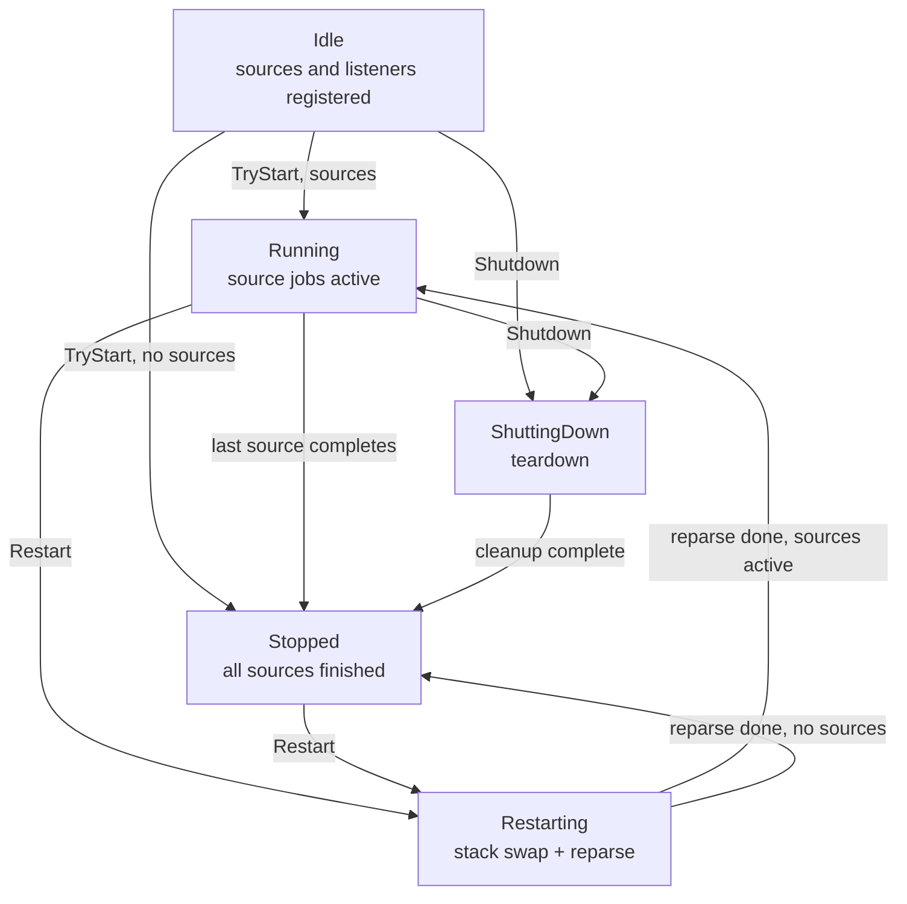

<!-- Copyright © 2026 DevAM. All rights reserved. Licensed under MIT license. See license in the repository root for license information. -->

# NetworkInspector.Sessions

[](https://www.nuget.org/packages/NetworkInspector.Sessions)
[](https://www.nuget.org/packages/NetworkInspector.Sessions)
[](https://dotnet.microsoft.com/download/dotnet/10.0)
[](../LICENSE)

The engine behind a packet-analysis application: a `Session` reads one or more capture sources on background
threads, parses every frame once, and lets any number of listeners (a packet list, a statistics view, a filtered
view, an exporter) pull exactly the packets they need, while the capture is still being read.

## Highlights

- **Built for UIs and services.** Every source and every listener runs on its own thread. Listeners are woken
  with coalesced notifications and pull by packet id; nothing is pushed or copied per listener.
- **Small memory footprint.** The session keeps only a packet-id → frame map, never parsed packets. A read
  re-parses the frame and can recycle a caller-owned packet.
- **Per-listener filters.** Each listener can have its own filter expression; filtered reads prune candidates
  with the presence index before any packet is evaluated.
- **Value caches.** Record selected field values into RAM columns during the first parse, or add a cache later
  and let it fill in the background.
- **Hot stack swap.** `Restart` replaces the protocol stack (new settings, new dissectors) without stopping running
  sources and re-parses every frame. A failing restart leaves the session as it was or fails closed.
- **Predictable errors.** Operational calls are `Try*` methods with a `SessionFailure` (code plus message);
  shutdown is idempotent, waits for a running restart, and collects disposal errors.

## Install

```bash
dotnet add package NetworkInspector.Sessions
dotnet add package NetworkInspector.Protocols
```

`NetworkInspector.Core`, `NetworkInspector.Sources`, and `NetworkInspector.Filter` come in as dependencies.
`NetworkInspector.Protocols` provides the standard dissectors.

## Quick Start

Read a capture in a session and print every packet from a listener thread:

```csharp
using NetworkInspector.Core;
using NetworkInspector.Core.Settings;
using NetworkInspector.Protocols;
using NetworkInspector.Sessions;
using NetworkInspector.Sessions.Listeners;
using NetworkInspector.Sources.Pcapng;

StackBuilder builder = new(new SettingsManager(), new FrameInterfaceRegistry());
builder.RegisterStandardProtocols();
using Stack stack = builder.Build(); // the caller owns the initial stack; declare it before the session

using Session session = new(stack);
PrintingListener listener = new();

// The session owns the source after a successful add and starts it on its own thread.
if (!session.TryAddFrameSource(PcapngSource.Open("capture.pcapng"), out _, out SessionFailure? failure)
    || !session.TryAddListener(listener, out _, out failure)
    || !session.TryStart(out failure))
{
    throw new InvalidOperationException(failure?.Message); // SessionFailure is a record struct
}

session.WaitForCompletion(); // all source threads are done
listener.Done.Wait();        // the listener has seen every packet
session.Shutdown();
Console.WriteLine($"{listener.Count} packets");

sealed class PrintingListener : ISessionListener
{
    private readonly Packet?[] _Buffer = new Packet?[256]; // reused by every read

    public ManualResetEventSlim Done { get; } = new();

    public int Count { get; private set; }

    public string UiName => "printer";

    // Runs on this listener's own thread with the new packet-id window.
    public void OnNewPackets(ISessionReader session, int fromIndex, int toIndexExclusive)
    {
        for (int start = fromIndex; start < toIndexExclusive; start += _Buffer.Length)
        {
            int length = Math.Min(_Buffer.Length, toIndexExclusive - start);
            int read = session.ReadPackets(start, _Buffer.AsSpan(0, length));
            for (int i = 0; i < read; i++)
            {
                if (_Buffer[i] is Packet packet)
                {
                    Console.WriteLine($"#{packet.Id.Value} {packet.Info}");
                }
            }
        }

        Count += toIndexExclusive - fromIndex;
    }

    // Raised after the final OnNewPackets.
    public void OnAllSourcesCompleted(ISessionReader session) => Done.Set();

    // Packet ids restart at 0 after a Restart.
    public void OnStackChanged(ISessionReader session) => Count = 0;
}
```

`WaitForCompletion` waits for the source threads only. Listener callbacks can still be running when it returns;
`OnAllSourcesCompleted` is the reliable "everything delivered" signal. Never call `Shutdown`, `Dispose`, or the
listener's own unsubscribe from inside a callback.

How to embed a session in an application (setup order, threads, recipes for packet lists, filtered lists, value
caches, field observers, restart, shutdown): [`SESSION_GUIDE.md`](SESSION_GUIDE.md).

## Lifecycle



`Shutdown` on a `Stopped` session keeps the phase `Stopped`; listeners receive `OnShuttingDown` without a phase
change.

Typical flow:

1. Create a `Session` with a `Stack`.
2. `TryAddFrameSource` (`Idle` only) and `TryAddListener` (`Idle`, `Running`, or `Stopped`; refused while a restart
   runs or after shutdown).
3. `TryStart(out failure)`: starts the source and listener threads; listeners added later start right away.
4. `WaitForCompletion()`: blocks until all source jobs finish (optional timeout).
5. `Shutdown()` or `Dispose()`: cancels listeners and jobs, disposes jobs and sources.
6. Dispose the initial stack after the session. Stacks created by a `Restart` factory are owned by the session.

## Key Types

| Type | Role |
| --- | --- |
| `Session` | Lifecycle orchestration; packets are re-parsed on read |
| `ISession` | Mutable API (`TryAddFrameSource`, `TryAddListener`, `TryStart`, `Restart`, `Shutdown`) |
| `ISessionReader` | Read view for listeners (`PacketCount`, `TryGetPacket`, `ReadPackets`, `TryReadPackets`) |
| `ISessionListener` | Pull-based notification callbacks (`.Listeners`) |
| `ListenerInfo` / `JobInfo` | Public views of a listener subscription and a job |
| `ValueCacheRequest` | Name-based request for an ingest or runtime value cache |
| `IValueCacheListener` / `ValueCacheInfo` | Value-cache notifications and subscription view (`.ValueCaches`) |
| `FrameSourceInfo` | Public view of a registered frame source (`NetworkInspector.Core.Infos`) |
| `FrameSourceAddOptions` | Per-source `CacheRandomAccess` opt-in |
| `PacketRef` | A `PacketId` paired with its packet, for gapped filtered reads |
| `PacketReadMode` | `All` or `Matching` (apply the listener's filter) |
| `PacketIdLayout` | `Contiguous` or `Gapped` |
| `SessionFailure` | Why an operational `Try*` call returned `false` (`Code`, `Message`) |
| `SessionException` | Caller bugs and hard limits, typed with `SessionErrorCode` |

Unless noted, types are in `NetworkInspector.Sessions`. Stream sources are wrapped in `CachedFrameSource` so their
frames stay readable after `NextFrame`; random-access sources are wrapped only with
`FrameSourceAddOptions.CacheRandomAccess`. The wrap holds the inner `Frame` and does not copy payload bytes.

## Pull-Based Listeners

Producers set atomic notification flags per listener and wake its thread. The listener clears the flags, then
pulls data from `ISessionReader`. Several events between two wake-ups coalesce into one callback. Only `UiName` and
`OnNewPackets` must be implemented; the other callbacks have empty default implementations.

| Flag | Callback |
| --- | --- |
| `StackChanged` | `OnStackChanged`: discard cached protocol state |
| `NewPackets` | `OnNewPackets(session, fromIndex, toIndexExclusive)` |
| `SourceAdded` / `SourceCompleted` | `OnSourcesChanged` |
| `AllSourcesCompleted` | `OnAllSourcesCompleted` |
| `JobAdded` / `JobStatusChanged` / `JobRemoved` | `OnJobsChanged` |
| `PhaseChanged` | `OnPhaseChanged(phase)` |
| `ShuttingDown` | `OnShuttingDown` |

Callbacks of one wake-up run in the order of this table.

## Per-Listener Filters

A listener can register a filter, which then applies to that listener's reads only:

```csharp
// Expression: a bad expression registers nothing and explains why in filterFailure.
session.TryAddListener(listener, "tcp.port == 443", out ListenerInfo? info, out FilterError? filterFailure,
    out SessionFailure? failure);

// A NetworkInspector.Filter.Filter you compiled yourself:
session.TryAddListener(otherListener, myFilter, out info, out failure);
```

An empty or whitespace-only expression compiles to the always-match filter. A filter compiled against another
stack (another session, or this session before a restart) is re-bound to the session stack with `TryDerive`; the
session installs that copy and leaves your instance untouched. A filter that cannot be re-bound throws
`ArgumentException` and registers nothing. `FilterError` is in `NetworkInspector.Filter.Errors`.

## Reading Packets

`ISessionReader` offers three read shapes. All fill a caller-owned buffer; reads allocate only for empty slots,
so reuse the buffer to recycle packets:

```csharp
// 1. Packets only; ids are implied by the start index.
int read = reader.ReadPackets(fromIndex, packetBuffer);           // Span<Packet?>

// 2. Packets with their ids; always contiguous.
PacketRef[] refs = new PacketRef[256];
int readRefs = reader.ReadPackets(startId, refs, out PacketIdLayout layout);

// 3. Listener-bound, optionally filtered (listenerId = ListenerInfo.Id, NetworkInspector.Sessions.Ids).
bool ok = reader.TryReadPackets(listenerId, startId, refs, PacketReadMode.Matching,
    out int count, out PacketIdLayout matchLayout, out FilterError? filterError, out SessionFailure? readFailure);
```

`Matching` scans from `startId` to the current `PacketCount` and keeps only what the filter accepts, so the layout
becomes `Gapped` as soon as an id is skipped. A listener without a filter, or with the always-match filter, takes
the unfiltered fast path. Otherwise the filter's presence-index candidate set prunes the range first.

`TryReadPackets` returns `false` with `count == 0` and `filterError` set when the filter cannot produce a verdict
(poisoned, a packet failed to evaluate, or not re-bound after a stack swap); `All` reads keep working. An unknown
listener id returns `SessionErrorCode.ListenerNotFound`; disabled queries (restart, shutdown) return
`SessionErrorCode.QueriesDisabled`.

The `Matching` scan can run past the window of the current `OnNewPackets` call. Keep a watermark (last returned
id + 1) and start the next read at `max(watermark, fromIndex)`; see [`SESSION_GUIDE.md`](SESSION_GUIDE.md)
section 7.3. Filtering never affects notifications: `OnNewPackets` always reports the unfiltered id window.

## Value Caches

A session can fill a RAM `ValueCache` during the first parse (`SessionOptions.ValueCache`) and add caches at
runtime with `TryAddValueCache`. Value-cache listeners receive `OnNewRows` on their own thread with the same
coalesced window as `OnNewPackets`, then read columns from `ReadOnlyValueCache`. Runtime caches never record on the
parse thread; they fill by skip-parsing frames in the background.

```csharp
using NetworkInspector.Core.ValueCaches;
using NetworkInspector.Sessions;
using NetworkInspector.Sessions.ValueCaches;

sealed class UdpPortCacheListener : IValueCacheListener
{
    private int _RowWatermark;

    public string UiName => "udp src ports";

    public void OnNewRows(ISessionReader session, ReadOnlyValueCache cache, int fromIndex, int toIndexExclusive)
    {
        if (!cache.TryGetSeries<ulong>("udp.srcport", out ReadOnlyValueCacheSeries<ulong> series))
        {
            return;
        }

        ValueCacheSeriesHandle<ulong> handle = series.Handle;
        foreach (ValueCacheRow<ulong> row in handle.EnumerateFrom(_RowWatermark))
        {
            Console.WriteLine($"packet {row.PacketId}: {row.Value}");
        }

        _RowWatermark = handle.Count;
    }
}
```

```csharp
// Runtime cache, filled in the background:
session.TryAddValueCache(new UdpPortCacheListener(), new ValueCacheRequest { FieldNames = ["udp.srcport"] },
    out ValueCacheInfo? cacheInfo, out SessionFailure? cacheFailure);

// Ingest cache, filled during the first parse:
using Session ingestSession = new(stack, new SessionOptions
{
    ValueCache = new ValueCacheRequest { FieldNames = ["udp.srcport"] },
});
```

`session.IngestValueCache` is the read-only view of the ingest cache. Field names are validated when the request
is bound (construction, `TryAddValueCache`, `Restart`). Usage of snapshots, watermarks, find, and SIMD scans:
[`VALUECACHE_GUIDE.md`](../NetworkInspector.Core/VALUECACHE_GUIDE.md).

## Restart (Stack Swap)

`Restart(stackFactory)` replaces the protocol stack without stopping running sources:

```csharp
session.Restart(registry =>
{
    // Use the registry passed in and a new SettingsManager: the session owns the new stack.
    StackBuilder newBuilder = new(new SettingsManager(), registry);
    newBuilder.RegisterStandardProtocols();
    return newBuilder.Build();
});
```

- Source threads wait at a parse gate while existing frames are re-parsed in id order (0 … N−1). `Restart`
  blocks until every frame is re-parsed; run it off a UI thread.
- Listeners receive `OnStackChanged` followed by `OnNewPackets` from 0.
- Every listener filter is re-bound with `TryDerive` (fresh state, empty match cache). A filter that cannot be
  re-bound is dropped, and that listener's `Matching` reads report the bind error instead of returning everything.
- The new ingest value cache and packet index are built before anything changes. A field the new stack lacks
  throws `ValueCacheUnknownField` and leaves the session as it was.
- A frame that cannot be re-read throws `FrameUnavailable` and leaves queries disabled (fail closed).
- The factory must not call `Shutdown`, `Restart`, `Dispose`, or `TryStart`.

## TryUnsubscribe vs Shutdown

`TryUnsubscribe(job)` ends one job:

- **Source job:** stops reading; the source stays available for random access until `Shutdown`.
- **Listener job:** cancels the slot, calls `OnUnsubscribed`, and removes it.
- **User job:** cancels its `CancellationToken`.

`Shutdown()` cancels all sources, listeners, and jobs, waits for them, and disposes everything.

`FrameSourceInfo.Stop()` and `ListenerInfo.Unsubscribe()` delegate to `TryUnsubscribe`. It returns `false` with a
`SessionFailure` for foreign jobs, terminal jobs, or during shutdown; a source that has not started can be removed
in `Idle`. `TryRemoveJob` removes a terminal job (Completed, Cancelled, Failed) and throws for a running one.

## Error Handling

- Operational `Try*` refusals return `false` and a `SessionFailure`.
- Null arguments throw `ArgumentNullException`. Other caller bugs and hard limits (empty UI names, a disposed
  session, exhausted ids) throw `SessionException` with a `SessionErrorCode`.
- `QueriesEnabled` is false while a restart rewrites packets, after a restart failed closed, and after shutdown.
  A failed read means "no row" only when it is true.
- `Shutdown()` throws `AggregateException` when disposing one or more items fails. `Dispose()` stores those errors
  in `Session.ShutdownErrors` instead of throwing.

## Thread Safety

All public `Session` methods are thread-safe. First parses are serialized under one lock across source threads
and get dense ids; re-parsing an announced id takes no lock. Counters use `Interlocked`, phase and flags use
`Volatile`. Listeners and value caches may be added in `Idle`, `Running`, or `Stopped`; user jobs until `Shutdown`
starts; frame sources only in `Idle`. `Shutdown` waits for a running restart, and later `Shutdown` callers wait for
the first one.

Each listener filter is single-threaded: `Matching` reads and restart re-binding share that listener's filter gate,
`All` reads do not take it.

## Learn More

- [Session guide](SESSION_GUIDE.md): embedding a session step by step
- [Filter](../NetworkInspector.Filter/README.md) · [Sources](../NetworkInspector.Sources/README.md) ·
  [Core](../NetworkInspector.Core/README.md) · [Root overview](../README.md)
- [GitHub repository](https://github.com/DevAM-Tools/NetworkInspector) ·
  [Issue tracker](https://github.com/DevAM-Tools/NetworkInspector/issues)

## License

[MIT License](../LICENSE)
