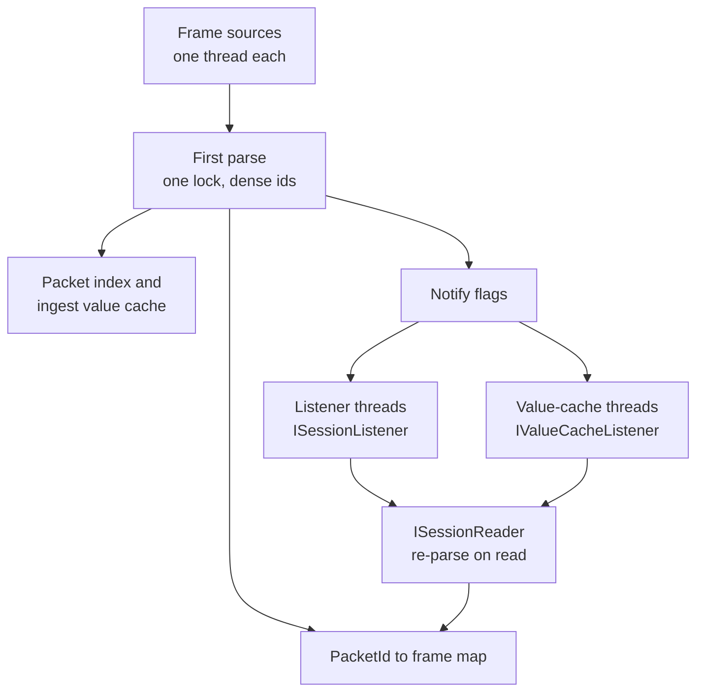
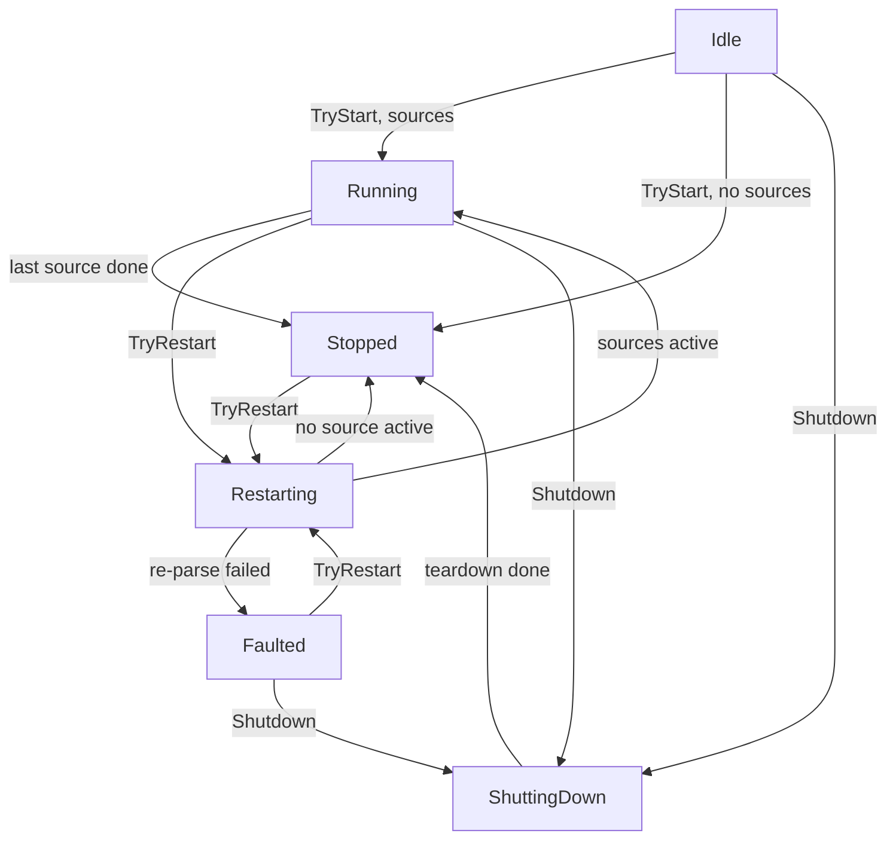
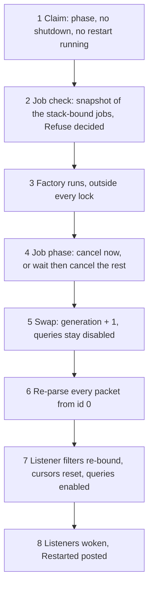

<!-- Copyright © 2026 DevAM. All rights reserved. Licensed under MIT license. See license in the repository root for license information. -->

# NetworkInspector Sessions — Guide

**Audience:** developers who embed a `Session` into their own application (a UI, a service, a CLI) and need to
know what it does, in which order to call it, and what to watch for.

**Scope:** the public API of `NetworkInspector.Sessions`. Package overview: [`README.md`](README.md). Filter
language: [`FILTER_GUIDE.md`](../NetworkInspector.Filter/FILTER_GUIDE.md). Columnar values:
[`VALUECACHE_GUIDE.md`](../NetworkInspector.Core/VALUECACHE_GUIDE.md).

The listener, reader, job, and restart code of sections 2, 8.1, 8.2, 8.4, 8.5 and 9 is compiled and run by
[`SessionGuideSamplesTests.cs`](../NetworkInspector.Sessions.Tests/SessionGuideSamplesTests.cs) (with a test
source instead of a capture file).

---

## 1. What a session is

A `Session` turns one or more frame sources into a growing, numbered packet set that many consumers can read
at the same time.

- Each **frame source** runs on its own thread. Every frame is parsed once ("first parse") under one shared
  lock, gets the next dense `PacketId` (0, 1, 2, …), and is announced.
- The session **never keeps parsed packets**. It keeps only the mapping `PacketId → (source, FrameId)`. Every
  read re-parses the frame from the source. Stream sources are wrapped in `CachedFrameSource` so their frames
  stay readable.
- **Consumers pull.** A listener is woken with coalesced flags and then reads what it needs through
  `ISessionReader`. Nothing is pushed, nothing is copied per listener.
- **Restart** swaps the protocol stack and re-parses every frame, without stopping running sources. It is a
  **generation change** the session publishes (section 6): every stack-bound thing you hold is of the old generation.



## 2. Quick start

```csharp
using NetworkInspector.Core;
using NetworkInspector.Protocols;
using NetworkInspector.Sessions;
using NetworkInspector.Sessions.Listeners;
using NetworkInspector.Settings;
using NetworkInspector.Sources.Pcapng;

StackBuilder builder = new(new SettingsManager(), new FrameInterfaceRegistry());
builder.RegisterStandardProtocols();
using Stack stack = builder.Build();                       // the caller owns the initial stack

using Session session = new(stack);
session.TryAddFrameSource(PcapngSource.Open("capture.pcapng"), out _, out _);   // the session owns sources
session.TryAddListener(new CountingListener(), out ListenerInfo? info, out SessionFailure? failure);
session.TryStart(out _);
session.WaitForCompletion();                               // all sources finished
session.Shutdown();                                        // or Dispose()

sealed class CountingListener : ISessionListener
{
    private int _Seen;

    public string UiName => "counter";

    // Runs on this listener's own thread. fromIndex/toIndexExclusive are packet ids.
    public void OnNewPackets(ISessionReader session, int fromIndex, int toIndexExclusive)
        => _Seen += toIndexExclusive - fromIndex;
}
```

## 3. Setup order

1. Build the `Stack` (`StackBuilder` + protocol registration). The session does **not** dispose this stack.
2. Create the `Session(stack, options)`. `SessionOptions` decides once whether the first parse fills the
   packet index (`IndexPackets`, default on) and an ingest value cache (`ValueCache`, `ValueCacheListener`).
   Field names of the ingest request are validated here; a bad name throws `SessionException`.
3. Add frame sources with `TryAddFrameSource` (only in `Idle`). From now on the session owns them.
4. Add listeners, value caches, and jobs. This is allowed before or after start.
5. `TryStart` starts every source thread and every pending listener thread.
6. Read through `ISessionReader` from your listener callbacks or from any other thread.
7. `TryRestart(factory)` whenever the stack must change (section 9).
8. `Shutdown()` or `Dispose()` cancels everything and disposes the sources and the stacks the session owns.

## 4. Lifecycle and phases



`Stopped` is reached twice: when all sources finished (the session is still fully usable) and after
`Shutdown` (reads are disabled). `QueriesEnabled` tells the two apart. `Shutdown` on a `Stopped` session keeps
the phase `Stopped`; listeners receive `OnShuttingDown` without a phase change.

`Faulted` is the state after a restart that failed once the stack was swapped (a frame could not be re-read):
`session.Fault` keeps the failure, reads and new work are refused with `SessionFaulted` (the message carries the
original fault text), and ingest stays parked, because a resumed source would allocate ids the half-rewritten state
cannot hold. The two ways out are another `TryRestart` (it re-parses from id 0, so packet ids stay dense and the parked
sources resume without a gap) and `Shutdown`.

| Operation | Allowed | Refused (`false` + `SessionFailure`) |
|-----------|---------|--------------------------------------|
| `TryAddFrameSource` | `Idle` | any other phase: `InvalidPhase` |
| `TryAddListener`, `TryAddValueCache` | `Idle`, `Running`, `Stopped` | shutting down: `InvalidPhase`; restart running, after shutdown: `QueriesDisabled` |
| `TryAddJob` | every phase until shutdown | once `Shutdown` started (also after it): `InvalidPhase`; stack-bound job while a restart is pending: `RestartPending` |
| `TryStart` | `Idle`, once (of several concurrent callers exactly one wins) | otherwise: `InvalidPhase` |
| `TryRestart` | `Running`, `Stopped`, `Faulted` | every expected refusal is a result (section 9) |
| `TryUnsubscribe` | every phase except `ShuttingDown` | `ShuttingDown`: `InvalidPhase`; foreign job: `JobNotFound`; finished job: `JobTerminal` |
| reads (`TryGetPacket`, …) | while `QueriesEnabled` | restart running, after shutdown: `QueriesDisabled` |
| every `Try*` except `TryRestart`, `Shutdown` while `Faulted` | — | `SessionFaulted` |

A listener or value cache added after packets exist is notified at once for the whole existing range.

## 5. Threads and callbacks

- Every listener and every runtime value cache has its **own thread** (`session-job-{id}-{UiName}`). All its
  callbacks run there, one at a time. Different listeners run in parallel.
- **Do not block** in a callback for long: it delays only that listener, but its flags keep coalescing.
- A UI must **marshal** to its UI thread inside the callback (for example `Dispatcher.UIThread.Post`). Hand
  over plain data (ids, counts, strings), not packets from a recycled buffer (section 7.4).
- `ISessionReader` is thread-safe. Reads may run on any thread, also outside callbacks. The lists from `GetJobs()`,
  `GetListeners()`, `GetFrameSources()`, and `GetValueCaches()` are read-only views of an immutable snapshot: a later
  change gives a new list, the one you hold stays valid and cannot be modified.
- **Never call these from a callback or a `Restarted` handler:** `Shutdown`, `Dispose` (they wait for the listener and handler threads, including
  the calling one), and `TryUnsubscribe` / `ListenerInfo.Unsubscribe` / `ValueCacheInfo.Unsubscribe` of the
  **own** listener (it waits for its own thread). Unsubscribing a different listener is fine.
- `TryRestart` blocks until every frame is re-parsed (and, under `WaitThenCancel`, until the jobs ended or the bound
  elapsed). Call it from a worker thread or an `Independent` session job, never from a UI thread, and never from a
  stack-bound job (it is refused with `RestartFromJob`: it would wait for itself).
- Every handler of `session.Restarted` has its **own thread** too (an `Independent` job named `restart-event`,
  thread `session-job-{id}-restart-event`). The handler runs there, one notification at a time; a handler that
  blocks delays only its own notifications. Never remove your own handler from inside it: `-=` throws
  `InvalidOperationException` and `TryUnsubscribe` of its job answers `InvalidPhase`, because the removal would wait for
  the calling thread; remove it from another thread.
- An exception thrown by a callback fails only that listener's job (`JobStatus.Failed`,
  `JobInfo.FailureException`). The listener then gets `OnUnsubscribed`; the session and the other listeners
  continue.

## 6. The pull model

Producers set flags on each listener slot and wake its thread. The thread takes all pending flags at once and
calls the matching callbacks in this order:

| Flag | Callback | Meaning |
|------|----------|---------|
| `StackChanged` | `OnStackChanged` | Restart finished; drop cached field state; ids restart at 0 |
| `NewPackets` | `OnNewPackets(session, from, to)` | ids `from … to-1` are announced and readable |
| `SourceAdded`, `SourceCompleted` | `OnSourcesChanged` | read `GetFrameSources()` |
| `AllSourcesCompleted` | `OnAllSourcesCompleted` | no more packets expected (until a restart) |
| `JobAdded`, `JobStatusChanged`, `JobRemoved` | `OnJobsChanged` | read `GetJobs()` |
| `PhaseChanged` | `OnPhaseChanged(phase)` | lifecycle phase moved |
| `ShuttingDown` | `OnShuttingDown` | last callback before `OnUnsubscribed` |

Many events between two wake-ups become **one** callback: a fast listener sees small windows, a slow listener
one large window. The windows of `OnNewPackets` are gap-free and ascending for a listener; after
`OnStackChanged` they start at 0 again.

Notifications are never filtered. A listener with a filter still gets every window and applies its filter
when it pulls (section 8.2).

### Generation: how to notice a restart without a callback

The **generation** is the number of the stack that serves reads now: 0 for the stack you constructed the session
with, plus one for every swap. `session.Generation` is one volatile read; `session.CurrentStack` returns the
current `Stack` together with its generation as one immutable `StackView` (taken from one load, so the two
never disagree), and `view.IsCurrent(session)` compares. A view stays what it was: after a restart the view you
took before still names the old stack and the old number, nothing is re-pointed behind your back.

Field ids are dense counters **per stack**: id 17 names another field after a restart. Keep the **names**
(`"ip.ttl"`), resolve them to ids on `view.Stack`, keep the view next to the ids, and compare it before you use
them again. The generation moves at the swap, before reads are enabled, so polling `Generation` and
`QueriesEnabled` tells the three states apart:

| `Generation` / `QueriesEnabled` | State |
|---------------------------------|-------|
| N / true | stable: everything derived from N is valid |
| N + 1 / false | a restart is in progress (swapped, re-parsing): reads are refused |
| N + 1 / true | done: reads serve N + 1; rebuild whatever you derived from N |

Two restarts that a slow listener sees in one wake-up show as a jump of two (`OnStackChanged` is called once):
compare for inequality, never assume "old + 1". **One read call parses on one generation**: a restart that starts
during `ReadPackets` leaves the remaining slots `null` instead of mixing two stacks in one buffer.

## 7. Reading packets

### 7.1 Read shapes

| Call | Returns | Use |
|------|---------|-----|
| `TryGetPacket(id, out packet, out failure)` | one packet with a field tree | detail view of one row |
| `TryGetPacket(id, recycle, out packet, out failure)` | same, reusing `recycle` | detail view without allocation |
| `TryGetPacket(id, in options, view, recycle, out packet, out failure)` | one packet parsed with your observers, under the session's lease | field observers (section 8.4) |
| `TryGetFrame(id, out frame, out failure)` | the raw frame, no parse | hex view |
| `ReadPackets(from, Span<Packet?>)` | contiguous packets | simple list fill |
| `ReadPackets(from, Span<PacketRef>, out layout)` | `(id, packet)` pairs, contiguous | list fill that keeps ids |
| `TryVisitPackets(from, to, in options, view, visitor, out count, out failure)` | each packet of a range, parsed with **your** options, handed to your visitor on the calling thread | exports and statistics over a few fields (section 8.6), tree-free |
| `TryReadPackets(listenerId, from, dest, mode, …)` | `All`: like above; `Matching`: only packets the listener's filter accepts | filtered list |

Every read except `TryVisitPackets` re-parses with a full field tree (`FieldTreeMode.Build`); `TryVisitPackets` parses with the options you give it. Reads never allocate buffers; the caller
owns `dest`. Reads stop at the `PacketCount` they saw when they started.

### 7.2 Failures

| Code | Meaning | What to do |
|------|---------|------------|
| `QueriesDisabled` | restart running, or shutdown finished | wait for `OnStackChanged`; check `QueriesEnabled` |
| `SessionFaulted` | a restart failed after the swap; the message carries the original fault | show it; `TryRestart` again or `Shutdown` |
| `OptionsStackMismatch` | parse options built for another generation (section 8.4) | take `CurrentStack` again and rebuild the options |
| `PacketNotFound` | id invalid or not announced yet | read only ids below `PacketCount` |
| `FrameUnavailable` | the source cannot re-read that frame | show the row as unavailable |
| `ListenerNotFound` | `TryReadPackets` with an unknown `ListenerId` | use the id from `ListenerInfo` |

`ReadPackets` returns 0 while queries are disabled. A `PacketRef.Packet` or `Packet?` slot is `null` when that
id could not be re-read. A `false` read, a `null` slot, or a 0 count means "no row" **only** while
`QueriesEnabled` is true; otherwise a restart interrupted the read and a fresh window follows. A range read parses on
one stack generation (section 6): the packets of one call never come from two stacks.

### 7.3 Filtered pulls

`TryReadPackets(…, PacketReadMode.Matching, out count, out layout, out FilterError? filterFailure,
out SessionFailure? sessionFailure)` scans from `startId` up to the current `PacketCount`, skips
non-matching ids (`layout` becomes `Gapped`), and stops when `dest` is full. Exactly one of the two failures is
set when it returns `false`:

- `filterFailure`: the filter is poisoned, a packet failed to evaluate, or the filter could not be re-bound
  after a restart. `All` reads keep working.
- `sessionFailure`: unknown listener or queries disabled.

The scan may run past the `toIndexExclusive` of the current notification, because `PacketCount` keeps growing.
Keep a watermark (`last returned id + 1`) and start the next read at `max(watermark, fromIndex)`; that returns
every match exactly once. Re-scanned ids are answered from the filter's match cache, so stateful filters
(`flank`) do not fail with `OutOfOrder`.

### 7.4 Recycling

- A non-null `recycle` packet (or a non-null slot in the destination buffer) is overwritten in place. Do not
  pass a packet that another thread, or an earlier `Field` / `MutField` of yours, still reads.
- Keep two kinds of buffers apart: a **list buffer** that each pull recycles, and a **detail packet** for the
  selected row that only the detail view recycles.
- Packets returned by the session are yours; the session keeps no reference.
- A recycled packet of an earlier stack is **rebound** to the current one when both share the frame registry (every stack
  of one session does): after a restart the same buffer comes back with the same instances, parsed on the new stack, and a
  restart costs no allocation per slot. A packet of another session (another registry) is refused and a fresh packet is
  allocated instead.

## 8. Recipes

### 8.1 Packet list with columns (generation-aware)

Columns are declared by **name**; the ids are resolved on the current stack and re-resolved when the generation
moved (section 6). The listener keeps the `StackView` its ids belong to next to them:

```csharp
sealed class ColumnListener : ISessionListener
{
    private readonly string[] _ColumnNames = ["ip.ttl", "udp.dstport"];   // names survive a restart, ids do not
    private readonly PacketRef[] _Buffer = new PacketRef[256];            // recycled by every pull
    private StackView _View;                                              // the generation the ids below belong to
    private FieldId?[] _ColumnIds = [];

    // Touched only on this listener's thread; a UI copies rows out by posting them.
    internal List<(int Id, ulong?[] Cells)> Rows { get; } = [];

    public string UiName => "packet list";

    public void OnNewPackets(ISessionReader session, int fromIndex, int toIndexExclusive)
    {
        _EnsureColumns(session);                                          // re-resolve when the generation moved
        for (int start = fromIndex; start < toIndexExclusive; start += _Buffer.Length)
        {
            int filled = session.ReadPackets(start, _Buffer, out PacketIdLayout _);
            for (int i = 0; i < filled && _Buffer[i].Id.Value < toIndexExclusive; i++)
            {
                Packet? packet = _Buffer[i].Packet;                       // null: a restart overtook this call
                if (packet is not null)
                {
                    // Build the row from the field tree here, then post the row data (not the packet) to the UI thread.
                    Rows.Add((packet.Id.Value, _ReadCells(packet)));
                }
            }
        }
    }

    public void OnStackChanged(ISessionReader session)
    {
        Rows.Clear();                                                     // the next OnNewPackets starts at 0
        _EnsureColumns(session);
    }

    private void _EnsureColumns(ISessionReader session)
    {
        StackView current = session.CurrentStack;                         // stack and generation from one load
        if (_ColumnIds.Length != 0 && _View.Generation == current.Generation)
        {
            return;
        }

        _View = current;
        _ColumnIds = [.. _ColumnNames.Select(name => current.Stack.GetFieldId(name))];   // null: the new stack lacks it
    }

    private ulong?[] _ReadCells(Packet packet)
    {
        ulong?[] cells = new ulong?[_ColumnIds.Length];
        for (int column = 0; column < cells.Length; column++)
        {
            if (_ColumnIds[column] is FieldId id
                && packet.TryGetFieldValue(id, out FieldValue value, materialize: true)
                && value.Data.TryGetAsU64(out ulong cell))
            {
                cells[column] = cell;
            }
        }

        return cells;
    }
}
```

For a virtualized list, keep only `PacketCount` in the view model and read the visible range on demand with
`ReadPackets(firstVisible, buffer, …)`; that costs one re-parse per visible row and no memory per packet.

### 8.2 Filtered list

Register the listener with an expression; the session compiles it against its current stack:

```csharp
session.TryAddListener(listener, "tcp.port == 443", out ListenerInfo? info, out FilterError? filterFailure, out SessionFailure? failure);
session.TryAddListener(listener, myFilter, out info, out failure);   // NetworkInspector.Filter.Filter
session.TryAddListener(listener, out info, out failure);             // no filter
```

A filter object you compiled yourself may come from another stack (another session, or this session before a
restart): the session installs a re-bound copy and leaves your instance untouched; when it cannot be re-bound
the call throws `ArgumentException`. Each filter is single-threaded; never share one between listeners. Pull
with `PacketReadMode.Matching` and the watermark rule of section 7.3.

### 8.3 Value caches (columns)

| | Ingest cache | Runtime cache |
|---|---|---|
| Declared | `SessionOptions.ValueCache` | `TryAddValueCache(listener, request, …)` |
| Filled by | the first parse (source threads) | its own thread, re-parsing frames from id 0 |
| Listener | optional `SessionOptions.ValueCacheListener` | required |
| Restart | rebuilt before anything changes; a missing field fails the restart | rebuilt on its thread; a missing field fails only that cache |

`OnNewRows(session, cache, from, to)` uses packet-id windows like `OnNewPackets`. Index columns with the
series `Count`, not with packet ids. A read refused during a restart only pauses the fill; after
`OnStackChanged` the window starts at 0 with the rebuilt cache. Prefer value caches for list columns and
charts: they read values once and do not build field trees.

### 8.4 One packet with field observers

`TryGetPacket(id, in options, view, recycle, …)` parses one packet with your `ParseOptions` (observers, a
first-protocol override, the field-tree mode) **under the session's own stack lease**, and refuses options that were
built for another generation. Take a `StackView`, resolve ids on `view.Stack`, build the options from them, and pass the
same view as `builtFor`:

```csharp
StackView view = session.CurrentStack;                              // stack and generation from one load
FieldId ipTtlFieldId = view.Stack.GetFieldId("ip.ttl")!.Value;      // resolve by name on exactly this stack
ParseObserver[] observers =
[
    new ParseObserver { Observer = myObserver, Watch = FieldWatch.Only(view.Stack, ipTtlFieldId) },
];
ParseOptions options = new(FieldTreeMode.Skip, observers: observers);
if (session.TryGetPacket(id, in options, view, recycle: null, out Packet? packet, out SessionFailure? failure))
{
    // myObserver saw BeginPacket and every watched field.
}
else if (failure!.Value.Code == SessionErrorCode.OptionsStackMismatch)
{
    // A restart happened since you took the view: take CurrentStack again and rebuild the options.
}
```

One integer compare against the generation of the stack the call leases decides, so a restart between building the
options and the call cannot feed your observer ids of the wrong stack, and cannot dispose the stack under the parse.
A `Cache` or `Index` of another stack inside the options is answered with the same code, not an exception. The
raw `session.Stack` is for lookups (names, ids, infos); parsing with it directly holds no lease and validates nothing.

Rules: only parse ids below `PacketCount`; `FieldWatch.Only` and a `FilterObserver` hold field ids of one stack, so
rebuild them when the generation moved; one observer instance per parse at a time. Other refusals:
`QueriesDisabled` while a restart runs, `SessionFaulted`, `PacketNotFound`, `FrameUnavailable`.

### 8.5 Background work

`TryAddJob(uiName, description, work, …)` runs `work(cancellationToken)` on its own thread and shows it in
`GetJobs()` (exports, statistics). It is allowed until shutdown starts; `Shutdown` cancels it, waits for it (within
the shutdown time budget), and disposes it, so the work must observe its token. It must not call `Shutdown`,
`TryRestart`, or `WaitForCompletion` once shutdown has begun (`Shutdown` waits for the job while it holds the lock
those calls need). `TryUnsubscribe(job)` cancels it early; `TryRemoveJob` removes a finished job from the list and
refuses a pending or running one (`false` with `JobStillRunning`).

**Binding.** A job declares whether it depends on the stack:

```csharp
session.TryAddJob("export rows", "rows to out.csv", JobStackBinding.StackBound,
    context => Export(context.Stack, context.Session, context.CancellationToken), out JobInfo? job, out _);
```

- `StackBound` (the default of the overload without a binding) reads session data or holds field ids, filters, caches,
  or an exporter catalog. A restart cancels it, waits for it, or is refused while it runs, as the caller of
  `TryRestart` chose. `JobInfo.Generation` is the generation it was added in; the `JobContext` hands it the
  `StackView` it started in.
- `Independent` (generation -1) reads no session data: a restart never touches it. Sources, listeners, value caches,
  and restart-event subscriptions are independent jobs.

**End reason.** `JobInfo.EndReason` says why a job ended, and it is stored before the terminal status, so a snapshot
that sees `Cancelled` also sees why: `Completed`, `UserCancelled`, `StackReplaced` (a restart ended it; re-create it
on the new stack), `SessionShutdown`, or `Failed` (see `FailureException`). The first reason wins, except that a job
that fails is always `Failed`.

### 8.6 Export a range (any shape, optional filter)

`SessionExport.TryStart` runs an export as a stack-bound job by the pull principle: the job thread pulls the range in windows
of 4 096 ids through `TryVisitPackets`, parses only what the exporter and the filter demand (a selected-fields export never
builds a field tree), commits matching packets with `OnPacket`, and finishes the exporter in every outcome. Progress:
`VisitedCount` and `ExportedCount` on the returned `SessionExportJob`, with the range (`FromId`, `ToIdExclusive`); a UI computes
the rate from two samples.

```csharp
if (SessionExport.TryStart(
        session,
        "export udp",
        view => CsvExporter.CreateBuilder()
            .ToFile(path)
            .WithContent(SelectedFields(view.Stack, "ip.src", "udp.length"))
            .Build(),
        0,
        session.PacketCount,
        "udp.length >= 56",
        out SessionExportJob? export,
        out SessionFailure? failure,
        out FilterError? filterError))
{
    export.Job.Join();                                  // or poll export.VisitedCount for a progress display
    exportedCount = export.ExportedCount;
    (export.Exporter as IDisposable)?.Dispose();        // the job finished the exporter; the caller releases it
}
else if (filterError is not null)
{
    Console.Error.WriteLine("filter: " + filterError.Message);
}
else
{
    Console.Error.WriteLine("export refused: " + failure!.Value.Message);
}
```

`SelectedFields` stands for `FieldSelection.TryCreate(view.Stack, …)` wrapped in an `ExportContent` (exporter guide §14); the
factory receives the `StackView` so that the field names are resolved on the stack that parses the export.

How it decides what to parse:

- The **filter** is compiled in its tree-free form first (a `FilterObserver`, demand `Packet`). An expression that needs the field
  tree (a subtree scope, a second `flank()`, the presence of a protocol without a container field) falls back to the tree filter;
  this is the rule of `ni export`, so a job and the command line accept and judge the same expressions. A syntax error is returned
  as `filterError` and nothing is created.
- The **exporter** states its demand (`IParseDemandSource`); an exporter without it demands the field tree. The job combines both
  into one `ParsePlan` (filter first, so its verdict exists when the exporter's packet is committed).
- A **restart** ends the job (`JobEndReason.StackReplaced`, status `Cancelled`); the exporter is finished, so the output holds the
  packets committed so far. Start a new export on the new stack. Cancellation is noticed after every packet, not only between windows.
- `SessionExportJob.Failure` says why a job ended early: `FrameUnavailable` (a frame could not be re-read; the message names the
  packet), `FilterFailed` (the filter could not decide a packet; the export stops instead of keeping or dropping data silently),
  or `OptionsStackMismatch` (the stack was replaced between `TryStart` and the start of the job thread).
- `TryStart` itself refuses a range past `PacketCount` with `PacketNotFound` (the message names the range and the count) and a plan
  conflict with `InvalidArgument`; an exporter it already created is finished and disposed then.

**Why a job and not a listener.** A listener is woken when packets arrive and reads what accumulated; an export has a fixed range
and ends. The job thread parses; ingest only publishes ids and never waits for it, and no ingest parse carries the export's
observer. The same pull is available without a job: `TryVisitPackets(from, to, in options, view, visitor, …)` calls
`visitor.Visit(packet)` for each id in order on your thread, parsing with your options (the options rules of section 8.4), under
**one** stack lease for the call. Read a large range in windows so that a retired stack is released soon after a restart. The packet
passed to `Visit` is recycled for the next id: copy what you keep. Return `false` from `Visit` to stop after that packet.

## 9. Restart (re-parse with a new stack)

Use `TryRestart` when the protocol settings or the protocol set change but the captured frames stay. Sources keep
running; no frame is lost. Every expected refusal is a result (`false` plus a `SessionFailure`), never an exception;
only caller bugs throw (null arguments, a disposed session, a factory that returns nothing or a stack of another
registry) and the factory's own exceptions propagate unchanged.

```csharp
RestartOptions options = new()
{
    JobPolicy = RestartJobPolicy.WaitThenCancel,                // default: CancelNow
    JobWaitTimeout = TimeSpan.FromSeconds(10),                  // 1 s .. 1 h, default 30 s
};
if (!session.TryRestart(
        registry =>
        {
            StackBuilder builder = new(newSettings, registry);  // must use the registry passed in
            builder.RegisterStandardProtocols();
            return builder.Build();
        },
        options,
        out RestartReport? report,
        out SessionFailure? failure))
{
    ShowError(failure.Value.Message);                           // JobsRunning, InvalidPhase, RestartInProgress, the fault, …
    return;
}

ShowInfo($"Restarted to generation {report.Generation}; cancelled {report.JobsCancelled.Count} jobs.");
```

What happens, in order:



1. **Claim.** The phase must be `Running`, `Stopped` or `Faulted`, no shutdown started, no other restart running.
2. **Job check.** The stack-bound jobs that are pending or running are snapshotted. Under `Refuse` any of them
   refuses the restart (`JobsRunning`, the message names them) and nothing changed. From here on no stack-bound job can
   be added (`RestartPending`), so the snapshot stays complete; independent jobs are still accepted.
3. **Factory.** The factory runs while every job is still untouched: a factory that throws costs no job, because ending
   a job is the only step that cannot be undone and it comes after the step that most often fails. The ingest value
   cache and the packet index are then built on the new stack before anything changes. A request field the new stack does
   not define refuses the restart (`ValueCacheUnknownField` / `ValueCacheInvalidFieldName` / `ValueCacheInvalidRequest`),
   the session is as it was, and the unused stack is disposed.
4. **Job phase.** See the policy table below.
5. **Swap.** Phase `Restarting`, source threads park before their next parse, queries are disabled, the stack is
   swapped (the session owns it from now on) and `Generation` becomes N + 1. The replaced stack, when the session created it,
   is retired: disposed at once if no session read is parsing on it, otherwise by the last such read when it ends. The restart
   never waits for those reads and never keeps the old stack until `Shutdown`.
6. **Re-parse.** Every frame is re-parsed in id order with its original id.
7. **Rebind.** Listener filters are re-bound to the new stack; a filter that cannot be re-bound makes that listener's
   `Matching` pulls fail with its `FilterError` (the listener is named in `report.FiltersNotRebound`). Queries are enabled.
8. **Wake.** Every listener gets `OnStackChanged` followed by `OnNewPackets(0, PacketCount)`, the `Restarted` handlers
   get their notification, sources resume and continue with the next id.

| `RestartOptions.JobPolicy` | What happens to stack-bound jobs | What you lose |
|----------------------------|----------------------------------|---------------|
| `CancelNow` (default) | cancelled at once (`StackReplaced`), after the factory returned | their unfinished work; the restart does not wait |
| `WaitThenCancel` | the call waits up to `JobWaitTimeout` for them, then cancels the rest | time: the call blocks; jobs that outlast the bound lose their unfinished work |
| `Refuse` | nothing; the restart is refused while they run (`JobsRunning`) | the restart, until the jobs end |

`JobWaitTimeout` is one budget for all jobs, 1 s to 1 h (default 30 s); a value outside the range is refused with
`RestartOptionOutOfRange` and a message that names the range. `RestartOptions.WaitCancellation` cuts the wait short:
the rest is cancelled at once and the restart **continues** (it does not abort). A shutdown that starts during the
wait ends it and abandons the restart (`InvalidPhase`); the shutdown ends the jobs with `SessionShutdown`.

**The report.** `RestartReport` says what the restart did: the new `Generation`, `ReparsedPackets`, `JobsWaitedFor` (ended in
time), `JobsCancelled`, `FiltersNotRebound` (listeners that lost their filter), and the two durations. A host shows it
instead of reconstructing it from job lists.

**The event.** `session.Restarted += notification => …` delivers a `RestartNotification` (generation, `Succeeded`, the
report or the fault) for every restart that got past the swap. Each handler has its own queue and thread, so handlers
never influence each other: a blocked handler delays only itself, a throwing handler ends only its own subscription (its
job is `Failed` with the exception) and the others and the session go on. Notifications are never merged and arrive in
generation order; when the handler runs, the session already reads the generation of its notification with reads
enabled. A restart refused before any change raises nothing. Do not remove a handler from inside itself; `Shutdown`
delivers what is queued within its time budget and reports the rest.

| Refusal (`false`) | Cause | State afterwards |
|-------------------|-------|------------------|
| `InvalidPhase` | `Idle`, shutting down, or abandoned because shutdown started | unchanged (abandoned: jobs left to the shutdown) |
| `RestartInProgress` | another restart runs | unchanged |
| `RestartOptionOutOfRange` | a restart option outside its range | unchanged |
| `JobsRunning` | `Refuse` and stack-bound jobs running | unchanged |
| `RestartFromJob` | called from the thread of a running stack-bound job | unchanged |
| `ValueCacheUnknownField`, `…InvalidFieldName`, `…InvalidRequest` | the new stack cannot satisfy the ingest request | unchanged, every job keeps running; the new stack is disposed |
| `FrameUnavailable` | a frame cannot be re-read | **`Faulted`**, the failure is `session.Fault` |

Everything that depends only on the new stack (the ingest request above) is decided before the job phase, so a refused
restart never costs a running job. A job that was already ended (`CancelNow`, or a wait that timed out) stays ended when
a later step abandons or faults the restart (shutdown started during the wait, `FrameUnavailable`); the job list shows
`StackReplaced`, no report is returned.

**Faulted.** After the `FrameUnavailable` fault the phase is `Faulted`, `session.Fault` keeps the failure, every read and
every `Try*` except `TryRestart` and `Shutdown` is refused with `SessionFaulted`, and ingest stays parked. Call
`TryRestart` again (fix the cause first, for example reopen the source) or `Shutdown`. A successful restart from `Faulted`
re-parses from id 0, clears the fault, resumes ingest without a gap in the ids, and wakes listeners once.

While a restart runs, `QueriesEnabled` is false and reads are refused: show a busy state and wait for
`OnStackChanged` (or poll the generation, section 6). Restart and shutdown never run at the same time; a shutdown waits
for a running restart.

## 10. Unsubscribe, shutdown, ownership

| Owner | Object | Released by |
|-------|--------|-------------|
| caller | the stack passed to the constructor | the caller, after the session |
| session | every added frame source | `Shutdown` |
| session | every stack built by a restart factory | the restart that replaces it (once its last in-flight read ended) or `Shutdown` |
| session | the thread and job of every `Restarted` handler | `-=` on the event, `TryUnsubscribe` of its job, or `Shutdown` (it delivers what is queued first) |
| caller | listener objects, filters, observers | the caller |

- `TryUnsubscribe(job)`: a source stops reading (its frames stay readable until `Shutdown`); a listener or value
  cache gets `OnUnsubscribed` and is removed; a user job is cancelled. Convenience: `FrameSourceInfo.Stop()`,
  `ListenerInfo.Unsubscribe()`, `ValueCacheInfo.Unsubscribe()`.
- `Shutdown(timeout)`: cancels sources and user jobs, waits for them (one shared time budget for both; `null` waits
  forever), drains and unsubscribes every listener (status `SessionEnded`; a flag raised before the cancellation is
  still delivered), disables reads, disposes jobs, sources and owned stacks (a replaced stack that a read still uses is waited for within
  the same time budget, then disposed anyway). A listener, value cache, or job added
  while the shutdown starts is either part of it or refused with `InvalidPhase`.
  It is idempotent and safe from several threads. Disposal errors are collected into one
  `AggregateException`; `Dispose()` stores them in `ShutdownErrors` instead of throwing.
- A source that ignores cancellation and returns after `Shutdown(timeout)` ends `Cancelled`; its late frame is
  not parsed.

## 11. Error model

- Expected refusals return `false` with a `SessionFailure(Code, Message)`; see the tables above. `SessionFailure` is a
  struct: the out parameter is `SessionFailure?`, read `failure.Value.Code` after a `false`. This includes every
  refusal of `TryRestart`.
- Caller bugs and hard limits throw `SessionException(Code)`: empty `UiName`, a disposed session, exhausted
  ids (`JobIdExhausted`, `ListenerIdExhausted`, `ValueCacheIdExhausted`, `PacketIdExhausted`), invalid or
  unknown value-cache names (`ValueCacheInvalidFieldName`, `ValueCacheUnknownField`), and a value-cache request that
  cannot be built (`ValueCacheInvalidRequest`: empty, a field that records nothing, a duplicate series, `ChunkShift`
  outside 4…20). Null arguments throw `ArgumentNullException`.
- The codes a restart and its neighbours added, and where they are returned: `RestartPending` (`TryAddJob`, stack-bound job
  while a restart is pending), `RestartFromJob`, `JobsRunning`, `RestartInProgress`, `RestartOptionOutOfRange`
  (`TryRestart`), `SessionFaulted` (every `Try*` and read while `Faulted`), `OptionsStackMismatch`
  (`TryGetPacket` with options, `TryVisitPackets`), `InvalidArgument` (`SessionExport.TryStart`: conflicting parse demands), `FilterFailed`
  (`SessionExportJob.Failure`: the filter could not decide a packet). `TryRestart` throws only for caller bugs: a null argument, a disposed session, a factory
  that returns `null` (`InvalidOperationException`) or a stack of another registry (`ArgumentException`); the factory's own
  exception propagates unchanged.
- Listener, value-cache, and `Restarted` handler exceptions fail only their own job.

## 12. Performance

- **No copies per listener:** flags plus pulls; a slow listener costs only its own re-parses.
- **Recycle** packets in your buffers; the read loops reuse them and allocate nothing, also across a restart.
- A read call takes **one** stack lease for the whole call (two interlocked operations), not one per chunk or per packet;
  the generation rides on the lease's holder, so noticing a restart costs the read path nothing.
- **Columns from value caches**, details from `TryGetPacket`: field trees only for what the user looks at.
- **Exports parse on the job thread with the plan's options** (`SessionExport`, `TryVisitPackets`): an export of a few fields costs a fraction of a field-tree read, because no tree is built.
- `SessionOptions.RedissectOnly` turns the packet index off when nobody needs presence pruning; filtered pulls
  then evaluate every packet.
- A `Matching` pull prunes with the packet index first and re-parses only candidates. Ids whose verdict the
  listener filter already cached as a non-match are skipped without a parse. For a stateless filter without scopes
  and without `matches`, an unknown id is first parsed without a field tree, with an equivalent observer that only
  rules packets out; that parse opens the lazy containers of the watched fields' protocols, as a field-tree lookup
  would, and the field-tree filter still decides every returned packet. When most packets match, this
  pre-check switches itself off for a while, so match-all filters do not pay for it.
- Memory: stream sources are cached (`CachedFrameSource` holds every frame for the session's lifetime). For
  long live captures plan for that growth, or use a random-access source.

## 13. Limits

- Packet, job, listener, and value-cache ids are `0 … ArrayIndexIdRange.MaxValue`; the next allocation throws
  the matching `…IdExhausted`.
- One first parse at a time (shared lock); re-parses of announced ids run in parallel.
- `RestartOptions.JobWaitTimeout`: 1 s … 1 h, default 30 s. It bounds how long `TryRestart` may block waiting for
  stack-bound jobs; a value outside the range is refused with `RestartOptionOutOfRange` and a message that names the
  range. Open by default (a local tool, the caller chooses to wait); a host that takes the value from an end user or a
  remote peer should cap it itself.
- A `Restarted` subscription costs one idle thread and one queue entry per restart the handler has not consumed
  (restarts are rare and serialized; `Shutdown` drains within its budget and reports the rest).

## 14. Checklist

- [ ] Initial stack disposed by you, after the session.
- [ ] Callbacks marshal to the UI thread and never call `Shutdown`, `Dispose`, or their own `Unsubscribe`.
- [ ] `TryRestart` runs off the UI thread (never from a stack-bound job); its result is shown, not caught; the UI shows a
      busy state until `OnStackChanged`.
- [ ] Derived state (ids, filters, caches, exporter catalogs) keeps the `StackView` it was built on and is rebuilt when
      the generation moved; never assume "old + 1".
- [ ] Jobs declare their binding: `StackBound` if they read session data, `Independent` only if they do not; a job ended
      with `StackReplaced` is re-created on the new stack.
- [ ] Parse options with observers are built from a `StackView` and passed with it (`TryGetPacket` with options, `TryVisitPackets`).
- [ ] Exports use `SessionExport` or `TryVisitPackets`, not `ReadPackets` (which builds a field tree for every packet).
- [ ] A `Faulted` session is answered with `TryRestart` or `Shutdown`.
- [ ] `OnStackChanged` clears rows, filters-derived state, `FieldWatch` / observer objects bound to the old stack.
- [ ] Reads treat `false` / `null` / 0 as "no row" only while `QueriesEnabled`.
- [ ] Filtered pulls use a watermark; one filter per listener.
- [ ] List buffer and detail packet are separate recycle targets.
