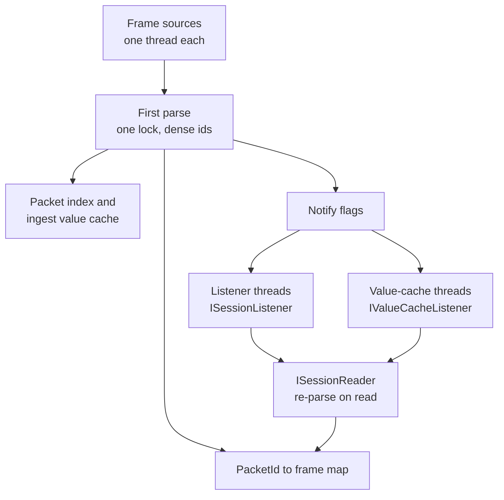
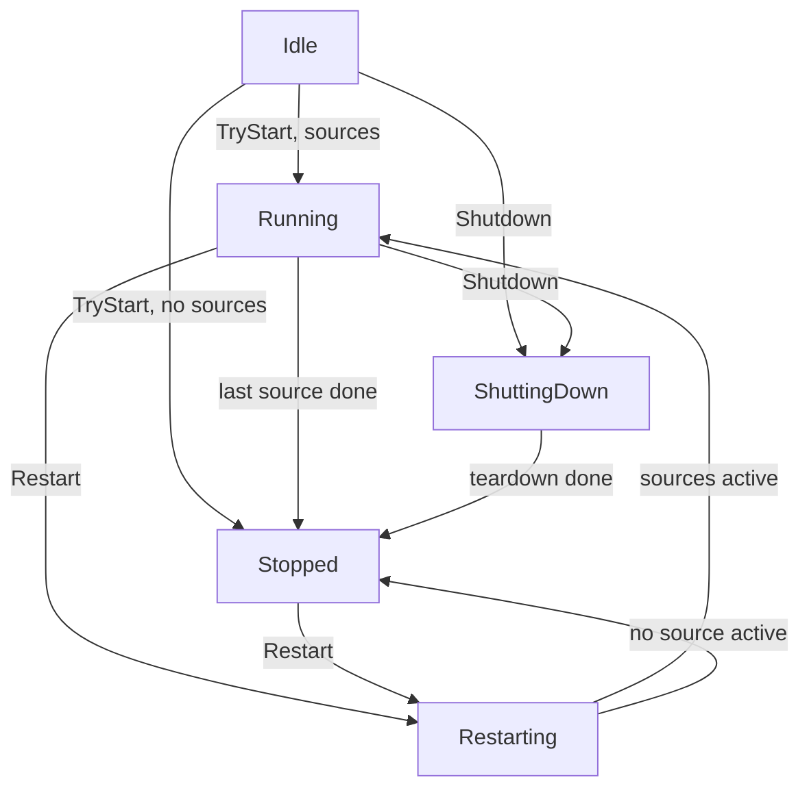

<!-- Copyright © 2026 DevAM. All rights reserved. Licensed under MIT license. See license in the repository root for license information. -->

# NetworkInspector Sessions — Guide

**Audience:** developers who embed a `Session` into their own application (a UI, a service, a CLI) and need to
know what it does, in which order to call it, and what to watch for.

**Scope:** the public API of `NetworkInspector.Sessions`. Package overview: [`README.md`](README.md). Filter
language: [`FILTER_GUIDE.md`](../NetworkInspector.Filter/FILTER_GUIDE.md). Columnar values:
[`VALUECACHE_GUIDE.md`](../NetworkInspector.Core/VALUECACHE_GUIDE.md).

The listener and reader code of sections 2, 8.1, 8.2 and 8.4 is compiled and run by
[`SessionGuideSamplesTests.cs`](../NetworkInspector.Sessions.Tests/SessionGuideSamplesTests.cs) (with a test
source instead of a capture file).

---

## 1. What a session is

A `Session` turns one or more frame sources into a growing, numbered packet set that many consumers can read
at the same time.

- Each **frame source** runs on its own thread. Every frame is parsed once ("first parse") under one shared
  lock, gets the next dense `PacketId` (0, 1, 2, …), and is announced.
- The session **never keeps parsed packets**. It keeps only the mapping `PacketId → (source, FrameId)`. Every
  read re-parses the frame from the source. Stream sources are wrapped in `CachedFrameSource` so their frames
  stay readable.
- **Consumers pull.** A listener is woken with coalesced flags and then reads what it needs through
  `ISessionReader`. Nothing is pushed, nothing is copied per listener.
- **Restart** swaps the protocol stack and re-parses every frame, without stopping running sources.



## 2. Quick start

```csharp
using NetworkInspector.Core;
using NetworkInspector.Core.Settings;
using NetworkInspector.Protocols;
using NetworkInspector.Sessions;
using NetworkInspector.Sessions.Listeners;
using NetworkInspector.Sources.Pcapng;

StackBuilder builder = new(new SettingsManager(), new FrameInterfaceRegistry());
builder.RegisterStandardProtocols();
using Stack stack = builder.Build();                       // the caller owns the initial stack

using Session session = new(stack);
session.TryAddFrameSource(PcapngSource.Open("capture.pcapng"), out _, out _);   // the session owns sources
session.TryAddListener(new CountingListener(), out ListenerInfo? info, out SessionFailure? failure);
session.TryStart(out _);
session.WaitForCompletion();                               // all sources finished
session.Shutdown();                                        // or Dispose()

sealed class CountingListener : ISessionListener
{
    private int _Seen;

    public string UiName => "counter";

    // Runs on this listener's own thread. fromIndex/toIndexExclusive are packet ids.
    public void OnNewPackets(ISessionReader session, int fromIndex, int toIndexExclusive)
        => _Seen += toIndexExclusive - fromIndex;
}
```

## 3. Setup order

1. Build the `Stack` (`StackBuilder` + protocol registration). The session does **not** dispose this stack.
2. Create the `Session(stack, options)`. `SessionOptions` decides once whether the first parse fills the
   packet index (`IndexPackets`, default on) and an ingest value cache (`ValueCache`, `ValueCacheListener`).
   Field names of the ingest request are validated here; a bad name throws `SessionException`.
3. Add frame sources with `TryAddFrameSource` (only in `Idle`). From now on the session owns them.
4. Add listeners, value caches, and jobs. This is allowed before or after start.
5. `TryStart` starts every source thread and every pending listener thread.
6. Read through `ISessionReader` from your listener callbacks or from any other thread.
7. `Restart(factory)` whenever the stack must change (section 9).
8. `Shutdown()` or `Dispose()` cancels everything and disposes the sources and the stacks the session owns.

## 4. Lifecycle and phases



`Stopped` is reached twice: when all sources finished (the session is still fully usable) and after
`Shutdown` (reads are disabled). `QueriesEnabled` tells the two apart. `Shutdown` on a `Stopped` session keeps
the phase `Stopped`; listeners receive `OnShuttingDown` without a phase change.

| Operation | Allowed | Refused (`false` + `SessionFailure`) |
|-----------|---------|--------------------------------------|
| `TryAddFrameSource` | `Idle` | any other phase: `InvalidPhase` |
| `TryAddListener`, `TryAddValueCache` | `Idle`, `Running`, `Stopped` | shutting down: `InvalidPhase`; restart running or failed, after shutdown: `QueriesDisabled` |
| `TryAddJob` | every phase until shutdown | once `Shutdown` started (also after it): `InvalidPhase` |
| `TryStart` | `Idle`, once | otherwise: `InvalidPhase` |
| `Restart` | `Running`, `Stopped` | throws (section 9) |
| `TryUnsubscribe` | every phase except `ShuttingDown` | `ShuttingDown`: `InvalidPhase`; foreign job: `JobNotFound`; finished job: `JobTerminal` |
| reads (`TryGetPacket`, …) | while `QueriesEnabled` | restart running or failed, after shutdown: `QueriesDisabled` |

A listener or value cache added after packets exist is notified at once for the whole existing range.

## 5. Threads and callbacks

- Every listener and every runtime value cache has its **own thread** (`session-job-{id}-{UiName}`). All its
  callbacks run there, one at a time. Different listeners run in parallel.
- **Do not block** in a callback for long: it delays only that listener, but its flags keep coalescing.
- A UI must **marshal** to its UI thread inside the callback (for example `Dispatcher.UIThread.Post`). Hand
  over plain data (ids, counts, strings), not packets from a recycled buffer (section 7.4).
- `ISessionReader` is thread-safe. Reads may run on any thread, also outside callbacks.
- **Never call these from a callback:** `Shutdown`, `Dispose` (they wait for the listener threads, including
  the calling one), and `TryUnsubscribe` / `ListenerInfo.Unsubscribe` / `ValueCacheInfo.Unsubscribe` of the
  **own** listener (it waits for its own thread). Unsubscribing a different listener is fine.
- `Restart` blocks until every frame is re-parsed. Call it from a worker thread (or a session job,
  `TryAddJob`), never from a UI thread.
- An exception thrown by a callback fails only that listener's job (`JobStatus.Failed`,
  `JobInfo.FailureException`). The listener then gets `OnUnsubscribed`; the session and the other listeners
  continue.

## 6. The pull model

Producers set flags on each listener slot and wake its thread. The thread takes all pending flags at once and
calls the matching callbacks in this order:

| Flag | Callback | Meaning |
|------|----------|---------|
| `StackChanged` | `OnStackChanged` | Restart finished; drop cached field state; ids restart at 0 |
| `NewPackets` | `OnNewPackets(session, from, to)` | ids `from … to-1` are announced and readable |
| `SourceAdded`, `SourceCompleted` | `OnSourcesChanged` | read `GetFrameSources()` |
| `AllSourcesCompleted` | `OnAllSourcesCompleted` | no more packets expected (until a restart) |
| `JobAdded`, `JobStatusChanged`, `JobRemoved` | `OnJobsChanged` | read `GetJobs()` |
| `PhaseChanged` | `OnPhaseChanged(phase)` | lifecycle phase moved |
| `ShuttingDown` | `OnShuttingDown` | last callback before `OnUnsubscribed` |

Many events between two wake-ups become **one** callback: a fast listener sees small windows, a slow listener
one large window. The windows of `OnNewPackets` are gap-free and ascending for a listener; after
`OnStackChanged` they start at 0 again.

Notifications are never filtered. A listener with a filter still gets every window and applies its filter
when it pulls (section 8.2).

## 7. Reading packets

### 7.1 Read shapes

| Call | Returns | Use |
|------|---------|-----|
| `TryGetPacket(id, out packet, out failure)` | one packet with a field tree | detail view of one row |
| `TryGetPacket(id, recycle, out packet, out failure)` | same, reusing `recycle` | detail view without allocation |
| `TryGetFrame(id, out frame, out failure)` | the raw frame, no parse | hex view, own parse (section 8.4) |
| `ReadPackets(from, Span<Packet?>)` | contiguous packets | simple list fill |
| `ReadPackets(from, Span<PacketRef>, out layout)` | `(id, packet)` pairs, contiguous | list fill that keeps ids |
| `TryReadPackets(listenerId, from, dest, mode, …)` | `All`: like above; `Matching`: only packets the listener's filter accepts | filtered list |

Every read re-parses with a full field tree (`FieldTreeMode.Build`). Reads never allocate buffers; the caller
owns `dest`. Reads stop at the `PacketCount` they saw when they started.

### 7.2 Failures

| Code | Meaning | What to do |
|------|---------|------------|
| `QueriesDisabled` | restart running or failed, or shutdown finished | wait for `OnStackChanged`; check `QueriesEnabled` |
| `PacketNotFound` | id invalid or not announced yet | read only ids below `PacketCount` |
| `FrameUnavailable` | the source cannot re-read that frame | show the row as unavailable |
| `ListenerNotFound` | `TryReadPackets` with an unknown `ListenerId` | use the id from `ListenerInfo` |

`ReadPackets` returns 0 while queries are disabled. A `PacketRef.Packet` or `Packet?` slot is `null` when that
id could not be re-read. A `false` read, a `null` slot, or a 0 count means "no row" **only** while
`QueriesEnabled` is true; otherwise a restart interrupted the read and a fresh window follows.

### 7.3 Filtered pulls

`TryReadPackets(…, PacketReadMode.Matching, out count, out layout, out FilterError? filterFailure,
out SessionFailure? sessionFailure)` scans from `startId` up to the current `PacketCount`, skips
non-matching ids (`layout` becomes `Gapped`), and stops when `dest` is full. Exactly one of the two failures is
set when it returns `false`:

- `filterFailure`: the filter is poisoned, a packet failed to evaluate, or the filter could not be re-bound
  after a restart. `All` reads keep working.
- `sessionFailure`: unknown listener or queries disabled.

The scan may run past the `toIndexExclusive` of the current notification, because `PacketCount` keeps growing.
Keep a watermark (`last returned id + 1`) and start the next read at `max(watermark, fromIndex)`; that returns
every match exactly once. Re-scanned ids are answered from the filter's match cache, so stateful filters
(`flank`) do not fail with `OutOfOrder`.

### 7.4 Recycling

- A non-null `recycle` packet (or a non-null slot in the destination buffer) is overwritten in place. Do not
  pass a packet that another thread, or an earlier `Field` / `MutField` of yours, still reads.
- Keep two kinds of buffers apart: a **list buffer** that each pull recycles, and a **detail packet** for the
  selected row that only the detail view recycles.
- Packets returned by the session are yours; the session keeps no reference.

## 8. Recipes

### 8.1 Packet list with field trees

```csharp
sealed class PacketListListener : ISessionListener
{
    private readonly PacketRef[] _Buffer = new PacketRef[256];   // recycled by every pull

    // Touched only on this listener's thread; a UI copies rows out by posting them.
    internal List<(int Id, Timestamp Time)> Rows { get; } = [];

    public string UiName => "packet list";

    public void OnNewPackets(ISessionReader session, int fromIndex, int toIndexExclusive)
    {
        for (int start = fromIndex; start < toIndexExclusive; start += _Buffer.Length)
        {
            int filled = session.ReadPackets(start, _Buffer, out PacketIdLayout _);
            for (int i = 0; i < filled && _Buffer[i].Id.Value < toIndexExclusive; i++)
            {
                Packet? packet = _Buffer[i].Packet;
                if (packet is not null)
                {
                    // Build the row (time, addresses, protocol, info) from the field tree here,
                    // then post the row data (not the packet) to the UI thread.
                    Rows.Add((packet.Id.Value, packet.Timestamp));
                }
            }
        }
    }

    public void OnStackChanged(ISessionReader session)
    {
        // The next OnNewPackets starts at 0 with the re-parsed packets.
        Rows.Clear();
    }
}
```

For a virtualized list, keep only `PacketCount` in the view model and read the visible range on demand with
`ReadPackets(firstVisible, buffer, …)`; that costs one re-parse per visible row and no memory per packet.

### 8.2 Filtered list

Register the listener with an expression; the session compiles it against its current stack:

```csharp
session.TryAddListener(listener, "tcp.port == 443", out ListenerInfo? info, out FilterError? filterFailure, out SessionFailure? failure);
session.TryAddListener(listener, myFilter, out info, out failure);   // NetworkInspector.Filter.Filter
session.TryAddListener(listener, out info, out failure);             // no filter
```

A filter object you compiled yourself may come from another stack (another session, or this session before a
restart): the session installs a re-bound copy and leaves your instance untouched; when it cannot be re-bound
the call throws `ArgumentException`. Each filter is single-threaded; never share one between listeners. Pull
with `PacketReadMode.Matching` and the watermark rule of section 7.3.

### 8.3 Value caches (columns)

| | Ingest cache | Runtime cache |
|---|---|---|
| Declared | `SessionOptions.ValueCache` | `TryAddValueCache(listener, request, …)` |
| Filled by | the first parse (source threads) | its own thread, re-parsing frames from id 0 |
| Listener | optional `SessionOptions.ValueCacheListener` | required |
| Restart | rebuilt before anything changes; a missing field fails the restart | rebuilt on its thread; a missing field fails only that cache |

`OnNewRows(session, cache, from, to)` uses packet-id windows like `OnNewPackets`. Index columns with the
series `Count`, not with packet ids. A read refused during a restart only pauses the fill; after
`OnStackChanged` the window starts at 0 with the rebuilt cache. Prefer value caches for list columns and
charts: they read values once and do not build field trees.

### 8.4 One packet with field observers

The session has no read overload that takes `ParseOptions`. Read the frame and parse it yourself with the
session's stack; observers are passed through `ParseOptions.Observers`:

```csharp
if (session.TryGetFrame(id, out Frame frame, out SessionFailure? failure))
{
    Stack stack = session.Stack;                               // read once; a restart may swap it
    ParseObserver[] observers =
    [
        new ParseObserver { Observer = myObserver, Watch = FieldWatch.Only(stack, ipTtlFieldId) },
    ];
    ParseOptions options = new(FieldTreeMode.Skip, observers: observers);
    if (Packet.TryParse(id, stack, frame, in options, out Packet? packet, out ParseFailure parseFailure))
    {
        // myObserver saw BeginPacket and every watched field.
    }
}
```

Rules: only parse ids below `PacketCount` (announced ids may be re-parsed on any thread); `FieldWatch.Only`
and a `FilterObserver` hold field ids of one stack, so rebuild them in `OnStackChanged`; one observer instance
per parse at a time.

### 8.5 Background work

`TryAddJob(uiName, description, work, …)` runs `work(cancellationToken)` on its own thread and shows it in
`GetJobs()` (exports, statistics). It is allowed until shutdown starts; `Shutdown` cancels it.
`TryUnsubscribe(job)` cancels it early; `TryRemoveJob` removes a finished job from the list.

## 9. Restart (re-parse with a new stack)

Use `Restart` when the protocol settings or the protocol set change but the captured frames stay. Sources keep
running; no frame is lost.

```csharp
session.Restart(registry =>
{
    StackBuilder builder = new(newSettings, registry);   // must use the registry passed in
    builder.RegisterStandardProtocols();
    return builder.Build();
});
```

What happens, in order:

1. The ingest value cache and the packet index are built on the new stack. A request field the new stack does
   not define throws `ValueCacheUnknownField` / `ValueCacheInvalidFieldName` here, **before anything
   changed**; the session disposes the unused stack.
2. Phase `Restarting`, source threads park before their next parse, queries are disabled.
3. The stack is swapped (the session owns it from now on and disposes a stack it created earlier).
4. Every frame is re-parsed in id order with its original id.
5. Listener filters are re-bound to the new stack; a filter that cannot be re-bound makes that listener's
   `Matching` pulls fail with its `FilterError`.
6. Queries are enabled, cursors reset, and every listener gets `OnStackChanged` followed by
   `OnNewPackets(0, PacketCount)`. Sources resume and continue with the next id.

| Failure | Thrown | State afterwards |
|---------|--------|------------------|
| wrong phase, shutdown started | `SessionException(InvalidPhase)` | unchanged |
| second restart at the same time | `InvalidOperationException` | unchanged |
| factory used another registry | `ArgumentException` | unchanged |
| ingest request not satisfiable | `SessionException(ValueCacheUnknownField / …InvalidFieldName)` | unchanged |
| a frame cannot be re-read | `SessionException(FrameUnavailable)` | queries stay disabled; only `Shutdown` remains |

While a restart runs, `QueriesEnabled` is false and reads are refused: show a busy state and wait for
`OnStackChanged`. Restart and shutdown never run at the same time; a shutdown waits for a running restart.

## 10. Unsubscribe, shutdown, ownership

| Owner | Object | Released by |
|-------|--------|-------------|
| caller | the stack passed to the constructor | the caller, after the session |
| session | every added frame source | `Shutdown` |
| session | every stack built by a restart factory | the next restart or `Shutdown` |
| caller | listener objects, filters, observers | the caller |

- `TryUnsubscribe(job)`: a source stops reading (its frames stay readable until `Shutdown`); a listener or value
  cache gets `OnUnsubscribed` and is removed; a user job is cancelled. Convenience: `FrameSourceInfo.Stop()`,
  `ListenerInfo.Unsubscribe()`, `ValueCacheInfo.Unsubscribe()`.
- `Shutdown(timeout)`: cancels sources, waits for them (one shared time budget; `null` waits forever), drains
  and unsubscribes every listener (status `SessionEnded`), disables reads, disposes sources and owned stacks.
  It is idempotent and safe from several threads. Disposal errors are collected into one
  `AggregateException`; `Dispose()` stores them in `ShutdownErrors` instead of throwing.
- A source that ignores cancellation and returns after `Shutdown(timeout)` ends `Cancelled`; its late frame is
  not parsed.

## 11. Error model

- Expected refusals return `false` with a `SessionFailure(Code, Message)`; see the tables above.
- Caller bugs and hard limits throw `SessionException(Code)`: empty `UiName`, a disposed session, exhausted
  ids (`JobIdExhausted`, `ListenerIdExhausted`, `ValueCacheIdExhausted`, `PacketIdExhausted`), invalid or
  unknown value-cache names. Null arguments throw `ArgumentNullException`.
- Listener and value-cache callback exceptions fail only their own job.

## 12. Performance

- **No copies per listener:** flags plus pulls; a slow listener costs only its own re-parses.
- **Recycle** packets in your buffers; the read loops reuse them and allocate nothing.
- **Columns from value caches**, details from `TryGetPacket`: field trees only for what the user looks at.
- `SessionOptions.RedissectOnly` turns the packet index off when nobody needs presence pruning; filtered pulls
  then evaluate every packet.
- A `Matching` pull prunes with the packet index first and re-parses only candidates. Ids whose verdict the
  listener filter already cached as a non-match are skipped without a parse. For a stateless filter without scopes
  and without `matches`, an unknown id is first parsed without a field tree, with an equivalent observer that only
  rules packets out; that parse opens the lazy containers of the watched fields' protocols, as a field-tree lookup
  would, and the field-tree filter still decides every returned packet. When most packets match, this
  pre-check switches itself off for a while, so match-all filters do not pay for it.
- Memory: stream sources are cached (`CachedFrameSource` holds every frame for the session's lifetime). For
  long live captures plan for that growth, or use a random-access source.

## 13. Limits

- Packet, job, listener, and value-cache ids are `0 … ArrayIndexIdRange.MaxValue`; the next allocation throws
  the matching `…IdExhausted`.
- One first parse at a time (shared lock); re-parses of announced ids run in parallel.

## 14. Checklist

- [ ] Initial stack disposed by you, after the session.
- [ ] Callbacks marshal to the UI thread and never call `Shutdown`, `Dispose`, or their own `Unsubscribe`.
- [ ] `Restart` runs off the UI thread; the UI shows a busy state until `OnStackChanged`.
- [ ] `OnStackChanged` clears rows, filters-derived state, `FieldWatch` / observer objects bound to the old stack.
- [ ] Reads treat `false` / `null` / 0 as "no row" only while `QueriesEnabled`.
- [ ] Filtered pulls use a watermark; one filter per listener.
- [ ] List buffer and detail packet are separate recycle targets.
