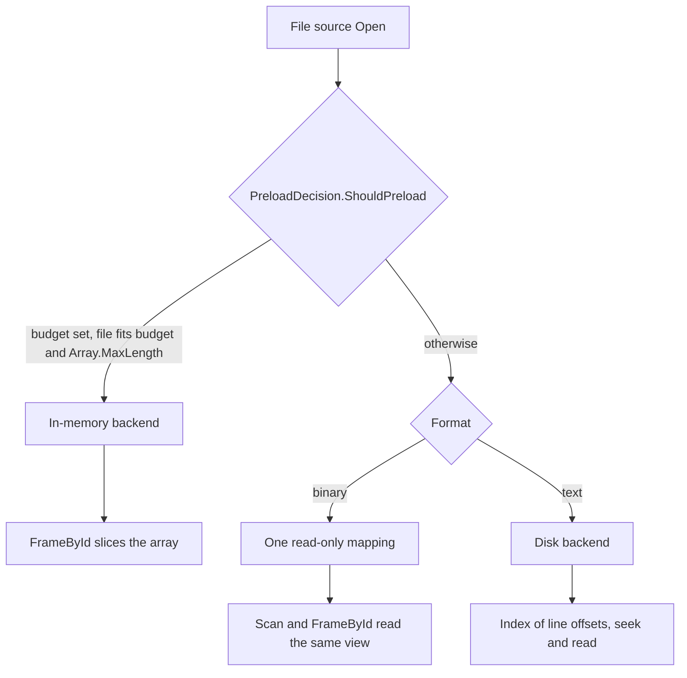

<!-- Copyright © 2026 DevAM. Licensed under the MIT License. See LICENSE in the repository root. -->

# Source Implementation Guide

> Canonical reference for implementing, reviewing, and maintaining frame sources.
> Derived from the established patterns in `PcapngSource`, `BlfSource`, `AscSource`,
> `RandomFrameSource`, and `CachedFrameSource`.

---

## Table of Contents

1. [Architecture Overview](#1-architecture-overview)
2. [Source Taxonomy](#2-source-taxonomy)
3. [Interface Hierarchy](#3-interface-hierarchy)
4. [File & Namespace Organisation](#4-file--namespace-organisation)
5. [Naming Conventions](#5-naming-conventions)
6. [Options Classes](#6-options-classes)
7. [Factory Methods](#7-factory-methods)
8. [Lifecycle](#8-lifecycle)
9. [Interface Registration](#9-interface-registration)
10. [Frame Creation](#10-frame-creation)
11. [Memory Management & Backends](#11-memory-management--backends)
12. [Error Tolerance](#12-error-tolerance)
13. [Thread Safety](#13-thread-safety)
14. [Scan Modes (Full vs Lazy)](#14-scan-modes-full-vs-lazy)
15. [Dispose Pattern](#15-dispose-pattern)
16. [Checklist for New Sources](#16-checklist-for-new-sources)

---

## 1. Architecture Overview

All frame sources follow a **pull-based model**: the consumer calls `NextFrame()` in a loop
until `null` is returned. Random-access sources additionally expose `FrameById()` for
concurrent, thread-safe re-reads.

```
  ┌─────────────────────────────────────────────────────────┐
  │                    Consumer Thread                       │
  │                                                         │
  │  source = XxxSource.Open("file.xxx", options);          │
  │  source.Start(sourceId, registry);                      │
  │                                                         │
  │  while (source.NextFrame() is { } frame)                │
  │      process(frame);                                    │
  │                                                         │
  │  // Concurrent random access from other threads:        │
  │  Frame? f = source.FrameById(id);                       │
  │                                                         │
  │  source.Dispose();                                      │
  └─────────────────────────────────────────────────────────┘
```

---

## 2. Source Taxonomy

Every file format is represented by **two** source classes:

| Variant | Base Interface | Purpose |
|---------|----------------|---------|
| **`XxxSource`** | `IRandomAccessFrameSource` | Random-access file reader. Builds an in-memory frame index. |
| **`XxxStreamSource`** | `IFrameSource` | Forward-only stream reader. No index, minimal memory. |

Both variants implement `IErrorTolerantFrameSource` when the format can encounter parse errors.

Special-purpose sources:

| Source | Purpose |
|--------|---------|
| `RandomFrameSource` | Deterministic synthetic frame generation (testing, benchmarks) |
| `CachedFrameSource` | Decorator that adds `IRandomAccessFrameSource`; holds each inner `Frame`; optional RA inner |

---

## 3. Interface Hierarchy

```
IFrameSource : IDisposable
├── UiName, Description, EstimatedFrameCount, IsRunning
├── Start(FrameSourceId, FrameInterfaceRegistry)
└── NextFrame() → Frame?

IRandomAccessFrameSource : IFrameSource
└── FrameById(FrameId) → Frame?          // Thread-safe

IFrameSourceStatistics
├── ReadFrameCount, SkippedFrameCount, ErrorCount, HasErrors

IErrorTolerantFrameSource : IFrameSourceStatistics
├── ErrorTolerance { get; set; }
└── event FrameSkipped

IFileSourceOptions
├── ScanMode, PreloadBudget, ErrorTolerance
```

---

## 4. File & Namespace Organisation

```
NetworkInspector.Sources/
  SourceType/                              ← One folder per format
    SourceTypeSource.cs                    ← Random-access implementation
    SourceTypeStreamSource.cs              ← Stream implementation
    SourceTypeSourceOptions.cs             ← Options record
    SourceTypeFrameIndex.cs                ← Frame index (if applicable)
    SourceTypeScanner.cs                   ← Incremental parser/scanner
    Format/                                ← Sub-namespace for format types
      Constants.cs
      HeaderTypes.cs
      Blocks/                              ← Block/record parsers
```

**Namespace:** `NetworkInspector.Sources.<FormatName>`
**Sub-namespace for format internals:** `NetworkInspector.Sources.<FormatName>.Format`

---

## 5. Naming Conventions

| Element | Pattern | Examples |
|---------|---------|----------|
| Random-access source | `XxxSource` | `PcapngSource`, `BlfSource`, `AscSource` |
| Stream source | `XxxStreamSource` | `PcapngStreamSource`, `BlfStreamSource` |
| Options | `XxxSourceOptions` | `PcapngSourceOptions`, `BlfSourceOptions` |
| Frame index | `XxxFrameIndex` or `FrameIndex` | `BlfFrameIndex`, `FrameIndex` |
| Scanner | `XxxIncrementalScanner` | `BlfIncrementalScanner`, `IncrementalScanner` |
| Display name property | `UiName` | — |
| Factory: file | `Open(path, options?)` | — |
| Factory: bytes | `FromData(byte[], uiName, options?)` | — |
| Factory: stream | `FromStream(stream, uiName, leaveOpen?, options?)` — the file source's options class | — |
| Factory: text | `FromText(string, uiName?, options?)` | — |

---

## 6. Options Classes

### 6.1 Interface

All file-based options classes **must** implement `IFileSourceOptions`:

```csharp
public interface IFileSourceOptions
{
    ScanMode ScanMode { get; }
    long? PreloadBudget { get; }
    ErrorToleranceMode ErrorTolerance { get; }
}
```

### 6.2 Immutability

**All option properties must use `init` setters** (not `set`).
Options are configuration snapshots — they must not be mutated after creation.
This prevents accidental state changes to a running source through a shared reference.

```csharp
// ✅ CORRECT — immutable after construction
public sealed class XxxSourceOptions : IFileSourceOptions
{
    public ScanMode ScanMode { get; init; } = ScanMode.Lazy;
    public long? PreloadBudget { get; init; } = 256 * 1024 * 1024; // 256 MiB
    public ErrorToleranceMode ErrorTolerance { get; init; } = ErrorToleranceMode.Tolerant;
    public string? UiName  { get; init; }
}

// ❌ WRONG — mutable options can be changed after Open()
public ScanMode ScanMode { get; set; }
```

### 6.3 Standard Defaults

| Property | Default | Rationale |
|----------|---------|-----------|
| `ScanMode` | `ScanMode.Lazy` | Fast open, index built on demand |
| `PreloadBudget` | `256 * 1024 * 1024` (256 MiB) | Files ≤ budget kept in memory |
| `ErrorTolerance` | `ErrorToleranceMode.Tolerant` | Skip errors, don't abort |
| `UiName` | `null` (derived from filename) | Override display name |
| `FrameSlabSize` | `0` (one array per frame) | Opt-in slabs for sequential reads (§11.4); validated in the `init` accessor |
| `TimestampTimeZone` (formats with zone-less dates: BLF, ASC) | `TimeZoneInfo.Utc` | Machine-independent timestamps; the exporters of the same format use the same default |

Every option that the format reader honours must also reach the reader on **every** factory (`Open`, `FromData`,
`FromStream`). A factory that ignores a member documents it on the parameter.

If a format does not support lazy scanning, make `ScanMode` a read-only property
returning `ScanMode.Full` and document why.

---

## 7. Factory Methods

### 7.1 Constructors Are Private

Sources are created exclusively through **static factory methods**.
Constructors are `private` to enforce validation and backend selection.

```csharp
public sealed class XxxSource : IRandomAccessFrameSource, IErrorTolerantFrameSource
{
    // Private constructor
    private XxxSource(/* internal state */) { }

    // Public factories
    public static XxxSource Open(string path, XxxSourceOptions? options = null) { ... }
    public static XxxSource FromData(byte[] data, string uiName, XxxSourceOptions? options = null) { ... }
}
```

### 7.2 Validation in Factories

Factory methods perform upfront validation:

```csharp
public static XxxSource Open(string path, XxxSourceOptions? options = null)
{
    ArgumentNullException.ThrowIfNull(path);
    if (!File.Exists(path))
        throw new FileNotFoundException("File not found.", path);

    XxxSourceOptions opts = options ?? new();

    // Parse file header, validate magic bytes
    // Select backend (in-memory vs mmap vs disk)
    // Build frame index (full scan) or initialise scanner (lazy scan)

    return new XxxSource(/* initialised state */);
}
```

### 7.3 Factory Naming

| Factory | Parameters | Purpose |
|---------|------------|---------|
| `Open` | `string path, XxxSourceOptions?` | File-based. Validates existence, selects backend. |
| `FromData` | `byte[] data, string uiName, XxxSourceOptions?` | In-memory. For tests, WASM, embedded. |
| `FromText` | `string text, string? uiName, XxxSourceOptions?` | Text formats only (ASC). |
| `FromStream` | `Stream stream, string uiName, bool leaveOpen = false` | Stream sources only. |

---

## 8. Lifecycle

### 8.1 State Machine

```
  ┌──────────┐     Open()      ┌───────────┐    Start()     ┌─────────┐
  │ (created)│ ──────────────► │  Opened    │ ────────────► │ Running │
  └──────────┘                 └───────────┘                └────┬────┘
                                                                 │
                                          NextFrame() returns null │
                                            or Dispose() called   │
                                                                 ▼
                                                           ┌──────────┐
                                                           │ Disposed │
                                                           └──────────┘
```

### 8.2 Start()

`Start()` initialises runtime state and registers interfaces:

```csharp
public void Start(FrameSourceId sourceId, FrameInterfaceRegistry registry)
{
    // Store source identity and registry
    _SourceId = sourceId;
    _Registry = registry;

    // Register all discovered interfaces (file sources with full/lazy-complete scan)
    RegisterDiscoveredInterfaces();

    // Reset iteration state
    _NextFrameIndex = 0;

    // Mark started — MUST use Volatile for cross-thread visibility
    Volatile.Write(ref _Started, true);
}
```

### 8.3 NextFrame()

```csharp
public Frame? NextFrame()
{
    // Guard: disposal check first
    ObjectDisposedException.ThrowIf(Volatile.Read(ref _Disposed), this);

    // Guard: not started
    if (!Volatile.Read(ref _Started))
        throw new InvalidOperationException($"{UiName} has not been started.");

    // Guard: aborted (strict mode error)
    if (Volatile.Read(ref _Aborted))
        return null;

    // Read next frame from format-specific backend
    // ...

    // Increment counters via Interlocked
    Interlocked.Increment(ref _ReadFrameCount);

    return frame;
}
```

### 8.4 FrameById() (Random-Access Sources Only)

```csharp
public Frame? FrameById(FrameId id)
{
    // Guard: disposal check
    ObjectDisposedException.ThrowIf(Volatile.Read(ref _Disposed), this);

    // Guard: ID indexed (false for negative ids and ids the scan has not reached)
    if (!_Index.TryGetBlockOffset(id.Value, out long blockOffset))
        return null;

    // Re-read the record at the indexed position with the scanner's own parser (§11.6); any mismatch → null
    // ...

    // A change found by a sequential check fails closed (§8.5); the latch is a volatile read, no system call
    if (_Guard is not null && _Guard.ChangeDetected)
        return null;

    return frame;
}
```

A source whose `Dispose` releases memory that `FrameById` reads (a memory-mapped view, a container cache) guards the
read with a `ReaderGate` (§13.4). Nothing may run between a successful `TryEnter` and the `try`:

```csharp
if (!_Gate.TryEnter(out ReaderGateToken token))
{
    return null;                     // or ObjectDisposedException, as the source documents
}

try
{
    // … parse the record in place and copy the frame bytes out …
}
finally
{
    _Gate.Exit(in token);
}
```

**`FramesById(FrameId first, Span<Frame?> frames)`** reads the range `first … first + frames.Length − 1`. The default
implementation calls `FrameById` per id. Override it when the source can read forward: walk the index once for the
range, request the bytes of the next records early, and reuse per-call state (a row cursor, the current container).
Read in chunks of 64 ids with one gate section per chunk, so a concurrent `Dispose` waits for at most one chunk; check
the disposed flag and the cancellation token before each chunk. Ids past the valid id range are `null` entries: form
`first + i` in `long`.

### 8.5 File Guard (File-Backed Sources)

Random access re-reads the file, so an unchanged file is a correctness precondition. Every `Open` creates a
`CaptureFileGuard` before the backend and keeps it until `Dispose` (after the backend):

- It holds a read handle with `FileShare.Read`. Windows enforces it (writers fail); Linux and macOS get an advisory
  lock only.
- `IsUnchanged()` compares length and last write time on Linux and macOS (a change latches) and returns `true`
  without a system call on Windows.
- `FrameById` reads only the latch (`ChangeDetected`) before returning a frame and never makes a system call. The
  sequential path calls `IsUnchanged()` every 4 096 frames and once at the end and reads the latch in between; a change raises
  `FrameReadErrorKind.SourceFileChanged` once and stops reading in every tolerance mode. A full scan at `Open` that
  sees a change throws `IOException`.
- On Linux and macOS the guard also starts a background monitor: a `Timer` runs `IsUnchanged()` every
  `CaptureFileGuard.MonitorInterval` (1 s), so a change made while only `FrameById` runs is noticed within that
  interval. The timer holds the guard through a weak reference (an undisposed source stays collectable) and stops
  after a change or on `Dispose`. Windows runs no monitor. `ChangeSignal` completes on detection, so tests await it
  instead of sleeping.
- Preloaded files read their bytes through the guard (`ReadAll`), so they stay locked as well. `FromData` /
  `FromText` have no guard. A preloaded source copies the file at `Open`; after the open-time check it keeps serving
  its copy and runs no monitor (`CaptureFileGuard.StopMonitoring`, called once the copy is verified unchanged).

---

## 9. Interface Registration

### 9.1 Random-Access Sources (Pre-Registration)

**Pre-register all interfaces in `Start()`** after the full scan is complete.
This avoids locking in `FrameById()`:

```csharp
// In Start():
foreach ((LinkType linkType, int channel) in _DiscoveredInterfaces)
{
    FrameInterfaceId id = registry.Register(new FrameInterfaceInfo(linkType, channel, _SourceId));
    _InterfaceMap[(linkType, channel)] = id;
}
```

**If lazy scan is active**, interfaces may be discovered during `NextFrame()`.
Register them as they appear and publish them in a single-writer / multi-reader table
(`PcapInterfaceTable` over `ChunkedGrowOnlyStore<T>`) **before** the frame index covers their first frame.
`NextFrame()` is the only writer, so registration needs no lock; `FrameById()` only reads the table.
BLF registers through one locked helper (`_GetOrRegisterInterface`) and reads AppText channel names from an
immutable snapshot that the scanner replaces as a whole.

### 9.2 Stream Sources (Lazy Registration)

Stream sources register interfaces on first encounter:

```csharp
// In NextFrame() — single-threaded, no lock needed:
if (!_InterfaceMap.TryGetValue(key, out FrameInterfaceId interfaceId))
{
    interfaceId = _Registry.Register(new FrameInterfaceInfo(linkType, channel, _SourceId));
    _InterfaceMap[key] = interfaceId;
}
```

### 9.3 Thread Safety Rule

- **`NextFrame()`** → single-threaded → interface registration needs no lock
- **`FrameById()`** → concurrent → interface lookup only, no modification, also while a lazy scan runs:
  it serves every id the index already covers and returns `null` for ids the scan has not reached
- If `FrameById()` can trigger registration (BLF channel discovery), use a lock

---

## 10. Frame Creation

All sources create frames through `Frame.Create()`:

```csharp
ReadOnlyMemory<byte> data = /* extracted from backend */;
Timestamp timestamp = new(timestampNanos);
FrameId frameId = new(sequentialIndex);
LinkType linkType = /* resolved from format metadata */;
FrameInterfaceId interfaceId = _InterfaceMap[key];

ParseResult<Frame> result = Frame.Create(
    frameId,
    timestamp,
    data,
    linkType,
    interfaceId,
    _Registry
);

if (!result.IsSuccess)
{
    // Handle error: skip frame, raise FrameSkipped event
    HandleSkip(frameIndex, fileOffset, FrameReadErrorKind.Other, result.Error);
    return null; // or continue to next
}

return result.Value;
```

**Rules:**
- Never construct `Frame` directly — always use `Frame.Create()`
- Handle `ParseResult` failures — do not discard errors silently
- The `FrameId` value is the zero-based sequential index of the frame (valid range: `0 … Array.MaxLength - 1`; see `ArrayIndexIdRange` in Core)
- PCAPNG/PCAP `Frame.Data` is **captured length**. On-wire `orig_len` is not stored on `Frame`. A DLT outside the
  `LinkType` enum is passed through as `(LinkType)rawValue` with unchanged bytes, so exporters can write it back.

---

## 11. Memory Management & Backends

### 11.1 Backend Decision Tree



- **One rule for all file sources:** `PreloadDecision.ShouldPreload(fileSize, budget)` returns true only when the budget is
  set and the file fits both the budget and `Array.MaxLength`. A larger file uses the mapped/disk backend even with
  `PreloadBudget = long.MaxValue`, instead of failing in `File.ReadAllBytes`.
- **Mapped backend (PCAPNG, BLF):** one `MemoryMappedViewAccessor` over the whole file. Sequential scans and concurrent
  `FrameById` calls read the same view. Every `NextFrame` call holds one reference on the view's `SafeHandle` for the
  whole call (`TryAcquireScanLease` / `ReleaseScanLease`), so a dispose from its own error handler unmaps only when the
  call ends. Random access (`FrameById`, `FramesById`) runs inside a reader-gate section instead (§13.4): a reader writes
  only its own thread's slot, and `Dispose` closes the gate, which waits for the sections of other threads, before it
  unmaps. Either way a concurrent `Dispose` cannot unmap memory under a running copy. This matters in practice: a session
  shutdown with a timeout disposes sources whose read loop may still run. There is no accessor pool.
- **Disk backend (ASC):** the index stores byte offsets per frame line (both backends, §11.6) and, per group of 64
  frames, one byte with the shift of a power-of-two read window. The open-time scan sizes that window to cover every
  record of the group: the line through its LF, and for Ethernet the continuation lines plus the whole line that ends the
  packet (the parser reads that line to decide that the packet ended). `NextFrame` and `FrameById` read exactly that
  window with one positional read through the guarded handle and parse it in place; a thread that walks the ids in order
  (forward or backward) is served from a per-thread 64 KiB read-ahead window (`AscReadAhead`, at most four sources per
  thread), so a sequential read costs one read per window, not one per frame. Random access never fills a read-ahead
  window. Memory grows with the frame count (well under 2 B per frame), not the file size.

### 11.2 Buffer Sizes

| Context | Default | Source |
|---------|---------|--------|
| PreloadBudget | 256 MiB (64-bit) / 64 MiB (32-bit) | All file sources |
| MaxUncompressedContainerSize | 128 MiB (`BlfSourceOptions.DefaultMaxUncompressedContainerSize`; `0` disables) | BlfSource, BlfStreamSource |
| MaxDecompressionConcurrency | `ProcessorCount` | BlfSource |
| Disk read buffer | 4 MiB | AscSource, AscStreamSource |
| Container cache (2Q) | 32 MiB | BlfSource |
| Stream read buffer | 64 KiB `BufferedStream` (unless the stream is a `MemoryStream` / `BufferedStream`) | All stream sources |
| Frame slab size (`FrameSlabSize`) | 0 = one array per frame; 1 KiB … 16 MiB when set | All sequential reads |

### 11.3 Cache Pattern (BLF)

BLF uses a **2Q (Two-Queue) eviction cache** for decompressed containers:
- Prevents scan pollution (full-file scan doesn't evict hot data)
- The `TwoQueueCache` type is **not** thread-safe; `BlfSource` wraps every `TryGet`/`Put`/`Clear`
  in `_ContainerCacheLock` so concurrent `FrameById` calls cannot corrupt the cache.
- Sized by `CacheBudget` option; the probation queue gets the whole budget, so one container as large as the budget
  is still cached
- The sequential path offers every container the scanner decoded to the cache (`OnContainerDecoded`), so a container
  is inflated once, not once by the scanner and again by `NextFrame`; a full scan offers the containers it decoded at open

---

### 11.4 Frame Memory (Slabs)

Sequential reads copy frame bytes out of the backend or a decompressed container. With `FrameSlabSize = 0`
(default) every frame gets its own array. With a slab size set, `FrameSlabAllocator` (a frame policy on top of the
Core `SlabAllocator<T>`, link-compiled) bump-allocates consecutive frames in shared slabs:

- A new slab starts when the rest of the current one is too small; old slabs live on through their frames.
- Frames above `slabSize / 4` get their own array, so one jumbo frame neither wastes nor pins a slab.
- Slab memory is uninitialised; parsers that leave header bytes unwritten use `FrameSlabAllocator.RentZeroed`.
- Retention: a consumer that keeps one frame keeps its whole slab alive.
- `FrameById` never uses slabs: it runs on any thread, and the allocator is single-threaded.
- BLF Ethernet objects 102 and 120–123 alias the decompressed container without slabs; with slabs they are copied, so a
  held frame pins one slab instead of a whole container.

Measured with `NetworkInspector.Profiling` (`read-pcapng-mmap[-hold][-slab64k]`, `read-pcapng-stream[-hold][-slab64k]`,
50 000 frames, two rounds):

| Path | Off | 64 KiB slabs | GC pause off → on |
|------|-----|--------------|-------------------|
| mapped, frames dropped | 3.55 M/s | 3.72 M/s | – |
| mapped, frames held | 2.09 M/s | 2.40 M/s | 10 % → 7 % |
| stream, frames dropped | 6.3 M/s | 7.55 M/s | – |
| stream, frames held | 2.55 M/s | 3.45 M/s | 12 % → 9.5 % |

The gain is +5 % to +35 % throughput, largest when the consumer keeps frames. Because of the retention trade-off
the option stays opt-in.

---

### 11.5 Large-File Support (Windowed Scanning)

Every scanner (incremental or one-shot) **must** use windowed I/O to support files larger than 2 GiB.

#### Why a whole-file span does not work

`ReadOnlySpan<byte>` uses an `int` length, so the maximum span is ≈ 2.15 GiB.
Passing the entire file as a single span to a scanner breaks for any file that exceeds this limit.

#### Required pattern

The scanner holds a backend reference (`DataBackend` / `BlfDataBackend`) and fetches
**one block or record per call** via the windowed accessor:

```csharp
// PCAPNG / PCAP — DataBackend
ReadOnlySpan<byte> block = _Backend.GetScanSpan(_Offset, (int)blockLength);

// BLF — BlfDataBackend
ReadOnlySpan<byte> obj = _Backend.GetSpan(_FileOffset, skipDistance);
```

For mmap backends `GetScanSpan` / `GetSpan` both use pointer + `long` arithmetic internally
(`_PrimaryPtr + offset`) so they correctly address any byte in the file regardless of size.

#### Rules

1. **Never** receive the entire file as a `ReadOnlySpan<byte>` parameter.
2. **Never** cast `_Offset` / `_FileOffset` (`long`) to `int` for span slicing — always pass
   the `long` offset directly to `GetScanSpan` / `GetSpan`.
3. Individual block/record lengths are 32-bit fields in every currently supported format
   (PCAPNG `block_total_length`, legacy PCAP `incl_len`, BLF `objectLength`), so a single
   block is always within `int` range.
4. Use a `MaxBlockReadSize` constant (recommended: 512 MiB) as a defensive cap to prevent
   OOM from corrupt headers claiming absurdly large block sizes.
5. Boundary conditions (`_Offset + blockLength > _Backend.FileSize`) must be tested as
   `long` comparisons — never cast to `int` first.

#### Concrete checklist

- [ ] Scanner constructor takes backend + `long fileSize` — **not** a `ReadOnlySpan<byte>`.
- [ ] `_Offset` / `_FileOffset` field type is `long`.
- [ ] No `int offset = (int)_Offset` or `(int)_FileOffset` casts at scan-loop level.
- [ ] Source factory methods (`Open`, `FromData`) do not pass a whole-file span to the scanner.
- [ ] No explicit `fileSize > int.MaxValue` guard in the source's `Open()` method.
- [ ] `MaxBlockReadSize` constant present in the scanner; applied before every `GetScanSpan` / `GetSpan` call.
- [ ] Corruption-recovery helpers (`ScanForMagic`, etc.) use the backend directly, not a cached span.

#### The only remaining limit

The only practical upper bound is available virtual address space for the mmap primary view.
On 64-bit processes this is effectively unlimited for capture files.

### 11.6 Compact Frame Index

The frame index is the only per-frame memory a file source keeps. It stores **where an accepted frame starts** and
nothing else:

| Source | Value per frame | Extra tables |
| --- | --- | --- |
| PCAPNG / PCAP (`FrameIndex`) | block (record header) start offset | sections (single writer, any reader) |
| BLF (`BlfFrameIndex`) | virtual position = container row start + inner offset; raw objects `RawFlag \| fileOffset` | container rows; lengths of objects split across containers |
| ASC (`AscFrameIndex`) | byte offset of the frame line | relative clock in nanoseconds; rare clock overrides; disk backend: one read-window shift per 64 frames (§11.1) |

**Rules.**

1. Index only records the scanner **accepted** as frames. `FrameById` and the index-driven sequential path
   re-read the record with the **same pure parser** the scanner ran (`PcapngPacketBlocks.TryRead*`,
   `PcapPacketHeader.TryParse`, `BlfBlockHeader.TryGetSkipDistance` + `BlfObjectHeaderParser.TryParse` +
   `BlfFrameDispatcher.TryGetChannel`, `AscLineClassifier.Classify` + `AscTimestamp.TryFold`). Acceptance is never
   decided again, so frame ids cannot shift.
2. Any parse failure on the re-read returns `null` (random access) or raises `FrameSkipped` (sequential): the source
   never guesses.
3. Values that cannot be re-derived from the record (the relative ASC clock, which non-frame lines also move; the
   length of a BLF object whose header is split across containers) are stored next to the positions.
4. A re-read must present the parser everything the scan-time parse could see. Where a record has no length field
   (ASC lines), the scan records how far the record reaches, including any line the parser reads to find its end, and
   the re-read reads at least that far. A window that is too short changes the result; one that is longer does not.

**Encoding (`PackedLongSequence`).** Values are stored in groups of 64. A sealed group keeps `value[0]`, the
smallest signed step of the group (`minDelta`), and the residuals `step − minDelta` shifted right by their common
trailing zero bits, **bit-sliced** into `width` planes (plane `b` holds bit `b` of every lane). One info word per
group holds `(wordOffset << 13) | (shift << 7) | width`. A lookup is

```text
value[j] = base + j·minDelta + (Σ_b 2^b · PopCount(plane_b & mask(j))) << shift        (mod 2^64)
```

— `width` hardware population counts, independent of `j`. Worked example: values 100, 192, 284, 908, 1000 → steps
92, 92, 624, 92 → `minDelta` 92 → residuals 0, 0, 0, 532, 0 → common trailing zeros 2 → stored 0, 0, 0, 133, 0 →
width 8. Lookup of `j = 4`: 100 + 4·92 + (133 << 2) = 1000.

Memory: 0.375 B + width/8 B per value. Constant steps (64-byte PCAPNG frames, CAN objects, fixed-length ASC lines)
give width 0; three block sizes (IMIX) give width 9 (≈ 1.5 B); random 64-bit values give width 64 (8.4 B, the
worst case). All arithmetic is unchecked modulo 2^64, so every `long` sequence reads back exactly.

**Publish protocol (single writer, any number of readers).** The open last group lives in a 64-slot staging array:
slot (volatile write) → count (volatile write). Sealing writes the words, appends the group info, then publishes
the sealed group count with one volatile write. A reader that reads a staging slot re-reads the sealed count
afterwards and decodes the sealed group when it changed meanwhile, so no torn value is ever returned. The scanner
calls `Complete()` when it is exhausted to seal the last partial group.

**In-order reads (`TryGetCached`).** Sessions, exporters, and UIs walk frame ids in order, often on several threads.
Per-frame lookups with varying steps (`FrameIndex.TryGetBlockOffset`, ASC line offsets and clocks, the session's
`PacketFrameMap`) therefore read through `DecodedGroupCache`, a `[ThreadStatic]` cache of 4 fully decoded sealed
groups (2 KiB per reading thread). The first
touch of a group decodes one lane and remembers the group; the second consecutive touch decodes all 64 lanes
(`BitPlanes.ExtractAll` plus a running sum); later reads of that group are one array load. Random access never
triggers a full decode. Sealed groups are immutable and entries are keyed by a process-unique sequence id, so cached
values are always exact and the cache keeps no sequence alive. Binary searches (BLF rows, spanning objects) keep
using `TryGet`, which leaves the cache alone. BLF positions also use `TryGet`: CAN objects of one size give width-0
groups whose direct decode is already a few instructions, and the cache measured 15–21 % slower there. The cache checks
the way of its previous hit first; owner and group are both compared, so another sequence never matches.

**Value and next value (`TryGetCachedWithNext`).** PCAPNG `FrameById` reads the block offset of its frame and of the
next indexed frame in one call (`FrameIndex.TryGetBlockSpan`): a decoded group yields both from the cache, a first touch
decodes both lanes in one pass (`BitPlanes.PrefixSumPair`). The next offset bounds the block; the newest frame has no
next value and is bounded by the file end.

**Block prefetch.** Before the parser reads a block, `DataBackend.PrefetchBlock` requests all its cache lines at once
(`CachePrefetch.Range`): `PREFETCHT0` per 64-byte line on x86/x64, one plain load per line elsewhere (.NET has no
prefetch instruction for ARM64; independent loads still overlap). The range ends at the next block, the file end, or
4 KiB (`CachePrefetch.MaxBytes`, a constant), whichever is first, so a hostile far offset costs at most 64 lines and no
load leaves the file. The prefetch is a hint and never changes what is read. A two-level search over the group first
values was tried for the BLF row lookup and dropped: with fewer than 64 container rows it costs more than the plain
binary search.

**BLF container memo.** `BlfSource.FrameById` remembers per reading thread the last container it used (source id,
container offset, decompressed bytes). Ids read one after another mostly fall into one container and then need neither
the row search nor the container cache lock, which four reading threads otherwise queue on for every frame. The bytes of
a decompressed container are never changed, so holding them is safe. Cost: one container per reading thread until its
next lookup of another container; with `CacheBudget` 0 no memo is kept.

---

## 12. Error Tolerance

### 12.1 Modes

| Mode | Behaviour |
|------|-----------|
| `Tolerant` (default) | Skip errored frames, raise `FrameSkipped`, continue |
| `Strict` | Return every frame in front of the first error, raise `FrameSkipped` once, set `_Aborted`, then `NextFrame()` returns `null` |

**File order in every scan mode:** a full scan finds errors while opening. The source keeps them as pending skips with
their frame index and replays each one when `NextFrame` reaches that index (PCAPNG `_ReplayPendingSkipsBefore`; BLF
lets the scanner note every counted failure as a `BlfScanDiagnosticsMark` with its frame position, also inside a
container, and replays the marks in
`_ReplayPendingDiagnosticsBefore`), so strict mode stops at the same frame as a lazy scan or a stream reader would.

**Every unreadable object raises `FrameSkipped`:** an object cut by the end of the file (`TruncatedStream`), a header or
payload too short for its type (`MalformedHeader`), a corrupt container tail (`CorruptedBlock`). Never drop one silently.

### 12.2 HandleSkip Pattern

Every source with error tolerance must implement a consistent `HandleSkip` method.
`FrameSkipped` is always raised regardless of the tolerance mode so that callers can
observe skipped frames in both strict and tolerant scenarios. In strict mode the
abort flag is additionally set after the event fires.

```csharp
private void _HandleSkip(FrameReadErrorEventArgs error)
{
    // Always count errors (saturating, see 12.3)
    _SkippedFrameCount.Increment();
    _ErrorCount.Increment();

    // Always raise the event so callers can observe skipped frames in both modes
    FrameSkipped?.Invoke(this, error);

    if (ErrorTolerance == ErrorToleranceMode.Strict)
    {
        // Strict: abort after notifying the caller (volatile field, see 13.2)
        _Aborted = true;
    }
}
```

### 12.3 Counter Requirements

| Counter | Increment Method | Visibility |
|---------|-----------------|------------|
| `_ReadFrameCount` | `Interlocked.Increment` | volatile field read in getter |
| `_SkippedFrameCount` | `SaturatingVolatileCounter.Increment` | `.Value` in getter |
| `_ErrorCount` | `SaturatingVolatileCounter.Increment` | `.Value` in getter |

### 12.4 Statistics Properties

```csharp
private volatile int _ReadFrameCount;
private readonly SaturatingVolatileCounter _SkippedFrameCount = new();
private readonly SaturatingVolatileCounter _ErrorCount = new();

public int ReadFrameCount => _ReadFrameCount;
public int SkippedFrameCount => _SkippedFrameCount.Value;
public int ErrorCount => _ErrorCount.Value;
public bool HasErrors => _ErrorCount.Value > 0;
```

Capacity: allocating a frame ID beyond `ArrayIndexIdRange.MaxValue` throws `InvalidOperationException` (no silent truncation).
---

## 13. Thread Safety

### 13.1 Threading Model

| Method | Threading | Synchronisation |
|--------|-----------|-----------------|
| `Start()` | Single caller | None needed |
| `NextFrame()` | Single-threaded | None needed (sequential iteration) |
| `FrameById()` | **Multi-threaded** | Required (see 13.2); reader gate when `Dispose` releases what it reads (13.4) |
| `FramesById()` | **Multi-threaded** | As `FrameById`; one gate section per chunk of 64 ids |
| `Dispose()` | Single caller | Idempotent via `_Disposed` flag |
| `IsRunning` | Any thread | `Volatile.Read` |
| Statistics | Any thread | `Volatile.Read` / `Interlocked` |

### 13.2 Volatile Fields (Mandatory)

Every cross-thread observable field is either `volatile` or accessed only through `Interlocked`:

```csharp
private volatile bool _Started;
private volatile int _Disposed;          // 0 = live, 1 = disposed; latched with Interlocked.Exchange
private volatile bool _Aborted;
private volatile int _ReadFrameCount;    // written by the NextFrame thread only
private readonly SaturatingVolatileCounter _SkippedFrameCount = new();
private readonly SaturatingVolatileCounter _ErrorCount = new();
```

**Rules:**
- **Dispose latch:** `if (Interlocked.Exchange(ref _Disposed, 1) != 0) return;` — an `int`, so the exchange is atomic and
  idempotent; public members check it with `ObjectDisposedException.ThrowIf(_Disposed != 0, this)`.
- **Lifecycle flags** (`_Started`, `_Aborted`) are `volatile` fields: plain reads and writes are already acquire/release.
  Do not wrap them in `Volatile.Read`/`Volatile.Write` as well.
- **Error counters** use `SaturatingVolatileCounter` (`Increment`, `.Value`): they stop at `int.MaxValue` instead of wrapping.
- **Fields read by `FrameById`** that `NextFrame` or `Dispose` replace (scanner, registry, channel-name snapshot) are
  `volatile` or snapshotted into a local once per call, so one call never sees two different values.

```csharp
// ✅ CORRECT — volatile field, plain access
_Aborted = true;
if (_Aborted) return null;

// ✅ CORRECT — snapshot once, then use the local
FrameInterfaceRegistry? registry = _Registry;
if (registry is null) return null;

// ❌ WRONG — reads the field twice; a concurrent Dispose can null it in between
if (_Registry is null) return null;
return Frame.Create(..., _Registry);
```

### 13.3 IsRunning Property

```csharp
public bool IsRunning => _Started && _Disposed == 0;
```

### 13.4 Reader Gate

`ReaderGate` lets any number of threads read a resource that `Dispose` releases, without a counter or lock that all
readers write. A per-call reference count or a reader lock writes one cache line shared by every reader; four reader
threads were then no faster than one.

- **Reader:** `TryEnter` publishes the gate in the calling thread's `ReaderSlot` with `Interlocked.Exchange` (a full
  fence) and then reads the gate's closed flag; closed → it clears the slot and fails. `Exit` clears the slot with a
  volatile write.
- **Closer:** `Close` sets the closed flag with `Interlocked.Exchange` (a full fence), then waits until no other thread's
  slot names the gate. One of the two always sees the other (Dekker), so after `Close` returns no thread reads the
  resource. The caller then releases it.
- **Nesting:** a slot holds one gate; a second section on the same thread uses the gate's shared overflow counter and a
  thread-static list, so `Close` still recognises its own thread. A thread inside a section that closes the same gate
  gets `InvalidOperationException` instead of waiting for itself.
- **Scope rule:** no user code inside a section (no events, no callbacks). `NextFrame` raises `FrameSkipped`, whose
  handler may dispose the source, so `NextFrame` keeps the `SafeHandle` lease (§11.1) and never enters the gate.
- **Memory:** a gate is two `int` fields (8 B per source). A slot is 40 B on 64-bit (object header 16 B plus the gate,
  the owning thread, and the next slot, 8 B each), one per thread that ever read by id, in a process-wide list. A new
  thread's registration unlinks the slots of finished threads, so the list does not grow with thread churn.

---

## 14. Scan Modes (Full vs Lazy)

### 14.1 Full Scan (`ScanMode.Full`)

- File is scanned completely in the factory method (`Open`)
- Full frame index is built before `Start()` returns
- All interfaces are discovered and registered in `Start()`
- `EstimatedFrameCount` returns exact count immediately

### 14.2 Lazy Scan (`ScanMode.Lazy`)

- Factory method only parses the file header
- Frame index grows incrementally during `NextFrame()`
- Interfaces may be registered during `NextFrame()` as they are discovered (before the index covers their first frame)
- `EstimatedFrameCount` may be `null` until scan completes
- `FrameById()` works during the scan for every id already indexed (single-writer / multi-reader index); it does not wait
  for the scan to finish
- When the scan is exhausted the source releases the scanner; later reads use the index only

### 14.3 Implementation Pattern

```csharp
public Frame? NextFrame()
{
    // ... guards ...

    if (_Scanner is not null)
    {
        // Lazy mode: advance scanner, index frame, register interface if new
        return NextFrameFromScanner();
    }
    else
    {
        // Full mode: read from pre-built index
        return NextFrameFromIndex();
    }
}
```

---

## 15. Dispose Pattern

### 15.1 Standard Pattern

```csharp
public void Dispose()
{
    // Idempotent: only dispose once
    if (Volatile.Read(ref _Disposed))
        return;

    Volatile.Write(ref _Disposed, true);

    // Random reads on other threads finish first (§13.4); none starts afterwards
    _Gate?.Close();

    // Release unmanaged resources
    _MmapPool?.Dispose();
    _FileStream?.Dispose();
    _Scanner?.Dispose();

    // Suppress finalizer (no destructor needed if only managed/OS resources)
    GC.SuppressFinalize(this);
}
```

### 15.2 Stream Sources: leaveOpen

```csharp
public void Dispose()
{
    if (Volatile.Read(ref _Disposed))
        return;

    Volatile.Write(ref _Disposed, true);

    if (!_LeaveOpen)
        _Stream?.Dispose();
}
```

### 15.3 ObjectDisposedException Guards

**Every public method** must check disposal:

```csharp
ObjectDisposedException.ThrowIf(Volatile.Read(ref _Disposed), this);
```

---

## 16. Checklist for New Sources

### Source Class (XxxSource)

- [ ] Implements `IRandomAccessFrameSource`, `IErrorTolerantFrameSource`
- [ ] Private constructor, public static factory methods (`Open`, `FromData`)
- [ ] Factory validates arguments (`ArgumentNullException`, `FileNotFoundException`)
- [ ] Factory parses file header and selects backend
- [ ] `Start()` registers interfaces, sets `_SourceId`, `_Registry`, `Volatile.Write(ref _Started, true)`
- [ ] `NextFrame()` checks `_Disposed`, `_Started`, `_Aborted` with `Volatile.Read`
- [ ] `FrameById()` is thread-safe (pre-registered interfaces, locked backend access)
- [ ] The index stores only positions of accepted records; `FrameById()` re-reads them with the scanner's parser (§11.6)
- [ ] `Open()` holds a `CaptureFileGuard` for the source's lifetime and checks it as in §8.5
- [ ] `HandleSkip()` follows standard pattern (Interlocked counters, Volatile abort flag)
- [ ] `Dispose()` is idempotent via `Volatile.Write(ref _Disposed, true)`
- [ ] Counters use `Interlocked.Increment`, getters use `Volatile.Read`
- [ ] `IsRunning` uses `Volatile.Read(ref _Started) && !Volatile.Read(ref _Disposed)`
- [ ] All lifecycle flags (`_Started`, `_Disposed`, `_Aborted`) use symmetric `Volatile`

### Stream Source Class (XxxStreamSource)

- [ ] Implements `IFrameSource`, `IErrorTolerantFrameSource`
- [ ] Public constructor or `FromStream` factory
- [ ] `leaveOpen` parameter for stream ownership
- [ ] `Start()` sets `_SourceId`, `_Registry`, `Volatile.Write(ref _Started, true)`
- [ ] `NextFrame()` checks `_Disposed`, `_Started` with `Volatile.Read`
- [ ] Lazy interface registration (no lock needed — single-threaded)
- [ ] `Dispose()` respects `_LeaveOpen` flag
- [ ] Same HandleSkip and counter patterns as file source

### Options Class (XxxSourceOptions)

- [ ] Implements `IFileSourceOptions`
- [ ] All properties use `init` setters (immutable after construction)
- [ ] `ScanMode` defaults to `ScanMode.Lazy` (or read-only `Full` if lazy not supported)
- [ ] `PreloadBudget` defaults to `256 * 1024 * 1024`
- [ ] `ErrorTolerance` defaults to `ErrorToleranceMode.Tolerant`
- [ ] Optional `UiName` property

### General

- [ ] XML documentation on all public members
- [ ] Copyright header on all files
- [ ] Unit tests for factory, lifecycle, error tolerance, and edge cases
- [ ] Integration tests in `NetworkInspector.Sources.Tests`
- [ ] README.md updated with new source in the table
- [ ] Scanner uses windowed I/O (see §11.5): holds backend reference, `_Offset` is `long`, no whole-file span passed in
- [ ] Backend choice through `PreloadDecision.ShouldPreload` (§11.1); `FrameSlabSize` honoured on sequential reads (§11.4)
- [ ] Stream factory takes the options class and wraps unbuffered streams in a `BufferedStream`
- [ ] Every unreadable object raises `FrameSkipped`; strict mode stops in file order (§12.1)
- [ ] No `fileSize > int.MaxValue` guard in `Open()` — large files supported by design
- [ ] `MaxBlockReadSize` (or equivalent) constant applied to all block-level `GetScanSpan`/`GetSpan` calls

---

## Appendix A: Complete Minimal Source Template

```csharp
// Copyright © 2026 DevAM. Licensed under the MIT License. See LICENSE in the repository root.

namespace NetworkInspector.Sources.Xxx;

/// <summary>
/// Random-access reader for XXX format files.
/// <para>This type is not thread-safe for <see cref="NextFrame"/>.
/// <see cref="FrameById"/> is thread-safe and can be called concurrently.</para>
/// </summary>
public sealed class XxxSource : IRandomAccessFrameSource, IErrorTolerantFrameSource
{
    #region Fields

    private FrameSourceId _SourceId;
    private FrameInterfaceRegistry _Registry;
    private volatile bool _Started;
    private volatile bool _Disposed;
    private volatile bool _Aborted;
    private volatile int _ReadFrameCount;
    private volatile int _SkippedFrameCount;
    private volatile int _ErrorCount;
    private int _NextFrameIndex;

    private readonly Dictionary<(LinkType, int), FrameInterfaceId> _InterfaceMap = new();
    private readonly string _UiName;

    #endregion

    #region Properties

    /// <inheritdoc />
    public string UiName => _UiName;

    /// <inheritdoc />
    public string? Description => null;

    /// <inheritdoc />
    public int? EstimatedFrameCount => _Index.Count;

    /// <inheritdoc />
    public bool IsRunning => _Started && !_Disposed;

    /// <inheritdoc />
    public int ReadFrameCount => _ReadFrameCount;

    /// <inheritdoc />
    public int SkippedFrameCount => _SkippedFrameCount;

    /// <inheritdoc />
    public int ErrorCount => _ErrorCount;

    /// <inheritdoc />
    public bool HasErrors => _ErrorCount > 0;

    /// <inheritdoc />
    public ErrorToleranceMode ErrorTolerance { get; set; }

    /// <inheritdoc />
    public event EventHandler<FrameReadErrorEventArgs>? FrameSkipped;

    #endregion

    #region Constructors

    private XxxSource(string uiName, ErrorToleranceMode errorTolerance /*, index, backend */)
    {
        _UiName = uiName;
        ErrorTolerance = errorTolerance;
        // Store index, backend, etc.
    }

    #endregion

    #region Factory Methods

    /// <summary>Opens an XXX file for random-access reading.</summary>
    public static XxxSource Open(string path, XxxSourceOptions? options = null)
    {
        ArgumentNullException.ThrowIfNull(path);
        if (!File.Exists(path))
            throw new FileNotFoundException("File not found.", path);

        XxxSourceOptions opts = options ?? new();
        string uiName = opts.UiName ?? Path.GetFileName(path);

        // Parse header, select backend, build index
        // ...

        return new XxxSource(uiName, opts.ErrorTolerance /*, index, backend */);
    }

    /// <summary>Creates a source from in-memory data.</summary>
    public static XxxSource FromData(byte[] data, string uiName, XxxSourceOptions? options = null)
    {
        ArgumentNullException.ThrowIfNull(data);
        ArgumentNullException.ThrowIfNull(uiName);

        XxxSourceOptions opts = options ?? new();
        // ...
        return new XxxSource(uiName, opts.ErrorTolerance /*, index, backend */);
    }

    #endregion

    #region Lifecycle

    /// <inheritdoc />
    public void Start(FrameSourceId sourceId, FrameInterfaceRegistry registry)
    {
        _SourceId = sourceId;
        _Registry = registry;
        _NextFrameIndex = 0;

        // Pre-register all interfaces discovered during scan
        foreach ((LinkType lt, int ch) in _DiscoveredInterfaces)
        {
            FrameInterfaceId id = registry.Register(new FrameInterfaceInfo(lt, ch, sourceId));
            _InterfaceMap[(lt, ch)] = id;
        }

        Volatile.Write(ref _Started, true);
    }

    /// <inheritdoc />
    public Frame? NextFrame()
    {
        ObjectDisposedException.ThrowIf(Volatile.Read(ref _Disposed), this);

        if (!Volatile.Read(ref _Started))
            throw new InvalidOperationException($"{UiName} has not been started.");

        if (Volatile.Read(ref _Aborted))
            return null;

        if (_NextFrameIndex >= _Index.Count)
            return null;

        // Read frame from backend
        int index = _NextFrameIndex++;
        // ...

        Interlocked.Increment(ref _ReadFrameCount);
        return frame;
    }

    /// <inheritdoc />
    public Frame? FrameById(FrameId id)
    {
        ObjectDisposedException.ThrowIf(Volatile.Read(ref _Disposed), this);

        if (id.Value < 0 || id.Value >= _Index.Count)
            return null;

        // Thread-safe re-read of the record at the indexed position with the scanner's parser (§11.6),
        // then the file guard check (§8.5)
        // ...

        return frame;
    }

    #endregion

    #region Error Handling

    private void HandleSkip(int frameIndex, long fileOffset, FrameReadErrorKind kind, string message)
    {
        Interlocked.Increment(ref _ErrorCount);
        Interlocked.Increment(ref _SkippedFrameCount);

        FrameSkipped?.Invoke(this, new FrameReadErrorEventArgs
        {
            FrameIndex = frameIndex,
            FileOffset = fileOffset,
            Kind = kind,
            Message = message,
        });

        if (ErrorTolerance == ErrorToleranceMode.Strict)
        {
            Volatile.Write(ref _Aborted, true);
        }
    }

    #endregion

    #region Dispose

    /// <inheritdoc />
    public void Dispose()
    {
        if (Volatile.Read(ref _Disposed))
            return;

        Volatile.Write(ref _Disposed, true);

        // Release resources
        // _Backend?.Dispose();
    }

    #endregion
}
```

## Appendix B: Minimal Stream Source Template

```csharp
// Copyright © 2026 DevAM. Licensed under the MIT License. See LICENSE in the repository root.

namespace NetworkInspector.Sources.Xxx;

/// <summary>
/// Forward-only streaming reader for XXX format.
/// <para>This type is not thread-safe. All methods must be called from a single thread.</para>
/// </summary>
public sealed class XxxStreamSource : IFrameSource, IErrorTolerantFrameSource
{
    #region Fields

    private FrameSourceId _SourceId;
    private FrameInterfaceRegistry _Registry;
    private volatile bool _Started;
    private volatile bool _Disposed;
    private volatile bool _Exhausted;
    private volatile int _ReadFrameCount;
    private volatile int _SkippedFrameCount;
    private volatile int _ErrorCount;
    private int _NextFrameIndex;

    private readonly Stream _Stream;
    private readonly bool _LeaveOpen;
    private readonly string _UiName;
    private readonly Dictionary<(LinkType, int), FrameInterfaceId> _InterfaceMap = new();

    #endregion

    #region Properties

    /// <inheritdoc />
    public string UiName => _UiName;

    /// <inheritdoc />
    public string? Description => null;

    /// <inheritdoc />
    public int? EstimatedFrameCount => null;

    /// <inheritdoc />
    public bool IsRunning => _Started && !_Disposed;

    /// <inheritdoc />
    public int ReadFrameCount => _ReadFrameCount;

    /// <inheritdoc />
    public int SkippedFrameCount => _SkippedFrameCount;

    /// <inheritdoc />
    public int ErrorCount => _ErrorCount;

    /// <inheritdoc />
    public bool HasErrors => _ErrorCount > 0;

    /// <inheritdoc />
    public ErrorToleranceMode ErrorTolerance { get; set; }

    /// <inheritdoc />
    public event EventHandler<FrameReadErrorEventArgs>? FrameSkipped;

    #endregion

    #region Constructors

    private XxxStreamSource(Stream stream, string uiName, bool leaveOpen, ErrorToleranceMode errorTolerance)
    {
        _Stream = stream;
        _UiName = uiName;
        _LeaveOpen = leaveOpen;
        ErrorTolerance = errorTolerance;
    }

    #endregion

    #region Factory Methods

    /// <summary>Creates a streaming reader from the given stream.</summary>
    public static XxxStreamSource FromStream(Stream stream, string uiName, bool leaveOpen = false,
        XxxSourceOptions? options = null)
    {
        ArgumentNullException.ThrowIfNull(stream);
        ArgumentNullException.ThrowIfNull(uiName);

        XxxSourceOptions opts = options ?? new();
        return new XxxStreamSource(stream, uiName, leaveOpen, opts.ErrorTolerance);
    }

    #endregion

    #region Lifecycle

    /// <inheritdoc />
    public void Start(FrameSourceId sourceId, FrameInterfaceRegistry registry)
    {
        _SourceId = sourceId;
        _Registry = registry;
        _NextFrameIndex = 0;

        Volatile.Write(ref _Started, true);
    }

    /// <inheritdoc />
    public Frame? NextFrame()
    {
        ObjectDisposedException.ThrowIf(Volatile.Read(ref _Disposed), this);

        if (!Volatile.Read(ref _Started))
            throw new InvalidOperationException($"{UiName} has not been started.");

        if (Volatile.Read(ref _Exhausted))
            return null;

        // Read next frame from stream
        // Register interface lazily if new (busType, channel) seen
        // ...

        Interlocked.Increment(ref _ReadFrameCount);
        return frame;
    }

    #endregion

    #region Error Handling

    private void HandleSkip(int frameIndex, long fileOffset, FrameReadErrorKind kind, string message)
    {
        Interlocked.Increment(ref _ErrorCount);
        Interlocked.Increment(ref _SkippedFrameCount);

        FrameSkipped?.Invoke(this, new FrameReadErrorEventArgs
        {
            FrameIndex = frameIndex,
            FileOffset = fileOffset,
            Kind = kind,
            Message = message,
        });

        if (ErrorTolerance == ErrorToleranceMode.Strict)
        {
            Volatile.Write(ref _Exhausted, true);
        }
    }

    #endregion

    #region Dispose

    /// <inheritdoc />
    public void Dispose()
    {
        if (Volatile.Read(ref _Disposed))
            return;

        Volatile.Write(ref _Disposed, true);

        if (!_LeaveOpen)
            _Stream?.Dispose();
    }

    #endregion
}
```
