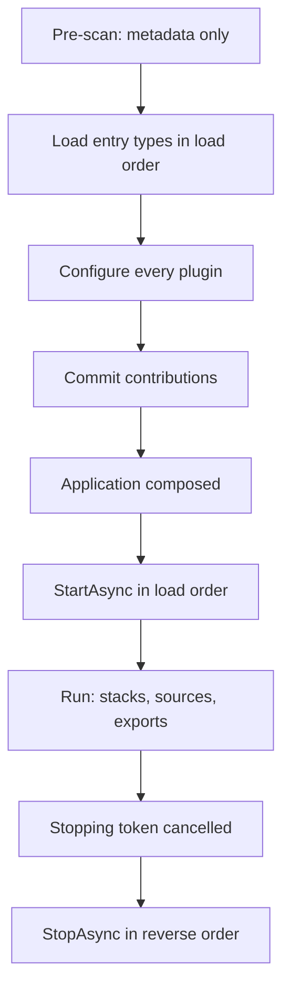

<!-- Copyright © 2026 DevAM. All rights reserved. Licensed under MIT license. See license in the repository root for license information. -->

# Plugin Guide

A plugin adds protocols, heuristic parsers, post-parsers, capture sources, export formats, and settings to
NetworkInspector without a change to NetworkInspector itself. It is an ordinary .NET class library with one entry class.
The `ni` command-line tool loads it from a folder you name, and every command of `ni` can use what it contributes: a
plugin protocol is decoded and filterable, a plugin source is an input of `ni convert` and `ni export`, a plugin format
is an output, and a plugin setting is listed and changed with `ni settings`.

The built-in functionality of `ni` uses the same contract: the standard protocols, the file and random sources, and the
nine export formats are four plugins in [`NetworkInspector.BuiltInPlugins`](../../NetworkInspector.BuiltInPlugins/README.md).
Whatever they can do, your plugin can do too.

This guide covers the core tier, which is everything a plugin can contribute today. Related documents:

| Document | Content |
| --- | --- |
| [Protocol chapter](protocols.md) | Writing a protocol, its fields, port registration, heuristic parsers, post-parsers |
| [Contract reference](reference.md) | One entry per type of `NetworkInspector.Plugins` |
| [Sample plugin](../../samples/Sample.Protocol/README.md) | A complete plugin that uses every part of the contract |
| [`NetworkInspector.Plugins`](../../NetworkInspector.Plugins/README.md) | The contract package |
| [`NetworkInspector.Plugins.Loader`](../../NetworkInspector.Plugins.Loader/README.md) | The loader, for applications that load plugins themselves |
| [CLI README](../../NetworkInspector.CLI/README.md#ni-plugins) | `ni plugins`, `ni settings`, `ni profile` |

## Contents

1. [Quick start](#1-quick-start)
2. [Project setup](#2-project-setup)
3. [Entry point](#3-entry-point)
4. [Contributions](#4-contributions)
5. [Options and settings](#5-options-and-settings)
6. [Lifecycle](#6-lifecycle)
7. [Build, publish, and distribute](#7-build-publish-and-distribute)
8. [Register and check the plugin](#8-register-and-check-the-plugin)
9. [Use the plugin from `ni`](#9-use-the-plugin-from-ni)
10. [Failures and isolation](#10-failures-and-isolation)
11. [Security](#11-security)
12. [Pitfalls and troubleshooting](#12-pitfalls-and-troubleshooting)
13. [Walkthrough: `Sample.Protocol`](#13-walkthrough-sampleprotocol)
14. [Loading plugins in your own application](#14-loading-plugins-in-your-own-application)

## 1. Quick start

The smallest useful plugin: a protocol `hello` on UDP port 40100 with two fields, and one application setting.

```xml
<!-- My.Hello.csproj -->
<Project Sdk="Microsoft.NET.Sdk">
  <PropertyGroup>
    <TargetFramework>net10.0</TargetFramework>
    <Nullable>enable</Nullable>
    <ImplicitUsings>enable</ImplicitUsings>
  </PropertyGroup>
  <ItemGroup>
    <!-- The application provides the contract and Core at run time. -->
    <PackageReference Include="NetworkInspector.Plugins" Version="0.19.0" ExcludeAssets="runtime" />
  </ItemGroup>
</Project>
```

```csharp
using NetworkInspector.Core;
using NetworkInspector.Core.Errors;
using NetworkInspector.Core.Fields;
using NetworkInspector.Core.Ids;
using NetworkInspector.Core.Interfaces;
using NetworkInspector.Core.Protocols;
using NetworkInspector.Core.Settings;
using NetworkInspector.Plugins;

namespace My.Hello;

public sealed class HelloPlugin : IPlugin
{
    public const ulong Port = 40100;

    public PluginInfo Info { get; } = new("My.Hello", "1.0.0", "MIT", "Hello protocol on UDP 40100.", []);

    public void Configure(IPluginBuilder builder)
    {
        // Runs for every stack the application builds; creates fresh protocol objects each time.
        builder.AddStackContribution(static stack =>
        {
            HelloProtocol protocol = new();
            ProtocolId id = stack.RegisterProtocol(protocol);
            protocol.RegisterFields(stack, id);
            stack.WhenProtocolTableRegistered("udp.port", table => stack.RegisterParserInU64Table(table, Port, id));
        });

        // A new Setting per call: the action runs once per settings manager.
        builder.AddSettings(SettingScope.Application, static registrar =>
        {
            registrar.RegisterGroup("hello", "Hello plugin", "Settings of the My.Hello plugin.");
            registrar.RegisterStringSetting("hello.greeting", "Greeting", "hello", "Hello", "Text the plugin logs at start.");
        });
    }

    public ValueTask StartAsync(IPluginContext context, CancellationToken cancellationToken)
    {
        context.Log.Info("greeting: " + context.ApplicationSettings.GetStringSetting("hello.greeting"));
        return ValueTask.CompletedTask;
    }
}

internal sealed class HelloProtocol : IProtocol
{
    private FieldId _Container;
    private FieldId _Kind;
    private FieldId _Length;

    public string Name => "hello";
    public string UiName => "Hello";
    public string? Description => "First byte is the kind, the rest is the body.";

    internal void RegisterFields(IStackBuilder stack, ProtocolId id)
    {
        _Container = stack.RegisterField(id, "hello", "Hello", FieldType.None, "Hello payload.");
        _Kind = stack.RegisterField(id, "hello.kind", "Kind", FieldType.U64, "First byte of the payload.");
        _Length = stack.RegisterField(id, "hello.length", "Body length", FieldType.U64, "Bytes after the kind.");
    }

    public ParseResult Parse(in MutField parentField, ReadOnlyMemory<byte> data, in ParseContext context)
    {
        if (data.Length < 1)
        {
            return ParseError.InsufficientDataWithInfo("hello", 1, (ulong)data.Length);
        }

        MutField hello = parentField.Append(_Container, FieldValue.None);
        hello.Append(_Kind, FieldValue.NewU64(data.Span[0]));
        hello.Append(_Length, FieldValue.NewU64((ulong)(data.Length - 1)));
        return data.Length;
    }
}
```

Build it, copy `My.Hello.dll` into a folder of its own, and register the folder:

```bash
dotnet build My.Hello.csproj -c Release
ni settings set plugins.paths /opt/ni-plugins/hello --scope application
ni plugins list
```

```text
Pre-scan: 1 candidate files, 1 inspected, 0 from cache, 1 plugin assemblies, 21.4 ms
NetworkInspector.StandardProtocols  0.19.0  core  Loaded  -  …  MIT  load 101.0 ms  Protocol 29, Heuristic 5, Reassembly 5, Setting 43
…
My.Hello  1.0.0  core  Loaded  -  /opt/ni-plugins/hello/My.Hello.dll  MIT  load 6.0 ms  Protocol 1, Setting 1
```

From now on every `ni` command decodes UDP port 40100 as `hello`:

```bash
ni export capture.pcapng -o hello.csv -f "csv:columns=udp.dstport;hello.kind;hello.length" --filter "hello.kind == 78"
ni settings set hello.greeting "Good morning"
```

## 2. Project setup

| Item | Rule | Why |
| --- | --- | --- |
| Project type | Class library, `net10.0` | `ni` runs on .NET 10; the plugin runs in the same process |
| Contract | `NetworkInspector.Plugins` (package or project reference) | Brings the contract and, through it, `NetworkInspector.Core` and `NetworkInspector.Values` |
| Runtime assets | `ExcludeAssets="runtime"` on the package, `Private="false"` on a project reference | The application provides the contract and Core; your folder stays small |
| Version | Build against the same or an older NetworkInspector version than the `ni` that loads it | See [12. Pitfalls](#12-pitfalls-and-troubleshooting) |
| Private dependencies | Normal package references; publish them next to the plugin | Each plugin assembly has its own load context that resolves them from its folder |

A project reference inside the NetworkInspector repository looks like this (the sample plugin uses it):

```xml
<ProjectReference Include="..\..\NetworkInspector.Plugins\NetworkInspector.Plugins.csproj" Private="false" />
```

`Private="false"` keeps the contract assembly itself out of the output folder; the build may still copy
`NetworkInspector.Core.dll` and `NetworkInspector.Values.dll` because they arrive through the contract. That is harmless:
the loader always gives a plugin the application's copy of every assembly the application already has (see
[10. Failures and isolation](#10-failures-and-isolation)). You do not need to ship them.

The namespaces a plugin usually imports:

| Namespace | Holds |
| --- | --- |
| `NetworkInspector.Plugins` | `IPlugin`, `IPluginBuilder`, `IPluginContext`, registrations, `PluginError` |
| `NetworkInspector.Core.Interfaces` | `IProtocol`, `IStackBuilder`, `IFrameSource`, `IFrameListener`, `IPacketListener`, … |
| `NetworkInspector.Core.Settings` | `SettingScope`, `SettingsRegistrar`, `Setting`, `ReadOnlySettingsManagerView` |
| `NetworkInspector.Core.Protocols`, `.Fields`, `.Ids`, `.Errors` | `ParseResult`, `ParseContext`, `MutField`, `FieldValue`, `FieldType`, `ProtocolId`, `FieldId`, `ParseError` |
| `NetworkInspector.Core` | `Frame`, `Packet`, `LazyString`, `FrameInterfaceRegistry` |

## 3. Entry point

The pre-scan finds a plugin by its entry class, without loading the assembly. An entry class:

- is `public`, not `abstract`, not generic, and not nested in a generic type;
- has a `public` parameterless constructor;
- lists `IPlugin` in **its own** interface list. A class that only inherits `IPlugin` from a base class is not found,
  because the pre-scan reads the metadata of the class itself and does not walk base types. List the interface again:
  `public sealed class MyPlugin : MyPluginBase, IPlugin`;
- needs no attribute.

One assembly may hold several entry classes; they load in the ordinal order of their full type names. Each of them is a
plugin of its own with its own `PluginInfo`.

`PluginInfo` is the identity of the plugin:

```csharp
public PluginInfo Info { get; } = new(
    Name: "My.Hello",                       // unique, ignoring case
    Version: "1.0.0",                       // free text, may be empty
    License: "MIT",                         // the plugin's own license, may be empty
    Description: "Hello protocol on UDP 40100.",
    Dependencies: []);                      // what the plugin ships privately, with licenses
```

| Field | Rule |
| --- | --- |
| `Name` | 1 to 256 characters; dot-separated identifiers of ASCII letters, digits, and underscores (`My.Hello`, `Acme.Can_Tools`); unique among all loaded plugins ignoring case. It names the plugin's data folder. |
| `Version`, `License`, `Description` | Any text, never `null` |
| `Dependencies` | Never `null`; one `PluginDependency` per library the plugin ships, with name, version, license, copyright holder, link, and optionally the license text |

A second plugin with a name that is already loaded fails with `A plugin named '<name>' is already loaded.`. Choose a
name with your organization as the first part.

Keep the constructor and `Info` cheap and free of side effects: the loader calls them on the loading thread before any
time limit applies. Do the real work in `Configure` and `StartAsync`.

## 4. Contributions

`Configure(IPluginBuilder builder)` declares everything the plugin contributes. The builder only stages the
contributions; they become visible after every plugin was configured, and only when the plugin's commit succeeds. Using
the builder after `Configure` returned throws `InvalidOperationException`.

| Builder call | Contributes | Core type behind it |
| --- | --- | --- |
| `AddStackContribution(Action<IStackBuilder>)` | Protocols, fields, port registrations, heuristic parsers, post-parsers, reassembly, protocol settings | `IStackBuilder` |
| `AddSettings(SettingScope, Action<SettingsRegistrar>)` | Application or profile settings of the plugin | `SettingsRegistrar` |
| `AddSource(SourceRegistration)` | A source kind | `IFrameSource` |
| `AddFrameExporter(ExporterRegistration<IFrameListener>)` | An export format that writes frames | `IFrameListener` |
| `AddPacketExporter(ExporterRegistration<IPacketListener>)` | An export format that writes parsed packets | `IPacketListener` |

### 4.1 Stack contributions

A stack contribution is a callback that receives the Core `IStackBuilder` of every stack the application builds: one
per run of `ni convert --filter` or `ni export`, and once more for every probe the loader runs. It registers exactly what
a built-in protocol registers. Rules:

- **Stateless or thread-safe.** The callback may run more than once and on any thread. Create new protocol objects in
  every call, as the quick start does; never keep a protocol instance in a static field.
- **Built-ins come first.** The standard protocols are registered before any external plugin, so the tables they own
  (`udp.port`, `tcp.port`, `tcp.heuristic`, `ethertype`, …) already exist when your callback runs.
- **Prefer the deferred form for foreign tables.** `WhenProtocolTableRegistered("udp.port", …)` registers at once when
  the table exists and as soon as it appears otherwise, so your plugin does not depend on the registration order and a
  stack without UDP simply gets no port registration. `RegisterParserInU64TableByName("udp.port", …)` also works when the
  table exists, and throws when it does not.
- **Names are global.** Protocol, field, and table names share one name space with every other plugin. Prefix them with
  your protocol name (`hello`, `hello.kind`).

The [protocol chapter](protocols.md) explains protocols, fields, heuristic parsers, and post-parsers in detail.

### 4.2 Sources

A source kind opens a Core `IFrameSource`. The registration has three parts: metadata, option settings, and a factory.

```csharp
public static SourceRegistration Registration { get; } = new(
    Kind: "SampleGen",                      // [A-Za-z][A-Za-z0-9_.-]*, unique ignoring case
    UiName: "Sample generator",
    Description: "Generates Ethernet/IPv4/UDP or TCP frames carrying the NIS1 sample payload.",
    FileExtensions: [],                     // ".xyz" entries pick this kind for a bare path; empty for generators
    AllowsMultipleFiles: false,             // true: several files, one source per file
    RegisterOptions: RegisterOptions,
    Create: TryCreate);

public static void RegisterOptions(SettingsRegistrar options)
{
    options.RegisterI64Setting("count", "Frames", "", 100, min: 0, max: int.MaxValue,
        description: "Number of frames to generate.");
}

public static bool TryCreate(SourceRequest request, [NotNullWhen(true)] out IFrameSource? source,
    [NotNullWhen(false)] out PluginError? error)
{
    source = null;
    if (request.Paths.Count != 0)
    {
        error = new PluginError(PluginErrorCode.InvalidOption, "The sample generator reads no files.", "paths");
        return false;
    }

    long count = request.Options.GetI64Setting("count") ?? 100;
    source = new SampleFrameSource((int)count, tcp: false, port: 40000, startCounter: 0);
    error = null;
    return true;
}
```

- `TryCreate` returns the source **not started**; the application starts it.
- Every expected failure (missing or unreadable file, wrong format, an option combination that cannot work) is a
  returned `PluginError` with a `PluginErrorCode` and the name of the option at fault (`paths` for the file list). Never
  throw for them: `ni` prints the message as one line and maps the code to its exit code. A throw means a bug in the
  plugin and is reported as such.
- `TryCreate` may run concurrently; keep no unsynchronized shared state.
- A request carries **one** path for file kinds. With `AllowsMultipleFiles` the application creates one source per file.
- The source may implement more Core interfaces, and the application uses them when present:
  `IRandomAccessFrameSource` (frames by id), `IFrameSourceStatistics` (counters), and `IErrorTolerantFrameSource`
  (skip damaged records instead of stopping).

### 4.3 Exporters

An export format creates a Core listener for one export. Frame formats (`AddFrameExporter`) receive raw frames and work
in `ni convert`; packet formats (`AddPacketExporter`) receive parsed packets and work in `ni export`.

```csharp
public static ExporterRegistration<IPacketListener> Registration { get; } = new(
    Format: "SampleText",                   // same name rule as source kinds, unique across all formats
    UiName: "Sample text",
    Description: "One line per sample packet: id, counter, gear, speed.",
    FileExtension: ".sampletxt",            // empty for formats that write a directory
    RegisterOptions: static options =>
        options.RegisterBoolSetting("includeHeader", "Header line", "", true, "Write the column header line."),
    Create: TryCreate);
```

- The application prepares the target before `Create` runs: it resolves the path, checks the folder, and decides about
  `--overwrite`. `ExportRequest.TargetPath` is the full path.
- `ExportRequest.Stack` is the stack that parsed the packets; resolve field ids by name there once, not per packet.
- `ExportRequest.ExpectedItemCount` is for progress only, never a stop condition.
- **No partial output.** A listener that is disposed without `OnFinish` leaves nothing behind: either it deletes its
  output itself, or the application's export runner deletes the target. A run that ends early (an error or Ctrl+C)
  therefore never leaves a truncated file that looks complete.
- Statistics and progress come from the Core interfaces `IExporterStatistics`, `IExportByteProgress`, and
  `IErrorTolerantExporter` when the listener implements them.

## 5. Options and settings

### 5.1 Options of sources and exporters

Options are Core settings. `RegisterOptions` registers them into a **fresh** `SettingsManager` per request, in group
`""`, with Core names, types, bounds, defaults, and enumeration values. Core parses and checks every option text before
your factory runs, so the factory only reads values that are already valid, and every application gives the same
messages for the same mistakes.

On the command line the options follow the kind or format after a colon:

```bash
ni export "SampleGen:count=10,transport=tcp" -o out.sampletxt -f "SampleText:includeHeader=false"
```

```text
Unknown option 'cout'; did you mean: count?
```

| Registrar method | Value type |
| --- | --- |
| `RegisterBoolSetting` | `true` / `false` |
| `RegisterI64Setting`, `RegisterU64Setting`, `RegisterF64Setting` | Numbers with optional `min` and `max` |
| `RegisterStringSetting` | Text |
| `RegisterBytesSetting` | Hex bytes (`0A1B`) |
| `RegisterEnumSetting` | A name from `EnumSettingMetadata.FromPairs([("udp", 0), ("tcp", 1)])` |
| `RegisterBoolArraySetting`, `RegisterI64ArraySetting`, `RegisterU64ArraySetting`, `RegisterF64ArraySetting`, `RegisterStringArraySetting` | Lists, as JSON (`[1,2]`) or comma lists |

### 5.2 Plugin settings

`AddSettings(SettingScope.Application | SettingScope.Profile, register)` adds settings that users change with
`ni settings` and that the plugin reads from its context.

| Scope | Stored in | Read through |
| --- | --- | --- |
| `Application` | `<settings base>/application/` | `IPluginContext.ApplicationSettings` |
| `Profile` | `<settings base>/<profile>/` | `IPluginContext.ProfileSettings` (the `--profile` of the run) |

- **A new `Setting` per call.** The action runs once per settings manager of that scope, and one `Setting` instance
  binds to the first manager that registers it. The registrar methods create a new instance each time, so calling them
  inside the action is always right.
- **Unique names.** Setting names share one name space with every plugin and the application. A name that is already
  registered fails the second plugin at its commit. Prefix the names with your protocol or plugin name.
- **`SettingScope.Session`** is refused with `ArgumentOutOfRangeException`: session settings belong to the application.
- **Protocol settings** that change how a protocol decodes are registered inside the stack contribution instead, like
  the built-in protocol settings (`tcp.relative_sequence_numbers`).
- **Values survive a missing plugin.** When a stored value belongs to a plugin that is not loaded, `ni settings list`
  shows it as `(not loaded)` and it stays editable as JSON; nothing is deleted.
- **Sparse storage.** Only values that differ from the default are stored, so changing a default in a new plugin version
  reaches every user who did not choose a value.

```bash
ni settings list --group hello
ni settings set hello.greeting "Good morning"
ni settings reset hello.greeting
```

## 6. Lifecycle



| Phase | What runs | Bound |
| --- | --- | --- |
| Load | Constructor, `Info` | none; keep them cheap |
| Configure | `Configure` for every plugin in load order, then the commit of each plugin | none; declare, do not work |
| Start | `StartAsync(IPluginContext, CancellationToken)` in load order | `plugins.startTimeoutSeconds` (default 120 s) |
| Run | Stack contributions, source and exporter factories, `SettingsApplied` | per call |
| Stop | `Stopping` is cancelled, then `StopAsync` in reverse load order | `plugins.stopTimeoutSeconds` (default 60 s) |

- **Load order.** Built-in plugins first, then the plugin assemblies in ordinal order of their full paths (so the order
  never depends on how a file system enumerates a folder), and inside one assembly the entry classes in ordinal order of
  their full type names. Do not rely on another external plugin being loaded before yours.
- **`StartAsync`** gets the context of the run: `PluginName`, `Log`, `DataDirectory`, `ApplicationSettings`,
  `ProfileSettings`, the event `SettingsApplied`, and the token `Stopping`. The default implementation does nothing.
  Long work does not belong here: the start is bounded, and `ni` waits for it before the command runs.
- **`StopAsync`** runs while the application still exists; release what you created. The default does nothing.
- **Every `ni` command is one run.** `ni export` loads, starts, runs, and stops the plugins; the next command loads them
  again. A plugin keeps nothing in memory between commands; use `DataDirectory` for files that must survive.
- **Timeouts are application settings:** `ni settings set plugins.startTimeoutSeconds 30 --scope application`.
- **Plugins cannot be unloaded** while the process runs; a changed `plugins.paths` takes effect at the next start.

The context in detail:

| Member | Use |
| --- | --- |
| `Log` | `Info`, `Warning`, `Error(text, exception)`. `ni` writes each entry as one line `<level> <plugin>: <text>` to the error output and to `logs/ni.log`; control characters become spaces, an exception adds its type and message, never its stack trace. Never log secrets or personal data. |
| `DataDirectory` | `<settings base>/plugins-data/<storage name>/`, created when the context is made. When that failed, reading the property throws `IOException` with the reason; only your plugin fails then. The storage name is the plugin name, shortened with a hash when it is too long for a folder name. |
| `ApplicationSettings`, `ProfileSettings` | Read-only views, including your own settings |
| `SettingsApplied` | Raised after application or profile settings were applied |
| `Stopping` | Cancelled when the shutdown starts, before `StopAsync` |

## 7. Build, publish, and distribute

```bash
# Build: enough for a plugin without dependencies.
dotnet build My.Hello.csproj -c Release

# Publish: copies private dependencies and the deps.json next to the plugin.
dotnet publish My.Hello.csproj -c Release -o dist/My.Hello
```

A distributable plugin is **one folder** with:

- the plugin assembly (`My.Hello.dll`);
- its private dependencies and, when it has them, its `My.Hello.deps.json` (the loader reads it to resolve them,
  including native libraries);
- nothing from NetworkInspector: the application's copies of the contract, Core, and every other assembly the
  application ships always win.

Give every plugin its own folder. Several plugins may share a parent folder that you register once, because folders are
searched recursively.

## 8. Register and check the plugin

`plugins.paths` is an application setting: a list of folders and files. It is empty by default, so `ni` loads no foreign
code until you add a path.

```bash
ni settings set plugins.paths /opt/ni-plugins --scope application
ni settings set plugins.paths "/opt/ni-plugins,/home/me/dev/My.Hello/bin/Release/net10.0" --scope application
ni plugins list
ni plugins list --json
```

- Folders are searched recursively for `*.dll`; a listed file is inspected directly.
- A relative folder given on the command line is stored as a full path. A relative entry written into the settings file
  by hand is reported once and ignored, because it would mean a different folder for every working directory.
- The **pre-scan** reads only metadata. It never loads or runs an assembly to find out whether it is a plugin. Its results
  are cached per file in `<settings base>/plugin-scan-cache.json`, keyed by path, length, and last write time, so an
  unchanged folder costs almost nothing at the next start.

The first line of `ni plugins list` is the pre-scan summary; every further line is one plugin:

```text
Pre-scan: 2 candidate files, 1 inspected, 1 from cache, 2 plugin assemblies, 27.8 ms
My.Hello  1.0.0  core  Loaded  -  /opt/ni-plugins/hello/My.Hello.dll  MIT  load 6.0 ms  Protocol 1, Setting 1
```

| Column | Meaning |
| --- | --- |
| Name, version | From `PluginInfo` |
| Tier | `core` for every plugin of this guide |
| State | `Loaded`, `Failed` (the reason column says why), or `Skipped` (the plugin needs an application tier that this application does not offer; its assembly is not loaded) |
| Path, license, load time | Where it came from, its license, and how long load, configure, and commit took |
| Contributions | Counts per kind: `Protocol`, `Heuristic`, `PostParser`, `Reassembly`, `Setting`, `Source`, `Exporter` |

## 9. Use the plugin from `ni`

| Contribution | Where it appears |
| --- | --- |
| Protocol and fields | Decoded in `ni export`; usable in `--filter`, in CSV `columns`, in every packet format |
| Source kind | An input spec `kind:key=value,…` of `ni convert` and `ni export`; a bare path with one of its `FileExtensions` |
| Frame format | `-f <format>` of `ni convert` |
| Packet format | `-f <format>` of `ni export` |
| Settings | `ni settings list|get|set|reset` |

```bash
ni convert "SampleGen:count=200" -o sample.pcapng
ni export sample.pcapng -o slow.csv -f "csv:columns=sample.counter;sample.speed" --filter "sample.speed == 254"
ni export "SampleGen:count=5" -o sample.sampletxt -f SampleText
```

A frame format given to `ni export`, or a packet format given to `ni convert`, is refused with a line that says which
kind of format it is.

## 10. Failures and isolation

A plugin is trusted in-process code, but one broken plugin must never stop the application or another plugin.

| What goes wrong | What happens |
| --- | --- |
| An assembly cannot be read or loaded | That plugin is `Failed`; the others load |
| The plugin references an application assembly (contract, Core, framework) in a newer version than the application has | `Failed` before any of its code runs; the reason names the assembly and both versions |
| The entry class is misdeclared (no public constructor, wrong interface) | `Failed` with the reason |
| The constructor, `Info`, or `Configure` throws | `Failed`; none of its contributions is published |
| A registration breaks a rule (invalid name, a name another plugin registered, an extension without `.`) | `Failed` at its commit; nothing of it is published |
| `StartAsync` throws or exceeds `plugins.startTimeoutSeconds` | `Failed`; one error line names the plugin and the setting; its sources and formats are refused with `plugin <Name> failed to start`; it is not stopped later |
| `StopAsync` exceeds `plugins.stopTimeoutSeconds` | One error line; the shutdown continues |
| A source or exporter factory returns a `PluginError` | One precise line and the matching exit code |

Every plugin assembly gets its own collectible load context. Assemblies that the application already has (the shared
framework, the contracts, Core, and every library `ni` ships) always come from the application, matched by name, so
contract types have exactly one identity. Other dependencies resolve from the plugin folder, through its `deps.json`
first. Two plugins may therefore ship different versions of the same private library. A plugin built against the same or
an older version of an application assembly runs with the application's copy; one built against a newer version is
refused at load with both versions in the reason, because a reference never binds to a lower version.

## 11. Security

- **Plugins run with your rights.** A plugin is ordinary .NET code in the `ni` process; it can do whatever `ni` can do.
  Add only folders whose content you trust, and keep them writable only for you. This is why `plugins.paths` is empty by
  default: loading foreign code is an explicit opt-in.
- **The pre-scan runs no code.** Looking at a folder full of unrelated DLLs does not execute any of them; only assemblies
  that declare an entry class are loaded.
- **Captures are untrusted input.** A protocol parses bytes from files of unknown origin. Check every length against the
  data you have before you read (`ParseError.InsufficientDataWithInfo`), never trust a length field to allocate memory,
  and bound every loop by the data, not by a count from the wire.
- **Logs are shared.** Plugin log lines reach the console and `logs/ni.log`; never log secrets, credentials, or personal
  data from the traffic.

## 12. Pitfalls and troubleshooting

| Symptom | Cause | Fix |
| --- | --- | --- |
| `The plugin was built against NetworkInspector.Plugins 0.20.0.0, but this application provides 0.19.0.0; …` | The plugin was built against a **newer** NetworkInspector (or .NET) version than the running `ni`; a reference cannot bind to a lower version, so the plugin is refused before any of its code runs | Build against the version of the `ni` you run or an older one, or update `ni` |
| `Entry type '…' was not found in the plugin assembly.` | The pre-scan found the class, but the runtime cannot load it (for example a base type in a dependency that is missing) | Ship the plugin's private dependencies next to it; check `ni plugins list` for the full reason |
| `… does not implement the loaded IPlugin; the plugin ships its own NetworkInspector.Plugins.` | The plugin loads its own copy of the contract | Remove the contract from the plugin folder; use `ExcludeAssets="runtime"` or `Private="false"` |
| The plugin does not appear at all | The class lists `IPlugin` only through a base class, is not public, or the folder is not in `plugins.paths` | List `IPlugin` on the entry class itself; check `ni settings get plugins.paths` |
| `A plugin named '…' is already loaded.` | Two plugins (or two copies of one) share a name | Remove the duplicate; use a unique name |
| A setting registration fails the plugin | The setting name exists already | Prefix setting names with your plugin or protocol name |
| Values of the protocol are missing in some runs | The protocol instance is shared between stacks, or the stack contribution keeps state | Create fresh objects inside the callback |
| A change of `plugins.paths` has no effect | The value is read at start | Run the next command |
| A changed DLL is not picked up | The file has the same length and modification time as before | Rebuild, or delete `plugin-scan-cache.json` |
| A static constructor throws | It runs when the type is first used, possibly on another thread | Avoid work in static constructors |

## 13. Walkthrough: `Sample.Protocol`

[`samples/Sample.Protocol`](../../samples/Sample.Protocol/README.md) uses every part of the contract. Read the files in
this order:

| File | Shows |
| --- | --- |
| [`SampleProtocolPlugin.cs`](../../samples/Sample.Protocol/SampleProtocolPlugin.cs) | The entry class: `Info`, `Configure` with all five builder calls, the setting `sample.greeting`, `StartAsync` reading it, `StopAsync` |
| [`SampleRegistration.cs`](../../samples/Sample.Protocol/SampleRegistration.cs) | The stack contribution: protocol, deferred UDP port registration, the TCP heuristic, the post-parser |
| [`SampleProtocol.cs`](../../samples/Sample.Protocol/SampleProtocol.cs) | A hand-written `IProtocol` with three fields and a lazily formatted packet info |
| [`SampleHeuristicParser.cs`](../../samples/Sample.Protocol/SampleHeuristicParser.cs) | Recognizing the payload in TCP data on any port |
| [`SamplePostParser.cs`](../../samples/Sample.Protocol/SamplePostParser.cs) | Annotating every frame that carries the magic |
| [`SampleSource.cs`](../../samples/Sample.Protocol/SampleSource.cs), [`SampleFrameSource.cs`](../../samples/Sample.Protocol/SampleFrameSource.cs) | The source kind `SampleGen` with four options and a random-access source with statistics |
| [`SampleTextExporter.cs`](../../samples/Sample.Protocol/SampleTextExporter.cs), [`SampleTextListener.cs`](../../samples/Sample.Protocol/SampleTextListener.cs) | The packet format `SampleText` with an option, statistics, and partial-output cleanup |

Try it:

```bash
dotnet build samples/Sample.Protocol/Sample.Protocol.csproj -c Release
ni settings set plugins.paths samples/Sample.Protocol/bin/Release/net10.0 --scope application
ni plugins list
ni export "SampleGen:count=5" -o sample.sampletxt -f SampleText
ni convert "SampleGen:count=20,transport=tcp" -o tcp.pcapng
ni export tcp.pcapng -o tcp.csv -f "csv:columns=tcp.dstport;sample.counter;sample.post.magic_offset"
```

## 14. Loading plugins in your own application

`ni` is not the only possible host. An application that wants the same plugins references
[`NetworkInspector.Plugins.Loader`](../../NetworkInspector.Plugins.Loader/README.md) (pre-scan, load contexts,
registry, lifecycle) and, for the standard protocols, sources, and formats,
[`NetworkInspector.BuiltInPlugins`](../../NetworkInspector.BuiltInPlugins/README.md). The loader README shows the
sequence: register the plugin settings, load, build stacks with the registry, start, run, stop.
